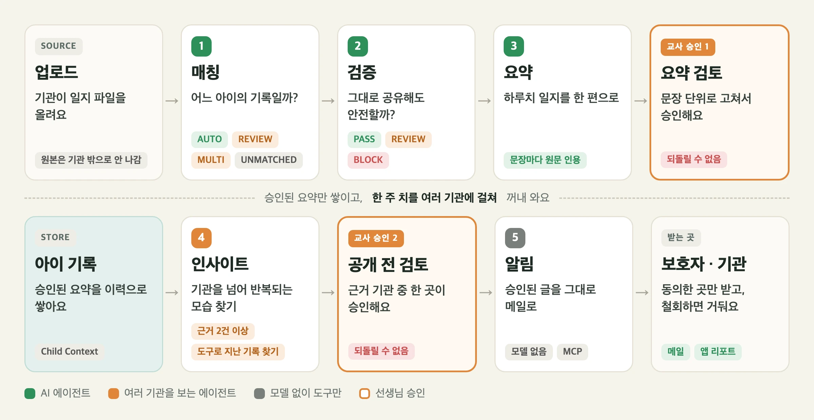
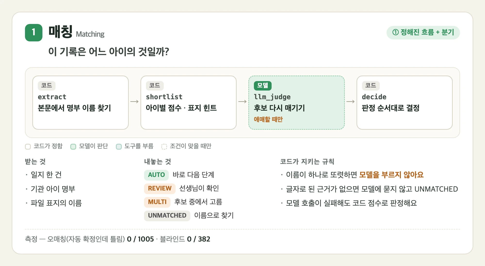
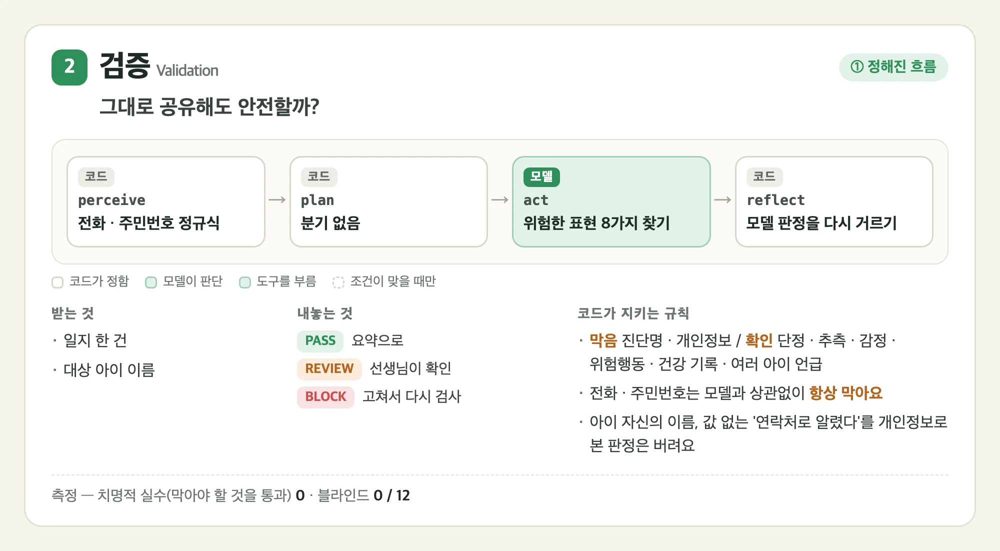
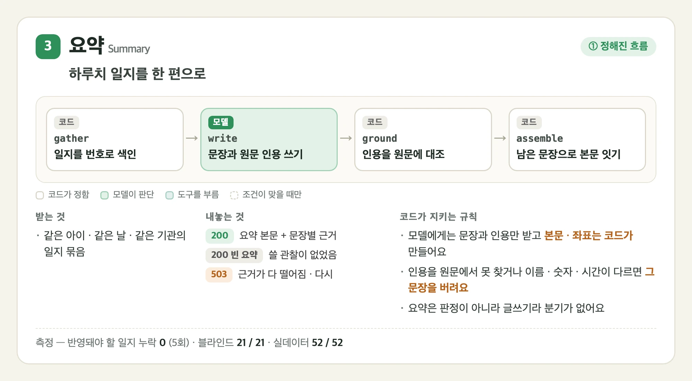
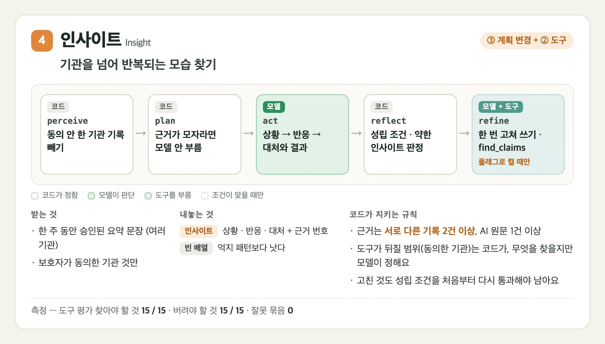
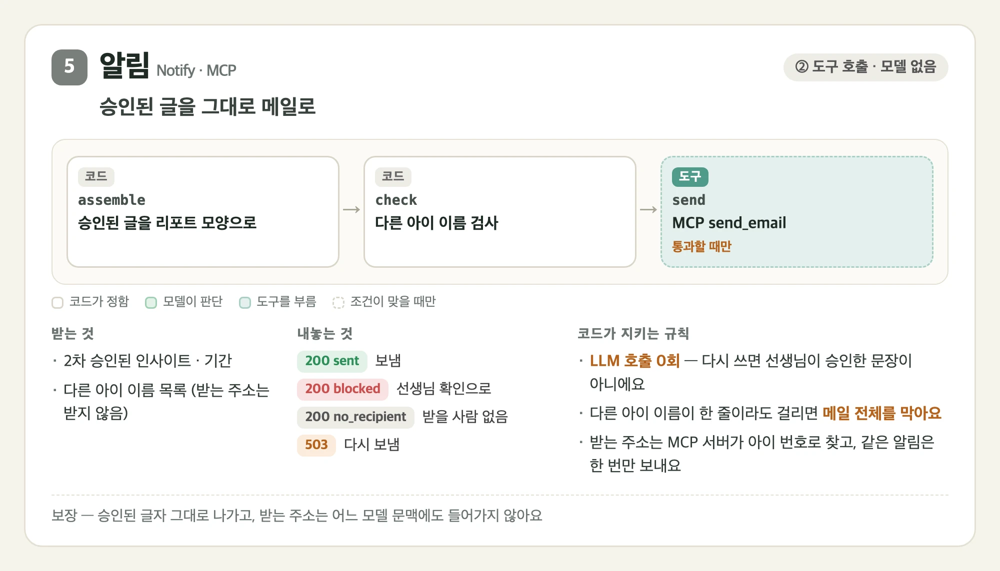

# Agentic 설계 — 분기 · 도구 · 상태 · 예외

이 문서는 "단계 분기 · 도구 연동 · 상태 관리 · 예외 처리가 실제로 구현되어, 워크플로가 끝까지 안정적으로 돌아가는가"에 답합니다.
먼저 에이전트 다섯이 각각 어떻게 생겼는지 보고, 이어서 네 주제를 에이전트를 가로질러 봅니다. 잘된 점과 약한 점을 함께 적습니다.

---

## 한눈에

[](../docs/images/readme/ai-workflow.webp)

- 매칭 · 검증 · 요약 · 인사이트 · 알림은 백엔드 워커가 주기적으로 일을 집어 AI 서버에 보냅니다. 사람이 누르지 않습니다
- 사람에게 오는 것은 두 가지입니다. AI가 판단하기 어려운 기록(누구 것인지 애매함, 위험한 표현)과 두 번의 승인입니다
- 2차 승인이 끝나면 알림 에이전트가 메일을 보냅니다. 워크플로는 보호자에게 닿는 데서 끝납니다

| 항목 | 상태 | 한 줄 요약 |
| --- | --- | --- |
| 단계 분기 | ⚠️ | 그래프 갈림길은 두 곳(매칭 · 알림)입니다. 인사이트의 갈림길은 노드 안에 숨어 있습니다 |
| 도구 연동 | ⚠️ | 지난 기록을 찾는 읽기 도구 하나와 메일을 보내는 MCP 서버 하나가 있습니다. 읽기 도구는 기본으로 꺼져 있습니다 |
| 상태 관리 | ✅ | 일지 상태 16개, 멈춘 일은 워커가 켜질 때 되돌립니다 |
| 예외 처리 | ✅ | "빈 결과"와 "모델 장애"를 섞지 않고, 실패 종류를 나눠 기록합니다 |

---

## 에이전트별로 보기

카드마다 그래프의 노드를 순서대로 그렸습니다. **흰 칸은 코드가 정하고, 초록 칸은 모델이 판단하고, 청록 칸은 도구를 부릅니다.**
점선 칸은 조건이 맞을 때만 돕니다. 이미지를 누르면 크게 볼 수 있습니다.

### 매칭 — 이 기록은 어느 아이의 것인가

[](../docs/images/agentic/matching.webp)

- 판정은 위에서부터 먼저 걸리는 조건이 이깁니다. **글자로 된 근거가 없으면 모델보다 먼저 끊습니다.** 모델은 근거가 없어도 명부의 아무 아이나 골라 높은 확신을 주기 때문입니다
- `AUTO`는 선생님 확인을 건너뜁니다. 여기서 틀리면 다른 아이의 기록이 보호자에게 가므로, 어떤 지표보다 오매칭 0건이 먼저입니다
- 판정 이름은 모델의 확신이 아니라 **선생님이 무엇을 해야 하는가**로 지었습니다

코드 [matching/graph.py](matching/graph.py) · [matching/nodes.py](matching/nodes.py) · 기준 [matching/CRITERIA.md](matching/CRITERIA.md)

### 검증 — 그대로 공유해도 안전한가

[](../docs/images/agentic/validation.webp)

- 위험한 표현은 여덟 가지입니다. 진단명 · 개인정보 표현은 막고(`BLOCK`), 단정 · 추측 · 감정 · 위험 행동 표현, 건강 관리 기록, 여러 아이 언급은 선생님이 확인합니다(`REVIEW`)
- 단정 · 위험 행동 표현만 **대상 아이 본인 이야기인지** 따집니다. 나머지는 누구 이야기든 보호자에게 전해지는 것 자체가 문제라 따지지 않습니다
- `BLOCK`된 일지는 선생님이 본문을 고치면 다시 검증을 받습니다 (아래 3. 상태 관리)

코드 [validation/nodes.py](validation/nodes.py) · [validation/config.py](validation/config.py) · 기준 [evals/scripts/validation/README.md](evals/scripts/validation/README.md)

### 요약 — 하루치 일지를 한 편으로

[](../docs/images/agentic/summary.webp)

- 묶음은 **아이 × 날짜 × 기관**입니다. 기관을 가로지르는 문장은 요약이 아니라 승인을 거친 요약 위에서 인사이트가 만듭니다
- 모델에게는 문장과 인용만 받고, 코드가 네 단계로 거릅니다
  ```
  ① 인용을 원문에서 찾는다              못 찾으면 그 근거를 버린다
  ② 근거가 0개가 된 문장을 버린다
  ③ 이름 · 숫자 · 시간 · 기관명이 근거에 없으면 버린다
  ④ 남은 문장으로 본문을 잇고, 반영된 일지를 센다
  ```
- 고쳐 쓰는 루프는 재 보고 넣지 않았습니다. 실데이터에서 버려지는 문장이 575개 중 2개(0.35%)뿐이라 고칠 거리가 없습니다. 루프를 넣은 인사이트는 14.9%였습니다

코드 [summary/nodes.py](summary/nodes.py) · 기준 [summary/CRITERIA.md](summary/CRITERIA.md)

### 인사이트 — 여러 기관에 걸친 패턴 찾기

[](../docs/images/agentic/insight.webp)

- 인사이트는 요약 한 편에서는 나올 수 없는 묶음입니다. **묶기 · 효과 비교 · 기관 간 차이 · 변화** 중 하나 이상이어야 합니다
- 동의하지 않은 기관의 기록은 맨 처음(`perceive`)에 뺍니다. 받는 쪽만 막으면 철회된 기관의 기록이 재료로 들어가기 때문입니다
- 근거가 최소 개수보다 적으면 모델을 부르지 않습니다. 성립할 인사이트가 없기 때문입니다
- 고쳐 쓰기와 도구는 기본으로 꺼져 있습니다 (`INSIGHT_WEAK_MODE` · `INSIGHT_TOOLS`). 켜면 갈래가 어떻게 나뉘는지는 아래 1. 단계 분기와 2. 도구 연동에 있습니다

코드 [insight/nodes.py](insight/nodes.py) · [insight/tools.py](insight/tools.py) · 기준 [insight/CRITERIA.md](insight/CRITERIA.md)

### 알림 — 승인된 인사이트를 보호자에게

[](../docs/images/agentic/notify.webp)

- 아이 정보가 기관 밖으로 나가는 **유일한 길**입니다. 그래서 되돌릴 수 없는 쓰기는 모델이 아니라 코드가 쥡니다
- 끝나는 길은 다섯입니다 — `sent` · `no_recipient` · `nothing_to_send` · `blocked` · `503`. 받을 사람이 없던 것을 `sent`로 묶지 않습니다. 장애는 아니지만 메일은 나가지 않았기 때문입니다
- `blocked`는 다시 보내도 같은 글이 나오므로 재시도하지 않고 선생님 확인으로 보냅니다

코드 [notify/graph.py](notify/graph.py) · [notify/nodes.py](notify/nodes.py) · [mcp_servers/itda_notify.py](mcp_servers/itda_notify.py) · 기준 [notify/CRITERIA.md](notify/CRITERIA.md)

---

## 1. 단계 분기 ⚠️

### 그래프에 보이는 갈림길 — 두 곳

**매칭: 모델을 부를지 그래프가 정합니다.** 이름이 그대로 적힌 아이가 한 명뿐이고 다른 이름이 없으면 모델을 건너뜁니다.
실제 기록의 대부분이 여기에 해당해서, 비용과 지연을 설계로 줄였습니다. 이름이 둘 이상이거나, 오타가 의심되거나, 후보가 없으면 모델에 묻습니다.

```
extract → shortlist ─┬─(애매)─→ llm_judge ─┐
                     └─(명확)──────────────┴→ decide
```

**알림: 보낼지 그래프가 정합니다.** 메일에 다른 아이 이름이 섞이면 보내지 않고 끝냅니다.

```
assemble → check ─┬─(통과)─→ send
                  └─(막힘)─→ 끝
```

### 노드 안에서 내리는 판단

**검증은 그래프가 곧게 흐르지만, 마지막 노드에서 코드가 모델 판정을 다시 거릅니다.**

- 모델보다 먼저 정규식으로 전화번호 · 주민번호를 잡습니다. 모델이 뭐라 하든 막힙니다
- 모델이 아이 자신의 이름을 개인정보로 본 판정은 버립니다. 같은 문장도 5번 중 2~5번 이렇게 틀렸습니다
- "연락처로 알렸다"처럼 값 없는 언급을 개인정보로 본 판정은 버립니다. 10번 중 1~8번 이렇게 틀렸습니다

**인사이트도 마지막에 코드가 갈래를 나눕니다.** 고쳐 쓰기를 켜 두면(`INSIGHT_WEAK_MODE=refine`) 약한 인사이트를 셋 중 하나로 보냅니다. 기본은 꺼져 있어 약한 인사이트를 세기만 하고 그대로 냅니다.

- 일지에 없는 말만 걸렸으면 → 한 번만 고쳐 쓰게 합니다
- 한 기관에서만 보이고 대처가 적히지 않았으면 → 도구로 지난 기록을 찾아 보강합니다 (도구가 켜져 있을 때)
- 그 밖이거나 고칠 수 있는 개수를 넘으면 → 버립니다

**요약은 일부러 분기가 없습니다.** 요약은 판정이 아니라서 고를 것이 없습니다.
대신 모델이 쓴 문장마다 원문 근거를 대조해, 인용을 못 찾거나 숫자가 다르면 그 문장을 버립니다.

> 모델 출력을 마지막에 코드가 다시 거르는 것이 이 프로젝트의 일관된 패턴입니다. 검증 · 요약 · 인사이트 · 알림 모두 같은 자리에 코드 검사가 있습니다.

### 약한 점

인사이트의 갈림길이 그래프 그림에 보이지 않습니다. 고쳐 쓰기 노드는 항상 실행되고, 할 일이 없으면 그냥 지나갑니다.
조건부 엣지로 바꾸면 동작은 그대로이고 그래프에 갈림길이 드러납니다.

```
지금:   reflect → refine → 끝          (refine이 알아서 비켜 감)
바꾸면: reflect ─┬─(고칠 것 있음)─→ refine → 끝
                └─(없음)─────────────────→ 끝
```

---

## 2. 도구 연동 ⚠️

### 읽기 도구 — 지난 기록 찾기

인사이트 에이전트가 쓰는 `find_claims` 하나입니다. 모델에 함수 호출 형식으로 노출합니다.

```
모델: "차량 탑승을 거부함"으로 지난 기록을 찾아 줘
코드: 동의한 기관의 지난 기록 안에서 두 글자 조각으로 겹침을 계산해 돌려줌
모델: 받은 기록으로 인사이트를 보강
코드: 보강한 인사이트가 성립 조건을 다시 통과하는지 검사
```

**모델은 무엇을 찾을지만 정하고, 어디서 찾을지는 코드가 정합니다.**

- 찾는 범위는 이미 보호자가 동의한 기관의 기록으로 좁혀져 있습니다
- 원문 인용은 돌려주지 않습니다. 다른 아이 이름이 남아 있을 수 있기 때문입니다
- 보강한 것도 처음 근거와 도구가 실제로 돌려준 기록만 근거로 쓸 수 있습니다

측정 (도구 평가 10건 × 3회): 찾아야 할 것 **15/15** 찾음 · 찾으면 안 되는 것 **15/15** 버림 · 잘못 묶음 **0**

### 쓰기 도구 — 메일을 보내는 MCP 서버

알림 에이전트가 MCP 서버 `itda-notify`의 도구 두 개를 부릅니다. 메일을 보내는 `send_email`과, 보낸 메일이 어떻게 됐는지 보는 `check_delivery`입니다.
읽기가 아니라 **바깥 세계에 실제로 행동하는** 도구입니다.

- **받는 주소를 도구 인자로 받지 않습니다.** 아이 번호만 받고 주소는 서버가 찾습니다. 주소가 어느 모델 문맥에도 들어가지 않습니다
- **같은 알림은 한 번만 보냅니다.** 백엔드가 다시 보내도 보호자가 메일을 여러 통 받지 않습니다
- MCP 클라이언트는 AI 서버가 돌립니다. 백엔드가 메일 API를 직접 부르지 않습니다

> "모델을 안 부르는데 에이전트인가"라는 질문에는 이렇게 답합니다.
> 모델이 정해야 좋은 자리(무엇을 쓸까)와 코드가 정해야 하는 자리(내보낼까)를 나눴습니다. 되돌릴 수 없는 쓰기는 코드가 쥐는 편이 맞습니다.
> 메일 본문은 선생님이 승인한 문장을 글자 그대로 씁니다. 승인 뒤에 모델이 다시 쓰면 "승인한 문장 = 보호자가 받는 문장"이 깨지기 때문입니다.

### 약한 점

- 읽기 도구는 하나뿐이고 기본으로 꺼져 있습니다(`INSIGHT_TOOLS`). 실데이터(4~6월)에서는 다른 기관 기록이 없어 한 번도 불리지 않았습니다
- 보호자 이메일을 DB에 저장하지 않습니다. 받는 사람은 서버의 파일에서 찾습니다. 시연용 계정에만 맞춰 둔 상태입니다

---

## 3. 상태 관리 ✅

### 일지 상태 16개

| 묶음 | 상태 |
| --- | --- |
| 흐름 | `PENDING` → `MATCHING` → `MATCHED` → `VALIDATING` → `VALIDATED` → `SUMMARIZING` → `GATE1_PENDING` → `COMPLETED` |
| 사람 확인 | `MATCH_REVIEW` (누구 것인지 확인) · `VALIDATION_BLOCKED` (막힌 표현 고치기) · `VALIDATION_HELD` (보류) · `GATE1_HELD` (1차 검토 보류) |
| 빠짐 | `EXCLUDED` (우리 기관 아이가 아님) |
| 실패 | `FAILED` (매칭 실패) · `SUMMARY_FAILED` (다시 요약할 수 있음) · `SYSTEM_ERROR` (관리자 확인 필요) |

보여 줄 만한 점은 셋입니다.

- **되돌아오는 길이 있습니다.** 선생님이 막힌 본문을 고치면 `VALIDATION_BLOCKED`에서 `MATCHED`로 돌아가 다시 검증받습니다
- **보류와 실패를 나눕니다.** 사람이 멈춘 것(`…_HELD`)과 기계가 멈춘 것(`SYSTEM_ERROR`)을 다르게 보여 줍니다
- **다시 할 수 있는 실패와 아닌 실패를 나눕니다.** `SUMMARY_FAILED`는 선생님이 다시 요약할 수 있고, `SYSTEM_ERROR`는 관리자가 봐야 합니다

### 요약 · 인사이트 · 알림 상태

- 요약: `GENERATED` · `GATE1_PENDING` · `APPROVED` · `CONFIRMED` · `REVERTED` · `HOLD` · `REMOVED`
- 인사이트: `GATE2_PENDING` · `APPROVED` · `HOLD`
- 인사이트 실행: `RUNNING` · `DONE` · `FAILED`
- 알림: `RUNNING` → `SENT` · `NO_RECIPIENT` · `BLOCKED` · `FAILED`

요약과 인사이트에는 "반려"가 없습니다. 재료가 그대로면 다시 만들어도 같은 글이 나와서, 반려가 끝없이 되풀이되기 때문입니다. 대신 보류하거나 선생님이 직접 고칩니다.

### 멈춘 일 되살리기

앱이 일하는 도중에 죽으면 일지나 실행이 "진행 중" 상태로 남습니다. 워커 다섯이 모두 켜질 때 이것을 찾아 되돌립니다.

- 매칭 · 검증 · 요약: `MATCHING` · `VALIDATING` · `SUMMARIZING`에 남은 일지를 앞 단계로
- 인사이트 · 알림: `RUNNING`에 남은 실행을 다시 집을 수 있게

인사이트 실행이 실패하면 다음 차례에 판 번호를 하나 올려 다시 만듭니다.

### 지운 기록 정리

1차 검토에서 지운 일지는 30일이 지나면 원본 파일까지 지웁니다. 매일 새벽 4시에 돕니다.

---

## 4. 예외 처리 ✅

### "빈 결과"와 "모델 장애"를 섞지 않습니다

```
모델이 처음부터 쓸 내용이 없다고 함       → 200 빈 요약       쓸 관찰 사실이 없었다
문장은 냈는데 근거 대조에서 전부 떨어짐   → 503              다시 부르면 될 수 있다
모델 호출 자체가 실패                    → 503              나중에 다시
정규식으로 막혔는데 모델도 실패           → 200 BLOCK        모델과 상관없이 막힌다
메일에 다른 아이 이름                    → 200 blocked      다시 보내도 같은 글이 나온다
메일 서버 장애                           → 503              다시 보낸다
```

빈 요약을 실패로 다루지 않으면 선생님이 빈 요약을 승인하면서 일지가 반영된 것처럼 닫힙니다.
반대로 다시 해도 같은 결과가 나올 일을 503으로 올리면 백엔드가 끝없이 재시도합니다.

### 상태 코드 하나로는 부족합니다

503이 "모델이 죽었다"인지 "이 묶음에서 근거를 못 댔다"인지 백엔드가 구분하지 못하면 차례를 통째로 멈춥니다.
실제로 근거가 늘 0개인 묶음("특이사항 없음" 한 줄) 하나가 큐 맨 앞에 박혀, 뒤의 아이들이 처리되지 않은 적이 있습니다.

그래서 상태 코드는 503 그대로 두고 응답 본문의 `detail.reason`으로 나눕니다.

- `llm_unavailable` → 멈췄다가 나중에 다시
- `no_grounded_claims` → 그 묶음만 되돌리고 다음으로
- `delivery_failed` → 메일을 다시 보냄

### 실패 종류를 나눠 기록합니다

AI는 모델 호출이 왜 실패했는지 나눠서 돌려줍니다 ([errors.py](common/errors.py) `FAILURE_KINDS`).
`timeout` · `empty_response` · `bad_json` · `bad_response` · `http_error` · `not_configured`

백엔드는 일지가 왜 `SYSTEM_ERROR`가 됐는지 남깁니다 (`FailureReason`).

- `REQUEST_REJECTED` — 백엔드가 계약과 다른 요청을 보냈다
- `RESPONSE_UNREADABLE` — 응답을 읽을 수 없다
- `EVIDENCE_MISMATCH` — 백엔드의 근거 재검사에 걸렸다 (다른 묶음의 응답, 보내지 않은 일지 번호)
- `AGENT_UNAVAILABLE` — AI 장애로 되돌린 횟수가 상한을 넘었다
- `CONTENT_TOO_LONG` — 기록이 너무 길어 AI로 보내지 않았다
- `INTERNAL_ERROR` — 위 어디에도 해당하지 않는 백엔드 오류

버그를 고친 뒤 이 값으로 골라 되돌릴 수 있습니다. 어느 문장이 문제였는지는 로그에만 남깁니다. 아이 기록이라 본문을 DB에 옮겨 적지 않습니다.

### AI 장애 판정

**`/health`만 보면 안 됩니다.** 모델 서비스가 죽어도 AI 서버는 살아 있어서 `/health`는 200입니다. 그래서 둘 중 하나면 장애로 봅니다.

- `/health` 실패가 15초 넘게, 3번 이상 이어짐. 워커 여럿이 동시에 보고하므로 횟수만 세면 한 번 깜빡여도 장애가 됩니다
- 워커가 재시도 끝에 AI를 못 불렀음. 60초 동안은 `/health`가 성공해도 풀지 않고, 어느 워커든 AI 응답을 받으면 바로 풉니다

기관 화면의 AI 장애 안내가 이 값을 읽습니다.

### 그 밖에

- **예외 클래스를 한 곳에 모읍니다.** 에이전트마다 같은 이름의 예외를 따로 뒀더니 서로 덮어써서, 한쪽 오류가 500으로 나간 적이 있습니다. 충돌 없이 합쳐지고 테스트도 통과하면서 조용히 깨지는 종류라 [common/errors.py](common/errors.py) 하나로 모았습니다
- **오류 메시지를 응답에 그대로 쓰지 않습니다.** 모델 주소와 아이 식별자가 들어 있어 로그로만 보냅니다

---

## 근거 파일

- 매칭 갈림길 — [matching/graph.py](matching/graph.py) `route_after_shortlist`
- 검증 재판정 — [validation/nodes.py](validation/nodes.py) `reflect`
- 요약 근거 대조 — [summary/nodes.py](summary/nodes.py) `ground`
- 인사이트 갈래 · 고쳐 쓰기 — [insight/nodes.py](insight/nodes.py) `reflect` · `refine`
- 읽기 도구 — [insight/tools.py](insight/tools.py) · [insight/llm.py](insight/llm.py) `ask_with_tools`
- 알림 · MCP — [notify/graph.py](notify/graph.py) · [mcp_servers/itda_notify.py](mcp_servers/itda_notify.py)
- 예외 — [common/errors.py](common/errors.py)
- 상태 — [JournalEntryStatus.java](../backend/src/main/java/com/itda/backend/domain/record/JournalEntryStatus.java) · [FailureReason.java](../backend/src/main/java/com/itda/backend/domain/record/FailureReason.java)
- 장애 판정 — [AiAvailability.java](../backend/src/main/java/com/itda/backend/service/agent/AiAvailability.java)
- 측정값 — [evals/SCOREBOARD.md](evals/SCOREBOARD.md)
