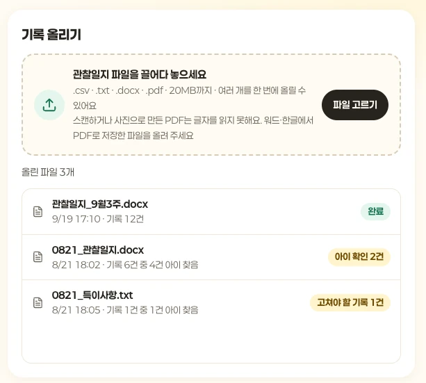
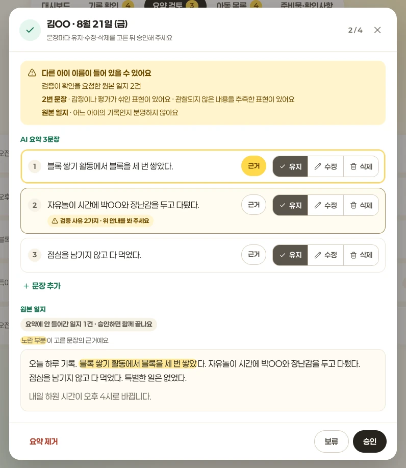
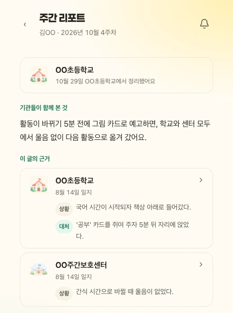
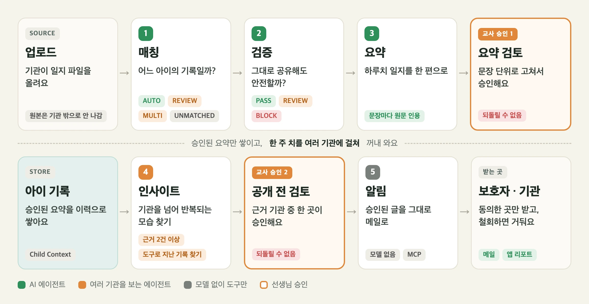

# 잇다(ITDA) — 아이를 함께 돌보는 기관의 기록을 보호자에게 잇다


> 학교 · 발달센터 · 활동보조 기관과 보호자를 위한 돌봄 기록 공유 서비스

<br />

## 🔗 프로젝트 링크

- **배포 주소**: [https://iitda.duckdns.org](https://iitda.duckdns.org)

---

## 📑 목차

1. [프로젝트 소개](#-프로젝트-소개)
2. [화면으로 보는 사용 흐름](#-화면으로-보는-사용-흐름)
3. [구조](#-구조)
4. [AI 워크플로](#-ai-워크플로)
5. [주요 기능](#-주요-기능)
6. [폴더 안내](#-폴더-안내)
7. [실행하기](#-실행하기)
8. [테스트](#-테스트)
9. [AI 품질 평가](#-ai-품질-평가)
10. [CI/CD와 환경](#-cicd와-환경)
11. [문서](#-문서)
12. [기술 스택](#-기술-스택)
13. [팀원 소개](#-팀원-소개)

---

## 📝 프로젝트 소개

한 아이가 학교, 발달센터, 활동보조 기관을 함께 다니면 기록도 기관마다 따로 쌓입니다.
보호자는 기관마다 따로 물어야 하고, 기관끼리는 서로의 기록을 모릅니다.

잇다는 기관이 올린 관찰일지를 AI가 **어느 아이의 기록인지 가리고(매칭), 그대로 둬도 안전한지 보고(검증),
하루치로 묶어 쓰고(요약), 여러 기관의 기록에서 반복되는 모습을 찾아(인사이트)** 보호자에게 전합니다.

선생님은 AI가 판단하기 어려운 기록을 확인하고, 하루 요약과 주간 인사이트를 각각 승인합니다.

```
업로드 → 매칭 → 검증 → 요약 → [1차 승인] → 보호자에게 일지 공유
승인된 일지 → 주간 인사이트 → [2차 승인] → 보호자와 공유 동의를 받은 기관에 인사이트 공유
```

- 매칭 · 검증 · 요약 · 인사이트는 백엔드 워커가 스스로 집어서 돌립니다
- 어느 아이 기록인지 애매하거나 위험한 표현이 있으면 선생님 확인 큐로 보냅니다
- 보호자는 **선생님이 승인한 일지와 인사이트**를 봅니다. 다른 기관에 인사이트를 공유할 범위는 보호자가 정합니다


---

## 🎬 화면으로 보는 사용 흐름

| 1. 기관이 관찰일지 업로드 | 2. 선생님이 AI 요약 검토 | 3. 보호자가 리포트와 근거 확인 |
| --- | --- | --- |
| 관찰일지 파일을 올리면 AI가 아이별로 기록을 나눕니다. | 선생님이 원문과 대조해 하루 요약을 승인하고, 주간 리포트도 한 번 더 검토합니다. | 보호자는 승인된 주간 리포트에서 근거가 된 기관별 일지를 열어 봅니다. |
| [](docs/images/readme/upload.webp) | [](docs/images/readme/review.webp) | [](docs/images/readme/report.webp) |

예시 데이터로 촬영했습니다. 이미지를 누르면 크게 볼 수 있습니다.

---

## 🏗 구조


- 외부에서 들어오는 길은 Caddy 하나뿐입니다. AI 서버는 밖에 열지 않고 백엔드만 부릅니다
- **AI는 DB를 만지지 않습니다.** 결과 저장과 상태 관리는 전부 백엔드가 하고, AI는 상태 없이 판정만 돌려줍니다
- 원본 파일은 브라우저가 S3에 바로 올리고, 백엔드는 업로드 주소와 권한만 내줍니다

---

## 🧠 AI 워크플로

[](docs/images/readme/ai-workflow.webp)

다섯 에이전트가 차례로 일하고, 기관 밖으로 나가기 전에 선생님이 두 번 승인합니다.

- **[매칭](AI/README.md#매칭--이-기록은-어느-아이의-것인가)** — 일지가 어느 아이의 것인지 가립니다. 이름이 또렷하면 모델을 부르지 않고, 애매하면 선생님께 묻습니다
- **[검증](AI/README.md#검증--그대로-공유해도-안전한가)** — 진단명 · 개인정보 · 다른 아이 이름 · 단정적인 표현을 찾습니다. 최종 판정은 코드가 합니다
- **[요약](AI/README.md#요약--하루치-일지를-한-편으로)** — 하루치 일지를 한 편으로 씁니다. 문장마다 원문 인용을 달고, 원문에서 못 찾은 문장은 버립니다
- **[인사이트](AI/README.md#인사이트--여러-기관에-걸친-패턴-찾기)** — 한 주 동안 여러 기관의 기록에서 반복되는 모습을 찾습니다. 근거는 서로 다른 기록 2건 이상입니다
- **[알림](AI/README.md#알림--승인된-인사이트를-보호자에게)** — 승인된 인사이트를 모델 없이 그대로 메일로 보냅니다. 다른 아이 이름이 걸리면 메일 전체를 막습니다

모델이 판단하는 자리와 코드가 정하는 자리, 도구 · 상태 · 예외 처리는 [AGENTIC.md](AI/AGENTIC.md)에 있습니다.

---

## ✨ 주요 기능

### 1️⃣ 일지 파일을 올리면 AI가 아이별로 나눠요
> csv · txt · docx · pdf 파일을 올리면 AI가 기록 한 줄마다 어느 아이의 것인지 가립니다. 애매한 기록만 선생님께 물어요


**근거** 코드 [`matching/graph.py`](AI/matching/graph.py) · 테스트 [`test_auto_gate.py`](AI/evals/scripts/matching/test_auto_gate.py) · 측정 [오매칭 0 / 1005](AI/evals/SCOREBOARD.md)

### 2️⃣ 위험한 표현은 공유 전에 걸러요
> 진단명 · 개인정보 · 다른 아이 이름 · 단정적인 표현을 찾아 표시합니다. 전화번호 · 주민번호는 모델 판단 없이 항상 막아요


**근거** 코드 [`validation/nodes.py`](AI/validation/nodes.py) · 테스트 [`test_pii_mention.py`](AI/evals/scripts/validation/test_pii_mention.py) · CI [`verify-ai.py`](infra/scripts/verify-ai.py)

### 3️⃣ 선생님이 확인한 요약과 인사이트만 보호자에게 가요
> 하루치 일지를 한 편의 요약으로, 여러 기관의 기록을 한 주의 인사이트로 묶습니다. 1차 · 2차 검토에서 선생님이 고치고 승인해요


**근거** 코드 [`summary/nodes.py`](AI/summary/nodes.py) · [`insight/tools.py`](AI/insight/tools.py) · [`GuardianJournalQueryService.java`](backend/src/main/java/com/itda/backend/service/child/GuardianJournalQueryService.java) · 테스트 [`test_grounding.py`](AI/evals/scripts/summary/test_grounding.py) · [`test_tools.py`](AI/evals/scripts/insight/test_tools.py) · [`Gate1PipelineIntegrationTest.java`](backend/src/test/java/com/itda/backend/Gate1PipelineIntegrationTest.java)

### 4️⃣ 보호자가 공유 범위를 정해요
> 보호자는 초대 코드로 아이와 연결하고, 기관별로 하루 요약과 주간 인사이트의 공유 범위를 정합니다.

- 동의를 철회하면 해당 기관은 받은 인사이트를 더 이상 열람할 수 없습니다. 해당 기관의 기록이 포함된 인사이트는 수신 기관 모두의 열람 권한이 회수됩니다.
- 보호자는 이미 승인된 일지와 인사이트를 계속 볼 수 있습니다. 승인 전 인사이트는 근거를 제공한 기관의 동의가 철회되면 승인할 수 없습니다.


**근거** 코드 [`InsightAccessRevoker.java`](backend/src/main/java/com/itda/backend/service/insight/InsightAccessRevoker.java) · 테스트 [`InsightAccessRevocationIntegrationTest.java`](backend/src/test/java/com/itda/backend/service/insight/InsightAccessRevocationIntegrationTest.java)

---

## 📂 폴더 안내

| 폴더 | 무엇 | 안내 |
| --- | --- | --- |
| [`AI/`](AI) | 매칭 · 검증 · 요약 · 인사이트 에이전트(FastAPI + LangGraph), 알림 MCP 서버, 평가 스크립트 | [AI/README.md](AI/README.md) |
| [`backend/`](backend) | API 서버(Spring Boot). 로그인 · 동의 · 승인 · 공유와, AI를 부르는 워커 | [backend/README.md](backend/README.md) |
| [`frontend/`](frontend) | 기관 대시보드와 보호자 웹앱(React Router SPA) | [frontend/README.md](frontend/README.md) |
| [`infra/`](infra) | Docker Compose · Caddy 설정, 배포 · 검증 스크립트 | [infra/README.md](infra/README.md) |
| [`docs/`](docs) | 팀 공통 문서 (API 규약 · DB 스키마 등) | [docs/README.md](docs/README.md) |

---

## 🚀 실행하기

### 전체 스택을 로컬에서 띄우기

Docker만 있으면 됩니다. 레포 루트에서 실행합니다.

```bash
cp infra/docker/.env.example infra/docker/.env
```

```bash
touch AI/.env
```

```bash
docker compose -f infra/docker/compose.yaml up -d --build
```

**http://localhost** 로 접속합니다. 카카오 계정 없이 들어오려면 로그인 화면의 개발용 로그인을 씁니다.

- 80 · 443 · 5432 · 8080 포트가 비어 있어야 합니다. 로컬에 PostgreSQL이 떠 있으면 5432가 겹쳐 DB가 뜨지 않습니다

- `.env.example`의 값은 자리표시자라 그대로도 뜹니다. 카카오 로그인을 쓰려면 `KAKAO_CLIENT_ID` · `KAKAO_CLIENT_SECRET`을 채웁니다
- `AI/.env`는 비어 있어도 되지만 파일은 있어야 합니다. AI가 실제로 판정하게 하려면 [`AI/.env.example`](AI/.env.example)을 보고 LLM 키와 주소를 채웁니다
- Docker로 띄운 백엔드는 원본 파일을 S3에 올립니다. 파일 업로드까지 해 보려면 AWS 자격 증명이 필요합니다

### 하나씩 띄우기

| 무엇 | 방법 |
| --- | --- |
| 프론트엔드만 (mock 데이터) | [frontend/README.md](frontend/README.md#실행) |
| 백엔드만 (로컬 PostgreSQL) | [backend/README.md](backend/README.md#로컬-postgresql로-실행) |
| AI 서버만 | [AI/README.md](AI/README.md#실행) |

### 배포

직접 배포하지 않습니다. `develop`에 병합되면 GitHub Actions가 바뀐 영역만 이미지로 만들어 서버에 배포합니다.
흐름은 [CI/CD와 환경](#-cicd와-환경), 서버 준비와 수동 복구는 [infra/README.md](infra/README.md)에 있습니다.

---

## 🧪 테스트

층마다 지키는 것이 다릅니다.

| 층 | 무엇을 지키나 | 실행 |
| --- | --- | --- |
| 단위 (BE) | 도메인 규칙, 서비스 판단, API 요청 · 응답. H2로 돌아 Docker가 필요 없다 | `cd backend && ./gradlew test` |
| 통합 (BE) | 실제 PostgreSQL에서의 쿼리 · 잠금 · 트랜잭션, 업로드부터 1차 검토까지의 흐름 | `cd backend && ./gradlew integrationTest` (Docker 필요) |
| E2E | 브라우저로 로그인 → 아이 등록 → 보호자 연결 → 업로드, AI가 멈췄을 때의 안내 | `cd frontend && npm ci && npx playwright install chromium && npm run e2e` |
| AI 규칙 | 모델 응답을 고정해 두고, 코드가 지키는 판정 규칙과 판정 기준 문서가 맞는지 본다. LLM을 부르지 않아 바로 끝난다 | 아래 |
| AI 품질 | 실제 모델로 평가 세트를 돌려 점수를 잰다 | [AI 품질 평가](#-ai-품질-평가) |
| 배포 스크립트 | 배포 · 복구 스크립트의 분기 | `python3 -m unittest discover -s infra/scripts/tests` |

AI 규칙 테스트는 `AI/`에서 실행합니다.

```bash
cd AI && python3 -m venv .venv && source .venv/bin/activate && pip install -r requirements.txt
```

```bash
for t in evals/scripts/*/test_*.py; do python "$t" > /dev/null || echo "FAIL $t"; done
```

아무것도 출력되지 않으면 전부 통과입니다.

---

## 🤖 AI 품질 평가

점수 하나보다 **과정**을 남깁니다.

```
평가 세트 → 채점 기준 → 결과 → 실패 분석 → 수정 → 재측정
```

| 단계 | 어디에 |
| --- | --- |
| 채점 기준 | 에이전트마다 "어떤 경우에 어떤 판정이 정답인가"를 문서로 둡니다 — [매칭](AI/matching/CRITERIA.md) · [검증](AI/evals/scripts/validation/README.md) · [요약](AI/summary/CRITERIA.md) · [인사이트](AI/insight/CRITERIA.md). 코드가 문서와 어긋나면 AI 규칙 테스트가 깨집니다 |
| 평가 세트 · 채점 | 에이전트별 스크립트 — [매칭](AI/evals/scripts/matching/README.md) · [요약](AI/evals/scripts/summary/README.md) · [실데이터 전체 흐름](AI/evals/scripts/real/README.md) |
| 결과 | [SCOREBOARD.md](AI/evals/SCOREBOARD.md) — 네 에이전트의 현재 점수를 한 곳에 |
| 실패 분석 · 수정 · 재측정 | [MEASUREMENTS.md](AI/evals/MEASUREMENTS.md) — 측정할 때마다 무엇이 틀렸고 무엇을 고쳤는지 · [교사 피드백 분석](AI/evals/scripts/feedback/README.md) |
| 모델 선택 근거 | [MODEL_COMPARE.md](AI/evals/scripts/real/MODEL_COMPARE.md) |

**개발용 세트와 블라인드 세트를 나눕니다.** 개발용 세트는 고치면서 계속 보기 때문에, 점수가 높아도
"처음 보는 기록에서도 된다"는 뜻이 아닙니다. 그래서 개발 중에 열어 보지 않는 블라인드 세트를 따로 두고,
**기준을 먼저 커밋한 뒤 한 번만 돌립니다**([실행 계획](AI/evals/scripts/real/BLIND_PLAN.md) · [결과](AI/evals/scripts/real/BLIND_RESULT.md)).
한 번 돌린 세트는 "소모됨"으로 표시하고 다시 쓰지 않습니다.

| 에이전트 | 가장 중요한 지표 | 개발용 세트 | 블라인드 세트 |
| --- | --- | --- | --- |
| 매칭 | 오매칭 (자동 확정인데 틀림) | 0 / 1005 | 0 / 382 · 실데이터 0 / 50 |
| 검증 | 치명적 실수 (막아야 할 것을 통과) | 0 | 0 / 12 |
| 요약 | 반영돼야 할 일지 누락 | 0 (5회) | 21 / 21 · 실데이터 52 / 52 |
| 전체 흐름 | 실데이터 정답 패턴 | 9~10 / 10 (5회) | 10 / 10 |

기준일과 모델, 남은 한계는 [SCOREBOARD.md](AI/evals/SCOREBOARD.md)에 함께 적습니다.

---

## 🔁 CI/CD와 환경


| 이벤트 | 도는 것 | 배포 |
| --- | --- | --- |
| `develop` · `main` 대상 PR | 바뀐 영역의 테스트 · 빌드, E2E | 없음 |
| `develop` 병합 | 같은 검사 → 이미지 게시 | 운영 EC2 (Docker Compose) |

- 영역마다 워크플로가 따로라, 프론트만 바뀌면 프론트만 다시 배포합니다 — [backend](.github/workflows/backend-ci-cd.yml) · [frontend](.github/workflows/frontend-ci.yml) · [AI](.github/workflows/ai-ci-cd.yml) · [E2E](.github/workflows/e2e.yml)
- 배포 확인이 실패하면 서버 checkout과 컨테이너를 이전 상태로 되돌립니다. DB 스키마는 되돌리지 않습니다
- 설정값은 커밋하지 않습니다. 예시 파일만 둡니다 — [`infra/docker/.env.example`](infra/docker/.env.example) · [`AI/.env.example`](AI/.env.example) · [`frontend/.env.example`](frontend/.env.example)

---

## 📚 문서

| 문서 | 내용 |
| --- | --- |
| 테크스펙 | https://app.notion.com/p/elice-track/3c62bb984257807ea0d3c8987dd6a1ac?source=copy_link |
| API 명세 | [api-conventions.md](docs/api/api-conventions.md) |
| DB 스키마 | [docs/db/schema.md](docs/db/schema.md) |
| AI 설계 | [AI/README.md](AI/README.md) · [AI/AGENTIC.md](AI/AGENTIC.md) |
| AI 평가 결과 | [AI/evals/SCOREBOARD.md](AI/evals/SCOREBOARD.md) |
| 협업 규칙 | [AGENTS.md](AGENTS.md) · [PR 템플릿](.github/pull_request_template.md) · [이슈 템플릿](.github/ISSUE_TEMPLATE) |

---

## 🛠 기술 스택

<table>
  <tr>
    <th>Category</th>
    <th>Stack</th>
  </tr>
  <tr>
    <td>Frontend</td>
    <td>
      
      
      
      
    </td>
  </tr>
  <tr>
    <td>Backend</td>
    <td>
      
      
      
      
      
    </td>
  </tr>
  <tr>
    <td>AI</td>
    <td>
      
      
      
      
    </td>
  </tr>
  <tr>
    <td>Testing</td>
    <td>
      
      
      
    </td>
  </tr>
  <tr>
    <td>Infra</td>
    <td>
      
      
      
      
      
    </td>
  </tr>
</table>

---

## 👥 팀원 소개

| | | |
| :--: | :--: | :--: |
|  |  |  |
| [jin2214](https://github.com/jin2214) | [chjh1211](https://github.com/chjh1211) | [KinsHishI](https://github.com/KinsHishI) |
| BE | BE | BE |
|  |  |  |
| [xohasnefo](https://github.com/xohasnefo) | [geunchanKim](https://github.com/geunchanKim) | [gogumajoha](https://github.com/gogumajoha) |
| FE | AI | AI |
