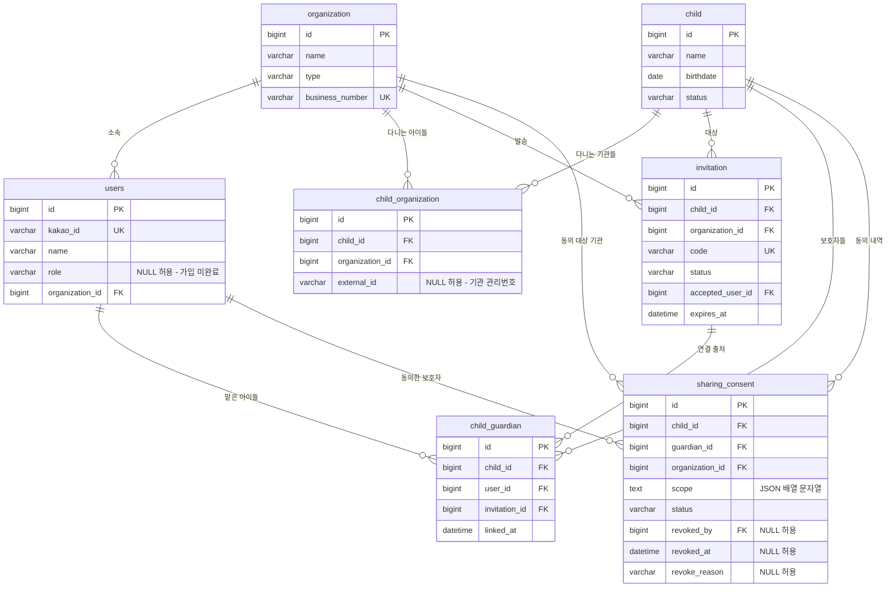
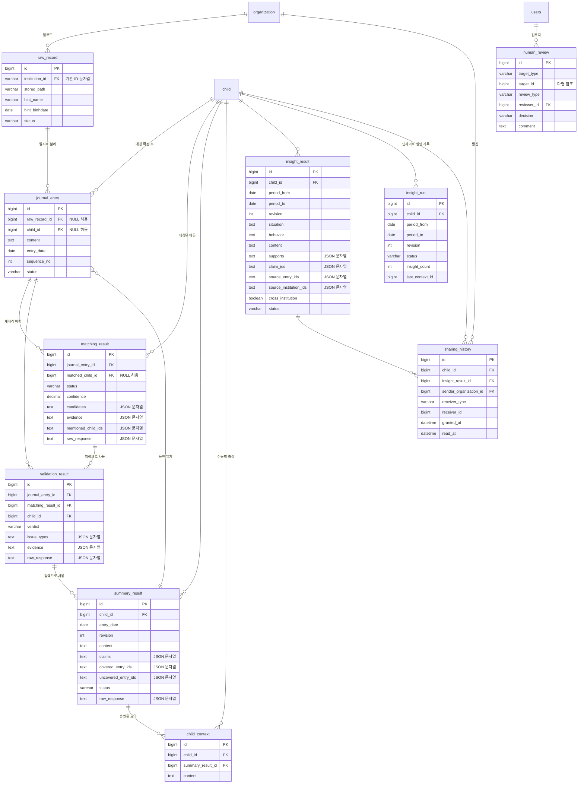

# 잇다 DB 스키마

> **이 문서가 DB 스키마의 원본이다.**
> 노션 「DB 수정본」은 이 문서를 주기적으로 옮겨 적은 **사본**이다. 노션을 먼저 고치지 않는다.
>
> **엔티티·테이블·컬럼·제약·enum 값을 바꾸는 PR은 이 문서를 같은 PR에서 고친다.** 예외 없음.
> 컬럼 하나 추가, NULL 허용 변경, enum 값 하나 추가도 해당한다.
> 코드와 이 문서가 다르면 **코드가 맞고 문서가 버그다.** 발견한 사람이 고친다.
>
> 고칠 때는 해당 절을 고치고, 맨 아래 **변경 이력**에 한 줄 남긴다.
> 설계와 다르게 구현했다면 §0.3 에도 적는다.

> **이 문서의 범위**
> 필수 테이블과 테이블 간 관계까지만 정한다. 세부 컬럼은 개발하면서 추가한다.
> 백엔드가 `ddl-auto: update`를 쓰기 때문에 **컬럼 추가는 자동 반영되지만, 관계 변경·컬럼 삭제·타입 변경은 자동 반영되지 않는다.**

---

## 0. 한눈에 보기

### 0.1 신뢰도 표시

| 표시 | 뜻 | 근거 |
| --- | --- | --- |
| ✅ **확정** | 바뀔 일 없음. 지금 구현해도 된다 | AI 코드에 박힌 계약 또는 기획 확정 사항 |
| 🟡 **초안** | 구조는 유지, **컬럼은 바뀔 수 있음** | 프론트 화면에서 역산. AI 계약이 아직 없음 |
| ⛔ **추정** | **근거 없음.** 예시일 뿐 | 누구도 확정한 적 없는 값 |

### 0.2 테이블 19개 현황

| # | 테이블 | 설계 | 구현 (엔티티) | 삭제 방식 |
| --- | --- | --- | --- | --- |
| 1 | `users` | ✅ 확정 | ✅ `User` | `deleted_at` |
| 2 | `organization` | ✅ 확정 | ✅ `Organization` | 삭제 없음 |
| 3 | `child` | ✅ 확정 | ✅ `Child` | `deleted_at` |
| 4 | `child_organization` | ✅ 확정 | ✅ `ChildOrganization` | `deleted_at` |
| 5 | `invitation` | ✅ 확정 | ✅ `Invitation` | `status` 로 대체 |
| 6 | `child_guardian` | ✅ 확정 | ✅ `ChildGuardian` | `deleted_at` |
| 7 | `sharing_consent` | ✅ 확정 | ✅ `SharingConsent` | `status` 로 대체 |
| 8 | `raw_record` | ✅ 확정 | ⚠️ `RawRecord` — 일부 다름 | `deleted_at` |
| 9 | `journal_entry` | ✅ 확정 | ✅ `JournalEntry` | `deleted_at` |
| 10 | `matching_result` | ✅ 확정 | ⚠️ `MatchingResult` — 설계와 다름 | 삭제 없음 (이력) |
| 11 | `validation_result` | ✅ 확정 | ✅ `ValidationResult` | 삭제 없음 (이력) |
| 12 | `summary_result` | ✅ 확정 | ✅ `SummaryResult` | 삭제 없음 (이력) |
| 13 | `human_review` | ✅ 확정 | ✅ `Approval` | 삭제 없음 (이력) |
| 14 | `child_context` | ✅ 확정 | ✅ `ChildContext` | 삭제 없음 (이력) |
| 15 | `insight_result` | ✅ 확정 | ✅ `InsightResult` | 삭제 없음 (이력) |
| 16 | `sharing_history` | ✅ 확정 | ✅ `SharingHistory` | 삭제 없음 (이력) |
| 17 | `insight_run` | ✅ 확정 | ✅ `InsightRun` | 삭제 없음 (이력) |
| 18 | `summary_run_request` | ✅ 확정 | ✅ `SummaryRunRequest` | 삭제 없음 (처리 시각으로 대체) |
| 19 | `child_organization_request` | ✅ 확정 | ✅ `ChildOrganizationRequest` | `status` 로 대체 |

**19개 모두 설계가 확정됐다.** `validation_result`·`summary_result` 는 에이전트 계약이 나와서,
`insight_result`·`sharing_history` 는 Insight 에이전트 계약(`AI/insight/schemas.py`)과 Gate 2 공유 정책이
정해져서 확정으로 올렸다. `human_review` 는 Gate 1 결정값이 `APPROVED`·`CORRECTED`·`HOLD`·`REMOVED`·`REOPENED` 로 정해지며 확정됐다.

**19개 모두 엔티티가 있다** (#258 에서 `child_organization_request` 가 마지막으로 들어왔다).
`human_review` 는 Gate 1 결정 API(#178)와 Gate 2 결정 API(#206)가 함께 쓴다.

삭제 방식은 §3.2 에서 설명한다. **`deleted_at` 이 붙은 6개 테이블만 삭제 대상이고, 나머지는 애초에 지우지 않는다.**

### 0.3 설계와 현재 코드가 다른 곳 ⚠️

> 기준: `backend/src/main/java/com/itda/backend/domain` 및 관련 Service·Repository · 대조일 2026-10-12.
> 이 목록이 비면 설계와 코드가 일치하는 것이다. 코드를 설계에 맞추든, 설계를 코드에 맞추든 **맞춘 뒤 여기서 지운다.**
> 이름·타입만 다르던 것(`stored_path`, TEXT 로 저장한 JSON 등)은 설계를 코드에 맞춰 이미 정리했다.

| 테이블 | 설계 | 현재 코드 | 비고 |
| --- | --- | --- | --- |
| `raw_record` | `organization_id BIGINT` | `institution_id VARCHAR(255)` | 기관 ID 숫자를 문자열로 저장. 배포 DB 컬럼 타입을 `ddl-auto`가 못 바꿔서 유지 중 (§6.1) |
| `raw_record` | status 가 파이프라인 단계 (`UPLOADED` → `PARSED` → `PROCESSING` → `COMPLETED`) | status `PENDING` `REVIEW` `BLOCKED` `FAILED` 중 실제로는 `PENDING`(저장 성공)·`FAILED`(메타데이터 저장 실패 후 별도 기록)만 씀 | 파이프라인 단계는 API `O-21 stage`로 따로 내려줄 계획이나 아직 미구현 (§6.1) |
| `matching_result` | 이력이라 수정하지 않음. 재처리는 새 행 | 사람이 확인 큐에서 처리하면 **기존 행을 수정**한다 (`status → AUTO`, `matched_child_id` 덮어씀, `reviewer_id` 기록) | §7.1 |
| `matching_result` | 검토자는 `users.id` BIGINT (`human_review.reviewer_id`와 같게) | `reviewer_id VARCHAR(255)` 에 `users.id`를 문자열로 저장 | §7.1 |
| `child`·`journal_entry` | 삭제되지 않고 그 기관에 동의(`sharing_consent` ACTIVE)가 있는 아동의 일지만 워커가 처리 (§5.1) | 매칭 명부와 사람의 매칭 확정에서만 확인. 검증·요약 워커와 매칭 결과 저장(`MatchingResultRecorder`)은 아동 삭제·동의를 재확인하지 않음 | AI 처리 중 동의 철회·아동 삭제 후 후속 처리 차단은 미구현 (#184 후속) |

---

## 1. ERD

> ERD 블록에는 핵심 컬럼만 적는다. `created_at` · `updated_at` · `deleted_at` 은 §3 공통 규칙을 따르므로 생략한다.

### 1.1 계정 · 아동 · 동의 ✅ 확정



### 1.2 파이프라인

파이프라인 테이블은 모두 ✅ 확정이고 모두 구현됐다.



### 1.3 데이터 흐름

> 아래 온보딩 흐름은 **아동-보호자 연결** 관점이다. 그보다 먼저, 로그인한 사용자가
> 역할(기관/보호자)을 정하는 **회원가입**이 있다 — 이건 `invitation`과 무관하게
> `POST /api/v1/auth/signup`으로 처리된다 (§4.1 참고).

```
[온보딩]  ✅ 확정
Organization → Child 등록 → Invitation 발송
                              ↓
                   보호자 카카오 로그인 → ChildGuardian
                              ↓
                SharingConsent 동의 (기관별)
                              ↓
          그 기관 매칭 명부에 들어감  ← 여기서부터 그 기관의 파이프라인 가동
          child.status = ACTIVE     ← 화면용 요약 (어느 기관이든 동의가 있으면)

[파이프라인]
RawRecord          원본 파일 + 표지 힌트          ✅
      ↓ 1:N
JournalEntry       일지 한 건 — 처리 단위          ✅
      ↓
MatchingResult     어떤 아동의 기록인가?           ✅
      ↓            → journal_entry.child_id 확정
ValidationResult   사용 가능한 기록인가?           ✅
      ↓
SummaryResult      기록 요약                      ✅
      ↓
HumanReview GATE1  교사 승인                      ✅ (#178)
      ↓
ChildContext       승인된 기록 축적                ✅ Gate 1 승인 시 생성
      ↓
InsightResult      변화 · 패턴 분석                ⬜ 미구현
      ↓
HumanReview GATE2  책임자 승인                    ⬜ 미구현
      ↓
SharingHistory     기관 간 공유                    ⬜ 미구현
```

---

## 2. 설계 원칙

### 2.1 관계 표현 — FK 제약을 걸지 않는다

- ERD의 관계선은 **논리적 관계**를 의미한다.
- 실제 DB에 `FOREIGN KEY CONSTRAINT`를 생성하지 않는다.
- 테이블에는 `raw_record_id`, `child_id` 같은 **ID 값만 저장**한다.
- JPA에서도 `@ManyToOne` / `@OneToMany`를 쓰지 않고 단순 `Long` 필드로 관리한다.
- 참조 대상의 존재 여부와 정합성은 **Service Layer에서 검증**한다.
- AI 각 단계의 결과를 별도 테이블로 분리해 단계 간 결합도를 낮춘다.

> **이 원칙의 대가 — 반드시 같이 읽을 것**
>
> FK 제약이 없으므로 **DB는 어떤 삭제도 막아주지 않고, 참조하는 행을 치워주지도 않는다.**
> `child` 한 행을 물리적으로 지우면 `journal_entry.child_id` · `matching_result.matched_child_id` ·
> `child_guardian` · `sharing_consent` 가 전부 존재하지 않는 ID를 가리킨 채 남는다.
> 에러도 나지 않고, 나중에 화면이 깨져서야 알게 되며, 복구할 방법이 없다.
>
> 그래서 §3.2 의 **삭제 금지(soft delete) 규칙은 선택이 아니라 이 원칙의 필수 짝이다.**

### 2.2 입력은 저장하지 않는다

`matching_input`, `validation_input` 같은 테이블은 만들지 않는다.
AI 입력은 기존 테이블에서 **그때그때 조립한다.**

```
MatchingInput
├── content          ← journal_entry.content
├── entry_date       ← journal_entry.entry_date
├── hint_name        ← raw_record.hint_name
├── hint_birthdate   ← raw_record.hint_birthdate
└── roster           ← child_organization + child
```

입력을 복사해두면 원본이 수정됐을 때 어긋난다.
대신 **어떤 입력을 썼는지는 결과 테이블의 ID 컬럼으로 기록한다** (`validation_result.matching_result_id`).

---

## 3. 공통 규칙 ✅ 확정

지금 정하지 않으면 나중에 바꿀 수 없는 항목이다.

| 항목 | 규칙 |
| --- | --- |
| PK | 전부 `BIGINT` auto increment. UUID를 쓰지 않는다 |
| 프론트 응답 | ID는 문자열로 직렬화해서 내려준다 (프론트 타입이 `string`) |
| AI 요청 | ID는 정수 그대로 보낸다 (AI 계약이 `int`) |
| 시각 컬럼 | `created_at`은 모든 테이블에. `updated_at`은 값이 바뀌는 테이블에만 |
| **삭제** | **어떤 행도 `DELETE` 하지 않는다.** `deleted_at`에 시각을 기록한다 (§3.2) |
| 열거형 | 문자열(`VARCHAR`)로 저장. DB `ENUM` 타입을 쓰지 않는다 |
| AI 응답 보관 | 결과 테이블은 `raw_response`에 응답 원본을 그대로 보관. 실제로 쓰는 값만 컬럼으로 승격 |
| JSON 컬럼 | 지금은 JSON 컨버터가 없어서 **`TEXT`에 JSON 문자열로 저장**한다 (`matching_result`). 아래 초안 테이블의 `JSON` 표기도 구현 시 같은 방식을 따른다 |

> **프론트 ID 직렬화는 아직 FE와 합의 전이다.** 프론트가 숫자로 바꾸겠다고 하면 이 규칙을 뒤집으면 된다. 백엔드는 어느 쪽이든 쉽다.

### 3.1 시각 컬럼

| 컬럼 | 타입 | NULL | 의미 |
| --- | --- | --- | --- |
| `created_at` | DATETIME | N | 생성 시각. 모든 테이블 |
| `updated_at` | DATETIME | N | 마지막 수정 시각. 값이 바뀌는 테이블만 |
| `deleted_at` | DATETIME | **Y** | **삭제 표시.** `NULL`이면 살아 있는 행 |

`deleted_at`을 찍을 때 `updated_at`도 같이 갱신된다(수정의 일종이다).

**예외 — `raw_record.updated_at`은 DB에서 NULL을 허용한다.** 배포 DB에 이미 행이 있어서
`ddl-auto: update`가 NOT NULL 컬럼을 추가하지 못하기 때문이다. 새 행과 수정되는 행은 코드가 항상 채운다.
나중에 추가하는 컬럼도 기존 행이 있는 테이블이면 같은 문제가 생긴다 (§11.4).

### 3.2 삭제 — Soft Delete ✅ 확정

**어떤 테이블도 `DELETE` 하지 않는다.** 삭제 요청은 `deleted_at`에 현재 시각을 기록하는 것으로 처리한다.
`deleted_at IS NULL`이면 살아 있는 행, 값이 있으면 삭제된 행이다.

#### 왜 이렇게 하나

§2.1 대로 FK 제약이 없어서 **DB가 아무것도 막아주지 않기 때문이다.** 세 가지 선택지 중 이것만 원하는 동작이 나온다.

| 방식 | 김하늘(`child.id = 5`)을 지우면 | 쓸 수 있나 |
| --- | --- | --- |
| FK + `CASCADE` | 일지·매칭결과·동의이력까지 전부 함께 삭제 | ❌ 기록과 동의 이력이 사라지면 안 된다 |
| FK + `RESTRICT` | 일지가 있으면 삭제 자체가 거부됨 | ❌ 화면의 삭제 기능이 동작하지 않는다 |
| FK 없이 물리 삭제 | 일지는 남고 `child_id = 5`가 존재하지 않는 행을 가리킴 | ❌ 누구의 기록인지 영영 알 수 없다 |
| **soft delete** | 아이 행도 일지도 그대로. "삭제됨" 표시만 붙는다 | ✅ |

부수적인 이유도 있다.

- 기관 담당자의 오삭제 복구 요청이 실제로 가장 흔한 운영 이슈다. `deleted_at = NULL`로 되돌리면 끝난다.
- 동의·공유 이력이 이 서비스의 핵심 기록인데, 아동 행이 사라지면 "누구 정보를 누구에게 줬는지"가 함께 사라진다.

#### `deleted_at`을 두는 테이블 (6개)

```
users
child
child_organization
child_guardian
raw_record
journal_entry
```

사용자가 화면에서 "삭제"·"연결 해제"·"탈퇴"를 할 수 있는 것들이다.

#### 두지 않는 테이블과 그 이유

| 테이블 | 이유 |
| --- | --- |
| `organization` | 회원가입 시 기관 담당자가 직접 생성하며(9.23 변경), 아직 삭제 기능이 없다. 나중에 필요해지면 같은 규칙으로 `deleted_at`을 추가한다 |
| `invitation` | `status = CANCELLED`(기관이 취소)가 이미 같은 일을 한다. 두 개를 같이 두면 "어느 쪽이 진짜인가"가 생긴다. 만료는 삭제가 아니라 `expires_at` 으로 판단한다 (§5.3) |
| `sharing_consent` | `status = REVOKED`가 이미 같은 일을 한다. 위와 동일 |
| `matching_result` `validation_result` `summary_result` `human_review` `child_context` `insight_result` `sharing_history` `insight_run` | 실행·검토 이력이라 애초에 삭제 개념이 없다. 잘못된 결과는 지우는 게 아니라 다시 실행해서 새 행을 쌓는다 |
| `summary_run_request` | 처리한 요청도 지우지 않는다. `handled_until`(어디까지 처리했는지)이 같은 일을 한다 (§8.3) |

#### 조회 규칙 — 이게 핵심이다

**`deleted_at`을 두는 6개 테이블을 조회할 때는 반드시 `deleted_at IS NULL`을 붙인다.**

빠뜨리면 조용히 틀린다. 특히 위험한 곳:

- **매칭 명부(roster)** — `child_organization` + `child`에서 만든다. 조건을 빠뜨리면 **삭제한 아이가 명부에 다시 나타나 AI 매칭 대상이 된다.**
- **보호자 권한 확인** — `child_guardian`. 연결을 끊은 보호자가 계속 아이 기록을 볼 수 있게 된다.
- **기관 아동 목록·일지 목록** — 삭제한 항목이 화면에 그대로 뜬다.

#### 삭제된 대상을 가리키는 행의 처리

`journal_entry.child_id`나 `matching_result.matched_child_id`가 **삭제 표시된 `child`를 가리키는 상태는 정상이다.**
행이 남아 있으므로 이름은 계속 읽을 수 있다. 화면에서는 "삭제된 아동"으로 표시한다.

설계상 삭제된 아동의 일지는 새로 파이프라인을 태우지 않는다. 현재 검증·요약 워커는
`child.deleted_at IS NULL`을 재확인하지 않아 이 규칙을 완전히 구현하지 못했다 (§0.3, §5.1).

#### 개인정보 파기 요구는 별개다

soft delete는 **오삭제 복구와 이력 보존**을 위한 것이지, 영구 보관 수단이 아니다.
정보주체가 파기를 요구하면 그때는 실제로 데이터를 지우거나 익명화해야 한다.
그 절차는 이 문서의 범위 밖이며, 필요해지는 시점에 따로 정한다.

### 3.3 유니크 제약 — 나중에 붙일 수 없으므로 지금 건다

```
users.kakao_id                                UNIQUE
organization.business_number                  UNIQUE
organization.code                             UNIQUE   (나중에 더해 배포 DB 에는 손으로 건다, §11.4)
invitation.code                               UNIQUE
child_organization(child_id, organization_id) UNIQUE
child_organization(organization_id, external_id) UNIQUE
child_guardian(child_id, user_id)             UNIQUE
summary_result(child_id, entry_date, institution_id, revision) UNIQUE
child_context.summary_result_id               UNIQUE
sharing_history(insight_result_id, receiver_type, receiver_id)         UNIQUE
insight_run(child_id, period_from, period_to, revision) UNIQUE
```

#### soft delete와 유니크 제약의 충돌 — 반드시 읽을 것

삭제 표시된 행도 테이블에 그대로 남아 있으므로 **유니크 제약을 계속 차지한다.**
그래서 그냥 두면 이런 일이 생긴다.

```
기관에서 김하늘을 뺌        → child_organization 행에 deleted_at 기록
같은 아이를 다시 등록하려 함 → INSERT 시 UNIQUE 위반으로 실패
```

**해결: 다시 연결할 때 새 행을 만들지 않고, 기존 행을 되살린다.**

```
연결 요청 → (child_id, organization_id) 행이 있나?
             있고 deleted_at != NULL  → deleted_at = NULL 로 복구
             있고 deleted_at == NULL  → 이미 연결됨. 아무것도 하지 않는다
             없음                     → 새로 INSERT
```

같은 규칙이 적용되는 곳:

| 대상 | 상황 |
| --- | --- |
| `child_organization(child_id, organization_id)` | 기관에서 뺐다가 다시 등록 |
| `child_guardian(child_id, user_id)` | 보호자 연결을 끊었다가 다시 연결 |
| `users.kakao_id` | 탈퇴한 사람이 같은 카카오 계정으로 재가입 |

`deleted_at IS NULL`인 행만 유니크로 보는 부분 인덱스(partial unique index)가 정석이지만,
`ddl-auto: update`가 만들어주지 못하므로 쓰지 않는다.

**`child_guardian` 은 행을 잠근 뒤 다시 확인한다.** 복구는 INSERT 가 아니라 UPDATE 라 유니크 제약이 막아 주지 않는다.
같은 보호자가 코드 두 개로 동시에 수락하면 둘 다 "삭제된 행이 있다"를 보고 둘 다 복구할 수 있다.
그래서 `SELECT ... FOR UPDATE` 로 행을 잠근 다음 살아 있는지 다시 보고, 복구할 때는 `invitation_id` 를 새 초대로 바꾼다.
행이 아예 없을 때의 동시 INSERT 는 유니크 제약이 막는다 (`InvitationService.accept`).

#### 잠금 순서 — 행 두 개 이상을 잠그는 작업은 이 순서를 지킨다

```
child → child_organization → child_organization_request → invitation → child_guardian → sharing_consent
```

순서가 하나뿐이라 교착(deadlock)이 생기지 않는다. 초대 코드 수락은 앞의 네 행을 모두 이 순서로 잠근다.

**동의를 바꾸거나 동의를 보고 결정하는 작업은 모두 `child` 를 먼저 잠근다.** `sharing_consent` 는 이력 테이블이라
UNIQUE 를 걸 수 없어서(§5.5), 이 잠금이 같은 아이의 동의 변경을 한 줄로 세운다.

| 작업 | 잠그는 행 (순서대로) |
| --- | --- |
| 동의 부여·철회 (G-41) | `child` → `child_organization` → `child_guardian`. 동의 행은 따로 잠그지 않는다 |
| 보호자 연결 해제 (G-05·O-19) | `child` → `child_organization_request` → `child_guardian`. O-19 는 `child` 를 잠근 뒤에 삭제·명부 소속을 본다. 끊긴 보호자의 대기 중 연결 요청을 거두고(§5.6), 동의를 같은 트랜잭션에서 철회한다 |
| 기관 연결 요청 (G-44) | `child`. 잠근 뒤 보호자 연결·명부·이 보호자의 대기 요청을 본다 — 같은 보호자의 동시 요청이 대기 행을 둘 만들지 않는다 |
| 연결 요청 수락 (O-61) | `child` → `child_organization` → `child_organization_request`. 요청 행은 잠그면서 처음 읽는다 — 그사이 연결 해제로 거둬진 요청을 옛 `PENDING` 으로 보지 않는다 |
| 연결 요청 거절 (O-62) | `child` → `child_organization_request` |
| 사람의 매칭 확정 (O-23 assign) | `child`. 잠근 뒤 그 기관 동의를 확인한다 — 철회가 커밋된 뒤에는 새 확정이 성공하지 않는다 |
| 인사이트 단건 열람 (G-36 · O-51) | `child` **FOR SHARE** → `sharing_history`(열람 시각 UPDATE 의 행 잠금). 잠글 아이는 `child_id` 값만 골라 알고, 권한 행은 잠근 뒤에 처음 읽는다. 철회·Gate 2 승인과는 줄을 서고 열람끼리는 `child` 에서 막지 않는다 — 같은 권한 행의 UPDATE 끼리만 기다린다 (§9.4) |

**잠그기 전에 같은 행을 엔티티로 읽지 않는다.** JPA 는 이미 읽어 둔 엔티티가 있으면 잠금 조회(`findByIdForUpdate`)가
행을 잠그기만 하고 그 낡은 엔티티를 그대로 돌려준다. 그 엔티티의 상태를 바꾸면 모든 컬럼을 UPDATE 하므로, 그사이
다른 트랜잭션이 커밋한 값(예: 아동 삭제의 `deleted_at`)을 덮어써 되돌린다. 권한 확인처럼 잠금 전에 할 일이 있으면
그 행을 읽지 않는 방식(존재 여부 조회 등)으로 하거나, 잠근 뒤에 한다.
그래서 아동 삭제나 명부 제외가 수락과 겹쳐도 수락은 그 행을 기다렸다가 커밋된 상태를 보고 판단한다.

**아직 없는 "명부 제외"·"아동 삭제" 기능을 만들 때도 이 순서를 따른다** — `child` 를 먼저 잠그고 `child_organization` 을 잠근다.
한 행만 잠그는 작업(초대 취소는 `invitation`)은 순서와 무관하다. 보호자 해제는 동의를 함께 끄므로 `child` 부터 잠근다.

**예외: `child_organization(organization_id, external_id)` 는 되살리지 않고 비운다.**

관리번호는 같은 아이가 돌아올 때가 아니라 **다른 아이가 그 번호를 받을 때** 충돌한다. 아이 등록은 항상
새 `child`·새 연결 행을 만들기 때문에, 예전 행을 되살리는 방식으로는 풀 수 없다(되살리면 예전 아이가 돌아온다).
그래서 연결을 해제할 때 `deleted_at`을 찍으면서 `external_id`를 NULL로 비운다. PostgreSQL 유니크 제약은
NULL끼리 겹치는 것을 허용하므로, 해제된 행은 번호를 놓아 준다.

```
연결 해제 → deleted_at = now(), external_id = NULL   (ChildOrganization.delete())
다시 연결 → deleted_at = NULL 만 되돌린다. 관리번호는 돌아오지 않는다 (ChildOrganization.restore())
```

---

# ✅ 확정 테이블

> 아래 10개는 **AI 코드에 박힌 계약** 또는 **기획 확정 사항**에서 나왔다.
> AI 에이전트가 앞으로 뭘 만들든 바뀌지 않는다. 지금 구현해도 된다.

---

## 4. 계정 · 조직

> **(9.25) 배포 주의 — 이전 스키마 테이블 정리**
> 배포 DB(PostgreSQL)에 이전 설계로 만들어진 `users`·`organization` 테이블이 이미 있다면 데이터를 보존하고,
> 백업 후 별도 스키마 변경을 준비한다. 테이블을 지우고 배포하지 않는다 (`backend/README.md`의 이전 절차 참고).
> `ddl-auto: update`는 `users.role`의 NOT NULL 해제와 `organization.name`의 UNIQUE 제거를 해주지 않고,
> 기존 행이 있으면 NOT NULL인 `organization.business_number` 컬럼 추가도 실패한다.
> `test` 프로필은 H2 인메모리(`create-drop`)라 재기동하면 초기화된다. 로컬 개발 DB는 개발자의
> `application-local.yml` 설정을 따른다 (`backend/README.md`의 로컬 PostgreSQL 실행 절차 참고).

### 4.1 `users` ✅

> **근거** — 기획: 기관·부모 인증을 카카오로 통일 · 회원가입 설계(9.23) — 역할 결정 방식 변경

카카오 로그인 주체. 기관 담당자와 보호자 모두 이 테이블을 쓴다.

> **테이블명이 `user`가 아니라 `users`인 이유.** `USER`는 PostgreSQL 예약어라
> `@Table(name = "user")`로 두면 테이블 생성 자체가 실패한다.

| Column | Type | NULL | 설명 |
| --- | --- | --- | --- |
| `id` | BIGINT | N | PK |
| `kakao_id` | VARCHAR(50) | N | 카카오 회원번호. UNIQUE. 개발용 로그인(`DEV_LOGIN_ENABLED`)으로 만든 테스트 회원은 `dev:{이름}` (실제 카카오 회원번호는 숫자뿐이라 겹치지 않음) |
| `name` | VARCHAR(100) | Y | 카카오 닉네임. 사용자가 동의를 거부할 수 있어 NULL 허용 |
| `role` | VARCHAR(20) | **Y** | 역할. **NULL이면 "가입 미완료" 상태** (9.23 변경 — 이전엔 NOT NULL) |
| `organization_id` | BIGINT | Y | 소속 기관. `role = ORGANIZATION`일 때만 |
| `created_at` | DATETIME | N |  |
| `updated_at` | DATETIME | N |  |
| `deleted_at` | DATETIME | Y | **탈퇴 표시.** NULL이면 활성 계정 |

**`role`**

```
ORGANIZATION
PARENT
```

**(9.23 변경) 역할은 더 이상 로그인 진입 경로로 결정하지 않는다.** 카카오 로그인은 신원
확인만 하고, `role`은 `NULL`인 채로 계정이 생성된다. 사용자가 로그인 후 화면에서 역할을
직접 선택해 `POST /api/v1/auth/signup`을 호출해야 확정된다.

```
카카오 로그인 성공 → users row 생성, role = NULL (가입 미완료)
                              ↓
              GET /api/v1/auth/me → signupCompleted: false
                              ↓
              POST /api/v1/auth/signup { role: "org" | "parent", ... }
                              ↓
                    role 확정 (이후 변경 불가)
```

이전 설계(로그인 URL의 `?invite=` 파라미터로 역할을 정하던 방식, `LoginRoleHintFilter`)는
폐기했다. **초대 코드로 로그인에 들어왔는지는 더 이상 역할 결정에 쓰지 않는다** —
`invitation`(§5.3)은 아동-보호자 연결 전용이고, 회원가입 자체와는 무관하다.

`role`이 `NULL`인 사용자가 `/auth/me`, `/auth/signup`, `/auth/logout` 외의 보호 API를 호출하면
`403 SIGNUP_NOT_COMPLETED`로 막는다.

한 사람은 한 기관에만 속한다. 그래서 중간 테이블 없이 `organization_id` 컬럼 하나로 둔다.

**`deleted_at`** — 탈퇴한 보호자가 남긴 `child_guardian` · `sharing_consent` · `human_review.reviewer_id`가
존재하지 않는 `users` 행을 가리키지 않도록 행을 남긴다. 재가입은 §3.3 의 복구 규칙을 따른다.
로그인·세션 조회(`/api/v1/auth/me`)는 `deleted_at IS NULL`인 사용자만 인정한다.

### 4.2 `organization` ✅

> **근거** — 프론트 `InstitutionType` · 회원가입 설계(9.23) — 사업자등록번호로 1기관 1계정 구분

| Column | Type | NULL | 설명 |
| --- | --- | --- | --- |
| `id` | BIGINT | N | PK |
| `name` | VARCHAR(100) | N | 기관명 |
| `type` | VARCHAR(30) | N | 기관 유형 |
| `business_number` | VARCHAR(10) | N | 사업자등록번호. UNIQUE (9.23 추가) |
| `code` | VARCHAR(8) | Y | 기관 코드. UNIQUE. 보호자가 이 코드로 아이를 이 기관에 연결해 달라고 요청한다 (10.29 추가, §5.6) |
| `created_at` | DATETIME | N |  |
| `updated_at` | DATETIME | N |  |

**`type`**

```
SCHOOL
CENTER
ACTIVITY_SUPPORT
```

**`business_number`**

`^\d{10}$` 형식만 검사하고 무조건 통과시킨다. **실제로 존재하는 사업자번호인지, 이 기관이
장애아동 기관이 맞는지는 검증하지 않는다** (MVP 의도적 선택 — 자세한 이유와 향후 검증
방향은 [회원가입 설계] 문서 §6 참고). 체크섬 검증도 하지 않는다 — 테스트 데이터를 쉽게
넣기 위해서다. 하이픈 없이 저장한다.

**`name`에는 UNIQUE를 걸지 않는다 (9.23 변경).** 같은 이름의 센터가 실제로 여러 곳 있을 수
있다. 기관을 유일하게 구분하는 키는 `business_number`다.

**(9.23 변경) 기관 행은 더 이상 미리 시드하지 않는다.** 이전에는 시연용 기관을 시더가 DB에
미리 넣고, 로그인한 기관 담당자를 첫 번째 기관에 자동 배정했다. 이 방식(`OrganizationSeedService`,
자동 배정 로직)은 폐기했다. 지금은 기관 담당자가 `POST /api/v1/auth/signup`으로
기관명·기관유형·사업자등록번호를 직접 입력하면 그 시점에 `organization` 행이 새로 생성된다.

**`code` (기관 코드)** (10.29 추가)

기관마다 고정인 8자리다. 초대 코드와 같은 생성기를 써서 헷갈리는 `0 O 1 I L` 을 뺀 31자에서 뽑고, 입력은 공백·하이픈·대소문자를
무시한다. 기관 담당자는 내 기관 정보(O-01)에서 보고 보호자에게 알려 준다. 바꾸지 않는다(재발급 없음).

- 새 기관은 회원가입 때 받는다. 사업자번호와 코드가 둘 다 UNIQUE 라 가입 중 제약 위반은 **제약 이름으로 가린다** —
  사업자번호면 `409 DUPLICATE_BUSINESS_NUMBER`, 코드면 `503 INSTITUTION_CODE_ISSUE_FAILED`(다시 보내면 된다).
- 이 컬럼보다 먼저 가입한 기관은 NULL 이다가 내 기관 정보를 **처음 열 때** 받는다. 기관 행을 잠근 뒤 비어 있는지 다시 보므로
  동시에 열어도 코드는 한 번만 붙는다.
- NULL 을 허용하는 이유는 위의 기존 기관 때문이다. UNIQUE 는 NULL 끼리 겹치는 것을 허용한다.

삭제 기능은 아직 없다. `deleted_at`을 두지 않는다.

---

## 5. 아동 · 연결 · 동의

### 5.1 `child` ✅

> **근거** — AI `RosterEntry(child_id, name, birthdate)` · 프론트 `ChildStatus`

| Column | Type | NULL | 설명 |
| --- | --- | --- | --- |
| `id` | BIGINT | N | PK |
| `name` | VARCHAR(100) | N | 아동 이름 |
| `birthdate` | DATE | **N** | 생년월일 |
| `status` | VARCHAR(30) | N | 등록 상태 |
| `created_at` | DATETIME | N |  |
| `updated_at` | DATETIME | N |  |
| `deleted_at` | DATETIME | Y | **삭제 표시.** NULL이면 살아 있는 아동 |

**`birthdate`가 NOT NULL인 이유**

AI 계약에서 필수값이다.

```python
class RosterEntry(BaseModel):
    child_id: int
    name: str
    birthdate: str    # 필수. None 허용 아님
```

비어 있으면 **그 아이는 매칭 명부(roster)에 넣을 수 없어 매칭 대상에서 빠진다.**
동명이인 구분에도 쓰이는 값이라 기관이 아동 등록 시 필수로 입력받는다.

**`status`**

```
PENDING_CONSENT   동의한 적이 한 번도 없다 (생성 시 기본값)
ACTIVE            어느 기관이든 살아 있는 동의(sharing_consent ACTIVE)가 하나라도 있다
SUSPENDED         동의한 적은 있지만 모두 철회됐다
```

기획의 **Consent First**를 요약해 보여 주는 **화면용 값**이다 (#184 에서 기관별 판정으로 바꿈).
**어느 기관이 이 아이를 매칭에 쓸 수 있는지는 이 값이 아니라 그 기관에 대한 동의(§5.5)로 판단한다.**
학교에만 동의한 아이도 `ACTIVE` 라서, 이 값으로 거르면 동의하지 않은 센터 명부에도 그 아이가 들어간다.

- 매칭 명부(`ChildRepository.findConsentedByOrganizationId`)와 사람의 매칭 확정(O-23 assign)은
  "그 기관에 `ACTIVE` 동의가 있는가"를 본다.
- 이 값은 동의 부여·철회·연결 해제 때 같은 트랜잭션에서 위 규칙으로 다시 계산한다(`ConsentService`).
  동의 행은 지우지 않으므로 한 번 `ACTIVE`/`SUSPENDED` 가 되면 `PENDING_CONSENT` 로 돌아가지 않는다.

**`status`와 `deleted_at`은 다른 것이다**

```
status = SUSPENDED   동의가 없어서 처리를 멈춘 상태. 아이는 기관에 그대로 있다
deleted_at != NULL   기관이 아이를 목록에서 뺀 상태. 조회 대상에서 빠진다
```

설계상 워커는 아동이 삭제되지 않았고 **일지 소속 기관에 동의가 있을 때만** 처리해야 한다.
현재 매칭 명부와 사람의 매칭 확정은 두 조건을 확인하지만, 검증·요약 워커와 매칭 결과 저장은 일지의 상태·삭제 여부만
확인하고 아동 삭제·동의를 재확인하지 않는다 (§0.3). AI 처리 중(호출이 나간 뒤) 아동이 삭제되거나 동의가 철회된
경우의 차단은 #184 후속 작업이다.

### 5.2 `child_organization` ✅

> **근거** — 프론트 `Child.institutions[]` (배열) · AI roster 구성

아동과 기관의 연결. **매칭 입력인 기관별 아동 명부(roster)가 이 테이블에서 나온다.**

행이 생기는 길은 둘이다. 기관이 아이를 새로 등록하거나(O-11, 새 `child` 도 함께 생긴다), 보호자가 기관 코드로 낸 연결 요청을
기관이 수락한다(§5.6, 이미 있는 `child` 에 붙는다). **이미 다른 기관에 다니는 아이는 두 번째 길로 붙여야 아이가 하나로 남는다** —
기관이 따로 등록하면 같은 아이가 둘이 된다.

| Column | Type | NULL | 설명 |
| --- | --- | --- | --- |
| `id` | BIGINT | N | PK |
| `child_id` | BIGINT | N |  |
| `organization_id` | BIGINT | N |  |
| `external_id` | VARCHAR(50) | Y | 기관이 쓰는 아동 관리번호. 등록 시 필수 입력(필수 전 등록분·연결 해제 행은 NULL) |
| `created_at` | DATETIME | N |  |
| `updated_at` | DATETIME | N |  |
| `deleted_at` | DATETIME | Y | **연결 해제 표시** |

`(child_id, organization_id)` UNIQUE. 재연결은 §3.3 의 복구 규칙을 따른다.

**`external_id` (관리번호)**

기관이 아이를 구분하려고 붙인 번호다(예: `2026-0031`). 기관마다 번호가 다르므로 `child`가 아니라 연결이 가진다.

- 아이 등록(O-11)에서 **필수로** 받는다. 앞뒤 공백을 떼고 1–50자, 비어 있거나 공백뿐이면 400. 형식은 기관마다 달라 강제하지 않는다.
- 그래도 컬럼은 NULL을 허용한다. 필수가 되기 전에 등록된 아이에게는 번호가 없고, 연결을 해제하면 번호를 비우기 때문이다.
- `(organization_id, external_id)` UNIQUE — **같은 기관 안에서만** 겹칠 수 없다. 다른 기관은 같은 번호를 써도 된다. NULL은 여럿이어도 된다.
- 서비스가 먼저 조회해 `409 DUPLICATE_EXTERNAL_ID`를 주고, 동시 등록으로 조회를 함께 통과한 경우는 유니크 제약이 막아 같은 409로 바꾼다.
- 연결을 해제하면 NULL로 비운다. 다시 연결해도 돌아오지 않는다(§3.3 예외).

**왜 FK 컬럼 하나가 아니라 별도 테이블인가**

한 아이가 여러 기관에 다닌다. 기관마다 흩어진 기록을 연결하는 것이 서비스의 목적이다.

```
임유진 ─┬─ 특수학교
        ├─ 발달센터
        └─ 활동지원사
```

한 아이가 여러 기관, 한 기관에 여러 아이 → N:M이라 중간 테이블이 필요하다.

**roster를 만들 때 가장 흔한 실수**

```sql
-- 틀림: 기관에서 뺀 아이가 매칭 대상에 다시 들어온다
SELECT c.* FROM child c
  JOIN child_organization co ON co.child_id = c.id
 WHERE co.organization_id = ?

-- 맞음
SELECT c.* FROM child c
  JOIN child_organization co ON co.child_id = c.id
 WHERE co.organization_id = ?
   AND co.deleted_at IS NULL
   AND c.deleted_at IS NULL
```

### 5.3 `invitation` ✅ — ✅ 구현 (`Invitation`)

> **근거** — 기획 변경: 부모 주도 → 기관 초대 방식 · 초대코드 설계(10.12): SMS 없이 기관이 코드를 직접 전달

기관이 보호자에게 건네는 **일회용 초대 코드**. **보호자 계정이 아직 없는 상태에서 만들어진다.**
SMS·전화번호 확인은 비용 때문에 쓰지 않는다. 기관이 화면에 뜬 코드나 링크를 카톡 등으로 직접 보내고,
보호자는 가입한 뒤 코드를 입력해 아이와 연결된다(`child_guardian`).

> **코드는 본인 확인이 아니라 연결 권한이다.** 코드를 가진 사람이 누구인지는 확인하지 않는다.
> 잘못 연결된 사람은 기관이나 본인이 해제한다(§5.4).

> **회원가입과는 다른 개념이다 (9.23 명확화).** 이 초대는 "이 아이의 보호자 연결"을 위한
> 것이지, 로그인 시 역할(기관/보호자)을 정하던 예전의 `?invite=` 방식과 무관하다. 보호자는
> 먼저 `POST /api/v1/auth/signup`으로 PARENT 가입을 끝낸 뒤, 이 `invitation`으로 특정
> 아동과 연결된다 (§4.1 참고).

| Column | Type | NULL | 설명 |
| --- | --- | --- | --- |
| `id` | BIGINT | N | PK |
| `child_id` | BIGINT | N | 대상 아동 |
| `organization_id` | BIGINT | N | 발급 기관 |
| `code` | VARCHAR(8) | N | 초대 코드. UNIQUE |
| `status` | VARCHAR(20) | N | 초대 상태 |
| `accepted_user_id` | BIGINT | Y | 수락한 보호자 user ID |
| `expires_at` | DATETIME | N | 만료 시각. 발급 후 10분 |
| `created_at` | DATETIME | N |  |
| `updated_at` | DATETIME | N |  |

**`status`**

```
PENDING     발급됨. expires_at 전이면 쓸 수 있다
ACCEPTED    보호자가 썼다 (accepted_user_id 기록)
CANCELLED   기관이 취소했다
```

**만료는 상태가 아니다.** `PENDING` 이어도 `expires_at` 이 지났으면 쓸 수 없다. "쓸 수 있는 코드"는 언제나
`status = PENDING AND now < expires_at` 이다. 스케줄러가 상태를 바꿔 주지 않아도 정확하다.

**코드 형식** — 대문자·숫자 31자(헷갈리는 `0 O 1 I L` 제외)에서 `SecureRandom` 으로 뽑은 8자리(31⁸ ≈ 8,500억).
하이픈 없이 저장하고, 화면은 `XXXX-XXXX` 로 보여 준다. 입력은 공백·하이픈·대소문자를 무시한다.
입력 시도 횟수는 제한하지 않는다 — 무차별 대입은 길이와 10분 만료·일회용으로 버틴다.

**발급 규칙**

- 아이 등록(O-11) 때 하나를 함께 발급하고, 기관은 언제든 추가 발급(O-15)·취소(O-17)할 수 있다.
- 한 아이에 쓸 수 있는 코드가 **여러 개** 있어도 된다 — 엄마·아빠에게 따로 보낸다.
- 새 코드는 기존 코드와 겹치지 않을 때까지 조회로 다시 뽑는다. 그 사이 다른 요청이 같은 코드를 먼저 저장해
  유니크 제약에 걸리면 **트랜잭션 안에서 다시 저장하지 않는다**(PostgreSQL 은 실패한 트랜잭션을 더 쓸 수 없다).
  요청 전체를 `503 INVITE_CODE_ISSUE_FAILED` 로 끝내고(O-11 이면 아이 등록도 롤백) 클라이언트가 다시 보낸다.

**수락 규칙** (G-04)

- 코드 소모(`ACCEPTED`)와 `child_guardian` 생성은 한 트랜잭션이다.
- §3.3 잠금 순서대로 `child` → `child_organization` → `invitation` → `child_guardian` 을 잠근다.
  아동이 삭제됐거나 발급 기관 명부에서 빠졌으면 쓸 수 없는 코드와 같은 `400 INVALID_INVITE_CODE` 다.
- 만료는 **코드를 소모하기 직전의 시각**으로 다시 확인한다. 잠금을 기다리는 동안 만료됐을 수 있다.
- 이미 연결된 보호자면 `409 LINK_ALREADY_EXISTS` 이고 코드는 쓰이지 않은 채 남는다.
- **수락은 아동 상태(`child.status`)를 바꾸지 않는다.** 연결은 동의가 아니다.

**수락해도, 취소해도 행은 삭제하지 않는다.** `status`만 바뀐다. 같은 코드의 재사용을 막고,
누가 언제 초대했고 누가 수락했는지 이력이 남아야 하기 때문이다.
이미 `status`가 삭제 역할을 하므로 `deleted_at`은 두지 않는다 — 초대 취소는 `CANCELLED`다.

### 5.4 `child_guardian` ✅ — ✅ 구현 (`ChildGuardian`)

> **근거** — 기획: 보호자 2명 동의 기준 (미정 사항에 명시된 것 자체가 복수 보호자를 전제)

아동과 보호자의 연결. 보호자가 초대를 수락한 시점에 생성된다.

| Column | Type | NULL | 설명 |
| --- | --- | --- | --- |
| `id` | BIGINT | N | PK |
| `child_id` | BIGINT | N |  |
| `user_id` | BIGINT | N | 보호자 user ID |
| `invitation_id` | BIGINT | N | 지금 연결을 만든 초대. 재연결하면 새 초대로 바뀐다 (10.12 추가) |
| `linked_at` | DATETIME | N | 지금 연결이 생긴 시각. 재연결하면 바뀐다 (10.12 추가) |
| `created_at` | DATETIME | N | 처음 연결된 시각 |
| `updated_at` | DATETIME | N |  |
| `deleted_at` | DATETIME | Y | **연결 해제 표시** |

`(child_id, user_id)` UNIQUE. 재연결은 §3.3 의 복구 규칙을 따르고, 행을 잠근 뒤 다시 확인한다.

보호자가 여러 명일 수 있고(부·모), 한 보호자가 여러 아이를 가질 수 있어 N:M이다.

**기관 구분 없는 전역 연결이다.** 아이가 기관 A·B 에 함께 다녀도 연결 행은 하나다.

**보호자 권한 확인은 반드시 `deleted_at IS NULL`을 본다.** 빠뜨리면 연결을 끊은 사람이
계속 아이 기록을 열람할 수 있다.

**연결 해제 규칙**

- 보호자 본인은 언제든 끊을 수 있다 (G-05).
- 기관은 **자기 기관이 발급한 코드로 생긴 연결만** 끊을 수 있다 (O-19). `invitation_id` 가 가리키는 초대의
  `organization_id` 로 판단한다. 다른 기관을 통해 들어온 보호자를 끊으면 그 기관의 판단을 뒤집게 된다.
- 해제는 **전역**이다. 끊으면 모든 기관에서 이 보호자는 아이에 닿지 못한다.
- 해제하면 그 보호자가 이 아이에 대해 남긴 `sharing_consent` 도 모든 기관에서 `REVOKED` 로 바꾼다
  (`revoke_reason = GUARDIAN_UNLINKED`, `revoked_by` = 끊은 사람) — 끊긴 사람의 동의로 공유가 계속되면 안 된다.
  다른 보호자의 동의는 그대로 둔다. 동의를 함께 바꾸므로 해제도 `child` → `child_guardian` 순서로 잠근다 (§3.3).

### 5.5 `sharing_consent` ✅ — ✅ 구현 (`SharingConsent`, #184)

> **근거** — 기획: Consent First · 추가 BE 도메인으로 `Consent` 명시 · 프론트 `ConsentField`

보호자의 기관별 정보 공유 동의 상태와 범위.

| Column | Type | NULL | 설명 |
| --- | --- | --- | --- |
| `id` | BIGINT | N | PK |
| `child_id` | BIGINT | N | 대상 아동 |
| `guardian_id` | BIGINT | N | 동의한 보호자 user ID |
| `organization_id` | BIGINT | N | 공유 대상 기관 |
| `scope` | TEXT | N | 공유 허용 항목. JSON 배열 문자열 (`["daily_summary","weekly_insight"]`) |
| `status` | VARCHAR(20) | N | 동의 상태 |
| `revoked_by` | BIGINT | Y | 철회한 사용자 ID. 보호자 본인이 아닐 수 있다(다른 보호자, 연결을 끊은 기관 담당자). 사람이 아닌 경로면 NULL (#184 추가) |
| `revoked_at` | DATETIME | Y | 철회 시각 (#184 추가) |
| `revoke_reason` | VARCHAR(30) | Y | 철회 사유 (#184 추가) |
| `created_at` | DATETIME | N |  |
| `updated_at` | DATETIME | N |  |

인덱스 `(child_id, organization_id)`. **UNIQUE 는 걸지 않는다** — 이력 테이블이라 같은 (아동, 보호자, 기관)에
철회된 행과 새 행이 함께 있다. 중복 `ACTIVE` 행은 `child` 행 잠금으로 막는다 (§3.3).

**`status`**

```
ACTIVE
REVOKED
```

**`scope`** — `daily_summary` · `weekly_insight` 코드만 담는다. 비어 있거나 `null` 이 섞인 배열은 받지 않고,
중복은 합쳐 정해진 순서로 저장한다. 동의 화면(G-02)의 한국어 문구("출결 시간" 등)는 기관 유형별 설명일 뿐 저장하지 않는다.

**`revoke_reason`**

```
GUARDIAN_REVOKED    보호자가 "공유 중단"(G-41 revoke). 그 기관의 모든 보호자 동의가 함께 꺼진다
GUARDIAN_UNLINKED   보호자 연결 해제(G-05 본인, O-19 기관). 끊긴 그 보호자의 동의만 꺼진다
ROSTER_REMOVED      아이가 기관 명부에서 빠졌다. 지금은 테스트 아이 스크립트만 쓴다 (revoked_by NULL)
```

**규칙** (#184 확정, §10.1 #8)

- **보호자 한 명만 동의해도 그 기관 공유가 켜진다.**
- **공유 항목은 기관 단위로 하나다.** 동의(grant)할 때마다 그 기관의 `ACTIVE` 행을 모두 같은 `scope` 로 맞춘다.
  마지막으로 동의한 보호자의 항목이 기관 전체에 적용된다. 그 보호자의 `ACTIVE` 행이 없으면 새로 만든다.
- **같은 보호자가 다시 동의하면 행을 새로 만들지 않고 `scope` 만 고친다.** 새 행은 그 보호자의 첫 동의이거나 철회 뒤 재동의일 때만.
  범위 변경 이력은 남지 않는다 (§10.2 #14).
- **보호자 한 명이 철회하면 그 기관의 모든 보호자 동의가 꺼진다.** 끄는 쪽을 우선한다(Consent First).
  철회할 동의가 없으면 아무것도 바꾸지 않는다.
- 동의할 수 있는 기관은 아이가 지금 명부에 올라 있는 기관(`child_organization` 살아 있음)뿐이다.
- 철회는 앞으로의 전달만 막는다. 이미 보낸 정보는 회수되지 않는다.

**연결 테이블의 컬럼이 아니라 별도 테이블인 이유**

- 동의 **철회 이력**이 남아야 한다. 컬럼으로 두면 덮어써서 사라진다.
- 보호자가 여러 명일 때 **각자의 동의 레코드**가 필요하다.

동의 철회가 곧 `REVOKED`이므로 `deleted_at`은 두지 않는다. 동의 기록은 어떤 경우에도 지우지 않는다.

**보호자 연결(`child_guardian`)이 해제되면 그 보호자의 이 아이 동의를 모두 `REVOKED` 로 바꾼다** (§5.4).
보호자 연결은 동의가 아니다 — 초대 코드 수락은 이 테이블에 아무것도 쓰지 않고 아동 상태도 바꾸지 않는다.

### 5.6 `child_organization_request` ✅ — ✅ 구현 (`ChildOrganizationRequest`, #258)

> **근거** — 기획: 한 아이의 기록을 학교·센터·활동지원사가 나눠 본다 · 같은 아이에 다른 기관을 붙이는 길이 없었다(#258)

보호자가 기관 코드(§4.2 `code`)로 "이 아이를 이 기관 명부에 올려 달라" 고 낸 요청. 기관이 관리번호를 넣어 수락하면
`child_organization` 이 생기거나 되살아난다(§5.2). **수락은 동의가 아니다** — 명부에 오른 뒤 보호자가 그 기관에 따로 동의해야
매칭이 시작된다. 수락 직후 그 기관의 동의 상태는 `not_granted` 라서 보호자의 "새 기관 권한 요청" 알림(G-40)에 뜬다.

| Column | Type | NULL | 설명 |
| --- | --- | --- | --- |
| `id` | BIGINT | N | PK |
| `child_id` | BIGINT | N | 대상 아동 |
| `organization_id` | BIGINT | N | 연결해 달라는 기관 |
| `requested_by` | BIGINT | N | 요청한 보호자 `users.id`. **행의 주인** |
| `status` | VARCHAR(20) | N | 요청 상태 |
| `decided_by` | BIGINT | Y | 수락·거절한 기관 담당자 `users.id`. 취소면 NULL |
| `decided_at` | DATETIME | Y | 수락·거절·취소 시각 |
| `created_at` | DATETIME | N | 요청 시각 |
| `updated_at` | DATETIME | N |  |

인덱스 `(organization_id, status)` · `(child_id, organization_id)`. **UNIQUE 는 걸지 않는다** — 거절·취소된 뒤 다시 요청하면
새 행을 만드는 이력 테이블이라 같은 (아동, 기관, 보호자)가 여러 번 나온다. "보호자마다 대기 행 하나" 는 `child` 행 잠금이 지킨다(§3.3).

**`status`**

```
PENDING     기관의 답을 기다린다
ACCEPTED    기관이 수락해 아이가 명부에 올랐다
REJECTED    기관이 거절했다. 보호자에게 따로 알리지 않고, 보호자는 다시 요청할 수 있다
CANCELLED   요청한 보호자의 아이 연결이 끊겨(G-05·O-19) 요청도 거뒀다
```

상태가 삭제를 대신하므로 `deleted_at` 은 두지 않는다(§5.3 초대와 같은 이유).

**보호자마다 자기 행을 가진다** (`sharing_consent` 와 같은 구조)

- 엄마와 아빠가 같은 기관에 요청하면 `PENDING` 행이 둘이다. 같은 보호자가 다시 요청하면 새로 만들지 않고 기다리는 행을 돌려준다.
- 엄마가 아이 연결을 끊으면 **엄마의 행만** `CANCELLED` 가 된다. 아빠의 요청은 남아 기관이 그대로 수락할 수 있다.
- 기관은 (아동, 기관) 단위로 묶어 본다(O-60). 수락·거절하면 그 묶음의 `PENDING` 행이 모두 함께 바뀐다.
- 보호자 화면(G-10·G-11 `linkRequests`)에는 누구의 요청이든 아이의 보호자 모두에게 "수락 대기 중" 으로 보인다.

**수락 규칙** (O-61)

- 관리번호는 아이 등록(O-11)과 같이 필수다. 같은 기관 안에서 겹치면 `409 DUPLICATE_EXTERNAL_ID`.
- 이미 명부에 있으면 `409 INSTITUTION_ALREADY_LINKED`. 해제된 연결 행이 있으면 새로 만들지 않고 **새 관리번호로 되살린다**
  (`ChildOrganization.restore(externalId)`, §3.3).
- 기다리는 요청이 없으면(삭제된 아이, 다른 기관에 낸 요청, 이미 처리된 요청, 연결 해제로 거둬진 요청) `404 LINK_REQUEST_NOT_FOUND`.

> ⬜ **알려진 빈틈** — 명부에서 빠지면서 꺼진 동의(`ROSTER_REMOVED`)는 다시 연결돼도 `revoked` 로 남는다. 동의 알림(G-40)은
> `revoked` 기관을 "보호자가 직접 끈 것" 으로 보고 알리지 않으므로, 이 경우 수락 뒤 알림이 뜨지 않는다. 보호자는 설정에서 켤 수 있다.
> 지금 명부에서 빼는 길은 테스트 아이 스크립트뿐이라 그대로 둔다.

---

## 6. 수집

### 6.1 `raw_record` ✅ — ⚠️ 일부 다름

> **근거** — 이미 구현된 테이블 · AI `hint_name` / `hint_birthdate` 계약

기관이 업로드한 원본 파일의 메타데이터. 하나의 `raw_record` 안에 여러 `journal_entry`가 존재한다.

| Column | Type | NULL | 설명 |
| --- | --- | --- | --- |
| `id` | BIGINT | N | PK |
| `institution_id` | VARCHAR(255) | N | 업로드 기관 ID. ⚠️ `organization.id`를 **문자열로** 저장 (아래 설명) |
| `original_filename` | VARCHAR(255) | N |  |
| `stored_path` | VARCHAR(255) | N | 저장소 경로 (로컬 디스크 또는 S3 Object Key) |
| `content_type` | VARCHAR(255) | N |  |
| `size_bytes` | BIGINT | N |  |
| `hint_name` | VARCHAR(100) | Y | 파일 표지에서 파싱한 아동 이름 |
| `hint_birthdate` | DATE | Y | 파일 표지에서 파싱한 생년월일 |
| `status` | VARCHAR(255) | N | 저장 상태 |
| `created_at` | DATETIME | N |  |
| `updated_at` | DATETIME | **Y** | DB만 NULL 허용. 새 행·수정 행은 항상 채워짐 (§3.1 예외) |
| `deleted_at` | DATETIME | Y | **삭제 표시.** 잘못 올린 파일을 목록에서 내릴 때 |

**`institution_id`가 문자열인 이유** ⚠️

처음(9.9)엔 기관 도메인이 없어서 요청 파라미터·카카오 회원번호 문자열을 그대로 기관 식별자로 썼다.
9.22에 실제 `organization.id`를 넣도록 바꿨지만, 배포 DB 컬럼 타입은 `ddl-auto: update`가 바꿔주지 않아
문자열 컬럼을 유지했다. 비교할 때 `String.valueOf(organizationId)`로 맞춘다.
프론트에 ID를 문자열로 내려주는 규칙(§3)과는 무관하다 — 그건 응답 DTO에서 변환한다.
컬럼 타입 정리(`organization_id BIGINT`)는 마이그레이션 도구가 들어온 뒤의 과제다.

**`status`** ⚠️ — 파일을 **저장했는지**만 나타낸다

```
PENDING      저장 성공 — 처리 대기
FAILED       파일 저장 후 메타데이터 저장 실패를 별도 행으로 기록
REVIEW       (정의만 있고 아직 쓰는 곳 없음)
BLOCKED      (정의만 있고 아직 쓰는 곳 없음)
```

설계는 이 컬럼으로 파이프라인 진행 단계(`UPLOADED` → `PARSED` → `PROCESSING` → `COMPLETED` / `FAILED`)를
나타내려 했다. 현재는 파이프라인 단계를 API `GET /raw-records/{id}/status`(O-21)의 `stage`로 따로 내려주기로 했다
(`docs/api/api-spec.md`). 매칭·검증·요약 워커는 구현됐지만, O-21 상태 조회 API는 아직 없다.
파일 저장소 호출 자체가 실패하면 `RAW_RECORD_STORAGE_FAILED`를 응답하고 `raw_record` 행은 남기지 않는다.

파일 저장·메타데이터 저장·`csv`/`txt` 기록 분리는 **업로드 요청 안에서 동기로 처리한다** (`RawRecordService`).
그 뒤 매칭·검증·요약은 워커가 비동기로 실행한다. 상태 조회(O-21)와 파일별 진행 조회(O-26)는 아직 미구현이다.

**조회는 `findByIdAndDeletedAtIsNull` · `findByInstitutionIdAndDeletedAtIsNull`을 쓴다.**

**`hint_name` / `hint_birthdate`**

확정된 아동 정보가 아니라 **표지에서 추출한 매칭 힌트**다. 매칭 결과와 값이 달라도 덮어쓰지 않는다.
표지와 실제 기록 대상이 다른 경우를 그대로 보존하기 위해서다.

**`deleted_at`과 S3 객체**

행에 삭제 표시를 해도 **저장소의 파일(S3 객체)은 지우지 않는다.** 원본은 모든 처리 결과의 근거이고,
객체를 지우면 이미 만들어진 `journal_entry`의 출처를 확인할 수 없다.
S3 객체의 실제 파기는 개인정보 파기 절차(§3.2 마지막)에서 함께 다룬다.

### 6.2 `journal_entry` ✅

> **근거** — AI `MatchingInput(journal_entry_id, content, entry_date)`

원본 파일 안의 개별 관찰 기록 한 건. **매칭과 검증의 처리 단위다.**

| Column | Type | NULL | 설명 |
| --- | --- | --- | --- |
| `id` | BIGINT | N | PK |
| `raw_record_id` | BIGINT | **Y** | 원본 파일 |
| `entry_date` | DATE | Y | 관찰 기록 날짜 |
| `content` | TEXT | N | 관찰 기록 내용 |
| `sequence_no` | INT | Y | 파일 내부 기록 순서 |
| `child_id` | BIGINT | **Y** | 확정된 아동 |
| `status` | VARCHAR(30) | N | 파이프라인 진행 상태 |
| `summary_id` | BIGINT | Y | 어느 요약에 들어갔는지 (§8.2). 요약에 반영되지 않은 일지도 채운다 |
| `created_at` | DATETIME | N |  |
| `updated_at` | DATETIME | N |  |
| `deleted_at` | DATETIME | Y | **삭제 표시.** 잘못 분리된 일지를 내릴 때 |
| `agent_retry_count` | INT | Y | AI 다운으로 지금 단계(매칭·검증)를 되돌린 횟수 (#153). NULL 은 0. `PENDING` 으로 만들 때 0, 매칭이 확정돼 `MATCHED` 로 들어올 때 0 으로. **`MATCHING`·`VALIDATING`·되돌려진 대기 상태에서만 뜻이 있고**, 다른 상태에 남은 값은 지난 단계의 것이다 (실패 원인은 `failure_reason` 으로 읽는다) |
| `failure_stage` | VARCHAR(30) | Y | `SYSTEM_ERROR` 로 멈춘 단계 — `VALIDATION`·`SUMMARY` (#180). 그 상태일 때만 채운다. 되돌릴 자리가 단계마다 달라서 둔다 |
| `failure_reason` | VARCHAR(30) | Y | `SYSTEM_ERROR` 로 멈춘 원인 코드 (#180, 아래 "실패 상태와 원인 코드"). 그 상태일 때만 채운다 |

기관 컬럼이 없다 — 어느 기관의 일지인지는 `raw_record_id`로 `raw_record`를 거쳐 찾는다.

**`entry_date`는 컬럼만 NULL 허용이고, 업로드 경로에서는 항상 채워진다** (#120)

요약이 아동 × 날짜 × 기관으로 묶이므로(§8.2) 날짜가 비면 그 기록은 어느 묶음에도 들어가지
못하고 요약에서 통째로 빠진다. 그래서 원본 파일 업로드로 만들어지는 일지는 BE가 아래 순서로
날짜를 정해 반드시 채운다.

```
개별 기록의 본문 날짜 헤더  →  같은 파일에서 처음 발견한 본문 날짜  →  파일명의 날짜  →  업로드 날짜
```

개별 기록에 날짜가 없으면 같은 파일의 첫 날짜를 우선 쓰고, 그것도 없을 때 파일명·업로드 날짜를 쓴다.
이 대체값들이 추정인지 개별 기록의 본문에서 읽은 값인지 구분하는 컬럼은 두지 않았다 — 추정이
틀리면 그 기록이 다른 날짜 묶음에 섞이지만, 교사가 Gate 1 에서 요약을 검토할 때 알아챌 수
있다고 보았다. 구분이 필요해지면 그때 컬럼을 추가한다.

컬럼을 NOT NULL 로 바꾸지 않은 이유는 직접 입력 경로(`raw_record_id` NULL)가 아직 없어서
그쪽이 날짜를 어떻게 받을지 정해지지 않았기 때문이다.

**`raw_record_id`가 NULL 허용인 이유**

기획에서 플랫폼 직접 입력을 보조 경로로 유지한다. 이 경우 원본 파일 없이 일지가 바로 생성되고
**매칭 단계를 건너뛴다.**

**`child_id`가 NULL 허용인 이유**

생성 시점에는 어느 아동의 기록인지 모른다. **매칭 결과가 확정되면 이 컬럼이 채워진다.**
파이프라인 전체가 이 값을 채우기 위해 도는 구조다.

**`raw_record`를 삭제해도 `journal_entry`는 자동으로 삭제되지 않는다**

FK 제약이 없으므로 연쇄 동작이 없다. 원본을 내릴 때 **그 원본에서 나온 일지들도 같은 트랜잭션에서
함께 `deleted_at`을 찍는 것은 Service의 책임이다.** 빠뜨리면 원본 없는 일지가 화면에 남는다.

**`status`** — 🟡 값 목록은 개발하면서 조정

```
PENDING            대기 (생성 시 기본값)
MATCHING           매칭 중
MATCHED            매칭 확정 — 검증 대기 (BE 추가)
MATCH_REVIEW       사람 확인 필요
EXCLUDED           선생님이 확인 필요 큐에서 제외 — 여기서 끝 (BE 추가)
CONSENT_BLOCKED    동의 대기 아동의 기록이라 정지
VALIDATING         검증 중
VALIDATED          검증 통과 (PASS·REVIEW) — 요약 대기 (BE 추가)
VALIDATION_BLOCKED 검증에서 막힘 (BLOCK) — 수정 요청 큐 (BE 추가)
REUPLOAD_REQUESTED 선생님이 수정한 원본을 다시 올리기로 함 — 여기서 끝 (BE 추가)
VALIDATION_HELD    선생님이 보류함 — 여기서 끝 (BE 추가)
SUMMARIZING        요약 중
GATE1_PENDING      1차 검토 대기
GATE1_HELD         이 일지가 든 요약을 교사가 보류함 — 보류 해제하면 GATE1_PENDING (BE 추가, #178)
COMPLETED          완료 — 이 일지가 든 요약이 Gate 1 에서 승인됨 (요약할 내용 없음이면 확인됨, #244)
SUMMARY_FAILED     근거가 남은 문장이 없어 요약하지 못함 — 다시 요약할 수 있음 (BE 추가, #180)
SYSTEM_ERROR       코드 버그·AI 계약 위반으로 검증·요약이 멈춤 — 관리자가 고친 뒤 되돌림 (BE 추가, #180)
FAILED             매칭 호출 실패 — 확인 필요 큐 (#180 전에는 검증·요약 실패도 이 값)
```

매칭 워커는 AI 판정에 따라 이렇게 바꾼다. 판정의 세부(review / multi / unmatched)는 `matching_result.status`에 남는다.

| AI 판정 | `journal_entry.status` | `child_id` |
| --- | --- | --- |
| `auto` | `MATCHED` | 판정된 아동으로 채움 |
| `review` · `multi` · `unmatched` | `MATCH_REVIEW` | NULL 유지 |
| 호출 실패 (4xx, 응답 해석 실패, 원본·기관 이상) | `FAILED` (그 건만, 다음 건 계속) | NULL 유지 |
| AI 를 쓸 수 없음 (연결 실패·타임아웃·5xx·408·429 가 재시도 2회 후에도 계속) | `PENDING` 으로 되돌리고 `agent_retry_count` + 1. 나머지도 되돌리고 이번 차례 멈춤, 워커는 30초 쉼. **이미 2번 되돌린 일지면 `FAILED`** (확인 필요 큐), 다음 건 계속 | NULL 유지 |

`MATCHED`는 초안에 없던 값이다. `VALIDATING`은 "검증 중"이라, 검증 워커가 집어 갈 "확정됐고 검증을 기다림" 상태가 따로 필요했다.

선생님이 확인 필요 큐에서 처리하면(API O-23) `matching_result`와 함께 일지도 바꾼다. `MATCH_REVIEW`·`FAILED`인 일지만 처리할 수 있다.
단, `matching_result.status`가 이미 `AUTO`(AI 자동 확정 또는 선생님이 처리 완료)면 거절한다. 일지 `FAILED`는
#180 전에는 검증·요약 호출 실패로도 생겼고 배포 DB 에 남아 있는데, 그 일지는 매칭이 이미 끝난 것이라 다시 처리하면 안 된다.

| 선생님 처리 | `journal_entry.status` | `child_id` |
| --- | --- | --- |
| `assign` (아이 확정) | `MATCHED` — AI 자동 확정과 같음 | 고른 아동으로 채움. 그 기관에 동의(`sharing_consent` ACTIVE)가 있는 아동만 가능. 아동 행을 잠근 뒤 확인한다 (§3.3) |
| `not_ours` (제외) | `EXCLUDED` | NULL 유지 |

`EXCLUDED`도 초안에 없던 값이다. 제외하는 경우는 다른 기관 아이보다 여러 아이가 함께 나온 기록이나
아이 기록이 아닌 줄(제목 등)이 기록으로 잘린 경우가 많다. 지우지 않고 남겨서 누가 제외했는지(`matching_result.reviewer_id`) 추적한다.

검증 워커는 `MATCHED`이고 `child_id`가 있는 일지를 `VALIDATING`으로 바꿔 집어 간 뒤 AI 판정에 따라 이렇게 바꾼다.
AI 자동 확정과 선생님 확정 둘 다 `MATCHED`로 들어오므로 구분하지 않는다. 판정 세부는 `validation_result`에 남는다 (§8.1).

| AI 판정 | `journal_entry.status` | `validation_result` |
| --- | --- | --- |
| `PASS` · `REVIEW` | `VALIDATED` (요약 대기) | 행 추가 |
| `BLOCK` | `VALIDATION_BLOCKED` (수정 요청 큐) | 행 추가 |
| 호출 실패 (4xx, 응답 해석 실패, 판정 없음·계약에 없는 판정, 매칭된 아이 없음, 저장 오류) | `SYSTEM_ERROR` + `failure_stage = VALIDATION` + 원인 코드 (그 건만, 다음 건 계속, #180) | `verdict = FAILED` 로 행 추가 (#122) |
| AI 를 쓸 수 없음 (연결 실패·타임아웃·5xx·408·429 가 재시도 2회 후에도 계속. LLM 실패 503 포함) | `MATCHED` 로 되돌리고 `agent_retry_count` + 1. 나머지도 되돌리고 이번 차례 멈춤, 워커는 30초 쉼. **이미 2번 되돌린 일지면 `SYSTEM_ERROR` (`AGENT_UNAVAILABLE`)**, 다음 건 계속 (#153, #180) | 되돌리면 남기지 않음. 시스템 오류면 `verdict = FAILED` 로 행 추가 |

**AI 다운으로 되돌리는 횟수에 상한(`app.ai.agent-down.max-releases`, 2)을 둔 이유** — AI 다운은 일지 잘못이 아니라
실패로 남기지 않는다. 하지만 검증 AI 는 Luna 호출이 실패하면 이유와 상관없이 503 `llm_unavailable` 을 줘서, Luna 가
이 일지만 거절하는 경우(입력 길이 초과, 콘텐츠 필터 등)도 BE 에는 다운으로 보인다. 횟수 제한 없이 되돌리면 그런 일지가
대기열 맨 앞(오래된 순)에 남아 뒤의 일지가 처리되지 않는다. 둘을 나누려면 AI 쪽 수정이 필요하고 모델이 200 으로
거부하는 경우는 그래도 못 잡아서, MVP 에서는 구분하지 않고 상한으로 함께 정리한다 (#153).
AI 다운 뒤 30초(`app.ai.agent-down.pause`) 쉬므로, LLM 이 1분 넘게 죽어 있어야 첫 시스템 오류가 생긴다.
AI 가 살아나면 `AGENT_UNAVAILABLE` 만 골라 되돌린다 (아래 "실패 상태와 원인 코드").

`VALIDATED`·`VALIDATION_BLOCKED`도 초안에 없던 값이다. `BLOCK`에 실패 상태를 쓰지 않는 이유는 `BLOCK`이
정상 판정이고 교사가 수정 요청 큐에서 처리하기 때문이다 — 실패 상태는 시스템이 처리하지 못했다는 뜻이다.

수정 요청 큐(O-25)에서 선생님이 처리하면 `VALIDATION_BLOCKED`가 아래 둘 중 하나로 끝난다 (#122).

| 선생님 선택 | `journal_entry.status` | 뜻 |
| --- | --- | --- |
| 수정한 원본 다시 올리기 | `REUPLOAD_REQUESTED` | 고친 내용이 **새 파일**로 올라온다. 원본은 고치지도 지우지도 않으므로(append-only) 이 일지는 대체될 예정이고 여기서 끝난다 |
| 이 기록 보류 | `VALIDATION_HELD` | 다음 단계로 가지 않는다 |

> **LLM 을 못 쓰면 AI 가 503 을 준다** (#98). 판정 없이 `REVIEW`로 오면 검증을 못 한 일지가 요약으로 새기 때문이다.
> 정규식으로 개인정보가 잡힌 경우만 LLM 과 상관없이 200 + `BLOCK`이다. Luna 설정이 없으면 `/health`도 503 이라
> 워커가 일지를 집지 않는다 (매칭 워커도 같은 `/health`를 본다).

요약 워커(#91)는 일지 한 건이 아니라 **아동 × 날짜 × 기관 묶음**으로 집는다. 묶음에 `VALIDATED` 일지가 있고
아래 둘을 모두 만족하면 묶음의 일지를 `SUMMARIZING`으로 바꿔 집어 간다 (AI/summary/CRITERIA.md §5, §8.2 "언제 묶는가").

```
요약 요청    교사가 그 묶음에 [요약](API O-32)을 눌렀고 아직 처리하지 않았다   summary_run_request (§8.3)
처리 중 없음 같은 기관·같은 날짜에 PENDING·MATCHING·MATCHED·VALIDATING 일지가 없다
```

**자동 요약은 없다** (2026-10-14 결정, #181). 누르지 않은 묶음은 며칠이 지나도 요약하지 않는다.

- "처리 중"은 같은 **아이**가 아니라 같은 **기관·날짜**로 본다. 매칭 전 일지는 `child_id`가 비어 있어 이 아이 일지인지
  아직 모른다.
- 사람 손이 필요한 상태(`MATCH_REVIEW`·`FAILED`·`VALIDATION_HELD`·`SUMMARY_FAILED`·`SYSTEM_ERROR` 등)는 기다리지 않는다. 일지 하나 때문에 묶음 전체가
  무기한 멈추지 않게 하려는 것이다. 나중에 확정되면 승인 전 요약에 덮어쓰거나 새 판으로 들어간다.
- [요약]은 처리 중 조건을 건너뛰지 않는다 — 업로드 직후 눌러도 받아 두고 매칭·검증이 끝나면 요약한다. 요청은
  DB 에 남아 앱이 재시작해도 사라지지 않는다. 결과를 남길 때(성공·`SUMMARY_FAILED`·`SYSTEM_ERROR`) 처리 표시를 하고,
  AI 장애로 묶음을 되돌렸을 때는 그대로 둬서 다음 차례에 다시 요약한다.
- 처리 중이 끝났는데 그 묶음에 `VALIDATED` 일지가 없으면 요청을 거둔다 (다른 아이로 매칭됐거나 `BLOCK`). 남겨 두면
  한참 뒤 그 날짜로 올라온 일지가 누르지 않았는데 요약된다. 확인 필요 큐(`MATCH_REVIEW`)처럼 사람을 기다리는 일지만
  남았어도 거둔다 — 교사가 처리한 뒤 다시 누른다.
- 승인 뒤 같은 묶음에 새 일지가 와도 다시 누르기 전까지 새 판을 만들지 않는다.
- 같은 묶음에 새 `VALIDATED` 일지가 오면, 그 묶음의 **최신 판이 아직 `GATE1_PENDING` 일 때만** 그 판
  (`summary_id`)에 든 `GATE1_PENDING` 일지를 함께 다시 집는다 (#178). 보류된 일지(`GATE1_HELD`)와 보류 해제된
  옛 판의 일지는 집지 않는다 — 다른 판의 일지가 섞이면 한 일지가 두 요약에 올라간다. 최신 판이 승인·보류·제거됐으면
  새 일지만 묶어 새 판(`revision + 1`)을 만든다.

| 결과 | 묶음의 `journal_entry.status` | `summary_result` |
| --- | --- | --- |
| 성공 | `GATE1_PENDING`. 요약에 반영되지 않은 일지(uncovered)도 같다 | 승인 전 판이 있으면 덮어쓰고, 없으면 새 판 |
| 근거가 남은 문장이 없음 (AI 503 `detail.reason = no_grounded_claims` 가 재시도 2회 후에도 계속, #148) | 처음 요약하던 일지는 `SUMMARY_FAILED` (다시 요약할 수 있음, #180), 이미 승인 전 요약에 들어가 있던 일지는 `GATE1_PENDING` 으로 되돌림. 그 묶음만, 나머지 묶음은 계속 처리 | 남기지 않음 |
| 200 인데 본문이 빔 | 처음 요약하던 일지는 `SYSTEM_ERROR` (`RESPONSE_UNREADABLE`) — AI 계약상 근거가 없으면 503 이라 나오면 안 되는 응답이다. 나머지는 위와 같음 | 남기지 않음 |
| BE 근거 재검사에 걸림 (§8.2) | 처음 요약하던 일지는 `SYSTEM_ERROR` (`EVIDENCE_MISMATCH`). 나머지는 위와 같음 | 남기지 않음 |
| 호출 실패 (4xx, 응답 해석 실패, 저장 오류) | 처음 요약하던 일지는 `SYSTEM_ERROR` (`REQUEST_REJECTED`·`RESPONSE_UNREADABLE`·`INTERNAL_ERROR`). 나머지는 위와 같음 | 남기지 않음 |
| AI 를 쓸 수 없음 (연결 실패·타임아웃·5xx·408·429 가 재시도 2회 후에도 계속. LLM 실패 503 `llm_unavailable`, 사유를 읽을 수 없는 503 포함) | 실패로 남기지 않고 요약하기 전 상태로 되돌림 (그 묶음과 나머지 묶음 모두). 이번 차례 멈춤 | 남기지 않음 |

교사가 Gate 1(API O-31)에서 결정하면 그 요약을 가리키는(`summary_id`) 일지가 함께 바뀐다 (#178).
요약에 반영되지 않은 일지(uncovered)도 같은 요약을 가리키므로 같이 바뀐다.

| Gate 1 결정 | `journal_entry` | 뜻 |
| --- | --- | --- |
| 승인 · 수정 후 승인 | `GATE1_PENDING` → `COMPLETED` | 끝. 다시 요약 대상이 되지 않는다 |
| 확인 (요약할 내용 없음, #244) | `GATE1_PENDING` → `COMPLETED` | 승인과 같다. 요약은 `child_context` 로 올라가지 않는다 |
| 요약 되돌리기 (요약할 내용 없음, #244) | `GATE1_PENDING` → `VALIDATED`, `summary_id` 를 비움 | 요약 전으로 돌아간다. [요약]을 다시 누르면 같은 묶음의 새 일지와 함께 새 판으로 요약된다. 연결을 남기면 다시 요약하다 실패할 때 끝난 요약을 가리키는 `GATE1_PENDING` 으로 가므로 끊는다 |
| 보류 | `GATE1_PENDING` → `GATE1_HELD` | 같은 묶음에 새 일지가 와도 함께 묶이지 않는다 |
| 보류 해제 | `GATE1_HELD` → `GATE1_PENDING` | 같은 요약을 가리킨 채 다시 Gate 1 대기 |
| 제거 (검토 대기 또는 보류함에서) | 상태는 그대로, `deleted_at` 표시 | 되돌릴 수 없다 |

같은 묶음(아동·날짜·기관)에 `SUMMARIZING` 일지가 있으면 결정과 보류 해제를 받지 않는다(409 `SUMMARY_REGENERATING`).
요약 결과는 그 묶음의 최신 판이 대기면 덮어쓰므로, 지금 승인하면 곧 바뀔 글이 올라가고 다시 만든 글이 새 판으로
쌓여 같은 일지가 두 번 올라간다. 이 요약의 일지가 집히지 않았어도 묶음 단위로 본다. 단, 워커는 **최신 판**이
대기일 때만 덮어쓰므로 옛 판(보류 해제된 1판 등)과 보류함에서의 제거는 막지 않는다.
워커는 묶음을 집을 때 그 묶음의 `summary_result` 행을 잠그고 최신 판을 고른다. Gate 1 도 요약 행을 잠그므로,
커밋 전인 결정을 기다렸다가 결정 뒤 상태로 고른다 — 승인된 일지를 다시 집지 않는다.

교사가 목록을 연 뒤 워커가 같은 요약을 새 일지까지 묶어 덮어쓸 수도 있다(id·판 번호 그대로). 목록이 판 표시
(`version` = `summary_result.updated_at` + 그 요약에 든 일지 id)를 내려주고 결정이 그 값을 돌려받아, 다르면 409 `SUMMARY_CHANGED` 다.
받으면 교사가 못 본 일지가 승인과 함께 끝나거나 제거와 함께 지워진다. 목록의 `processing` 은 같은 묶음에 아직 요약에
반영되지 않은 일지(아동을 모르는 매칭 전·중은 기관·날짜 단위, 아동이 정해진 `MATCHED`~`SUMMARIZING` 은 그 아이 묶음 단위)가 있어 곧 바뀐다는
표시다. 최신 판이면서 검토 대기인 요약에만 켜진다 — 보류된 판이나 옛 판은 바뀌지 않는다.

요약 실패는 `summary_result`에 행을 남기지 않는다. 요약은 묶음 단위라 일지별 실패 행을 둘 자리가 없고, `status`에
실패 값도 없다. 일지 상태(`SUMMARY_FAILED`·`SYSTEM_ERROR` + `failure_stage = SUMMARY`)로 안다.

**실패 상태와 원인 코드 (#180)** — 실패를 처리하는 사람에 따라 셋으로 나눈다. `EXCLUDED`("우리 아이 아님")와는 섞지 않는다.

| 상태 | 언제 | 누가 · 어떻게 |
| --- | --- | --- |
| `FAILED` | 매칭 호출 실패 | 교사가 확인 필요 큐(O-23)에서 아이를 고른다 |
| `SUMMARY_FAILED` | 요약에 근거가 남은 문장이 없음. 주로 모델이 인용을 원문과 다르게 옮긴 경우 | 교사가 묶음 카드에서 다시 요약하거나 제외한다 (#182). 그 전까지는 관리자가 `VALIDATED` 로 돌린다 (`backend/README.md`) |
| `SYSTEM_ERROR` | 코드 버그·AI 계약 위반. 다시 돌려도 같다 | 관리자가 고친 뒤 원인별로 골라 되돌린다 |

`SYSTEM_ERROR` 일 때만 `failure_stage`·`failure_reason` 을 채운다. 세부(어느 문장·근거인지, 일지 id)는 로그에 남기고,
아이 기록이라 본문은 DB 에 옮겨 적지 않는다. 예외를 원인으로 바꾸는 곳은 `AgentFailureReasons` 한 곳이다.

| `failure_reason` | 단계 | 뜻 | 고칠 곳 |
| --- | --- | --- | --- |
| `REQUEST_REJECTED` | 검증 · 요약 | AI 가 요청을 거절함 (4xx, FastAPI 422 포함) | BE 요청 |
| `RESPONSE_UNREADABLE` | 검증 · 요약 | AI 응답을 못 읽음 (본문 없음, JSON 아님, 필수 값 빠짐, 검증 판정 없음·`FAILED`, `no_content` 표시 없이 요약 본문이 빈 200) | AI 응답 |
| `EVIDENCE_MISMATCH` | 요약 | BE 근거 재검사에 걸림 (§8.2). 다른 묶음 응답·필수 값 빠짐, `no_content` 인데 문장·본문·반영된 일지가 있는 응답도 여기다. 요약하는 사이 교사가 일지를 지웠는데 AI 가 그 일지를 근거로 든 경우도 걸리는데, 이때는 고칠 것 없이 바로 되돌리면 된다 (로그의 `reason` 으로 구분) | AI 근거 계산 |
| `AGENT_UNAVAILABLE` | 검증 | AI 다운으로 되돌린 횟수가 상한을 넘음 (#153) | 없음 — AI 가 살아나면 되돌린다 |
| `INTERNAL_ERROR` | 검증 · 요약 | 위에 없는 BE 오류 (매칭된 아이 없음, DB 오류 등) | BE |

"요약할 내용 없음"(멘토 A3, #244)은 실패가 아니라 정상 결과다. AI 가 `no_content: true` 를 붙여 빈 본문으로 보내면
`RESPONSE_UNREADABLE` 로 보내지 않고 빈 요약으로 저장해 Gate 1 에서 교사가 확인하게 한다 (§8.2 "요약할 내용 없음").
이 BE 보다 AI 가 먼저 배포되면 그 응답이 시스템 오류로 쌓이므로 BE 쪽이 먼저 배포돼야 한다.

**되돌리기** — 고친 뒤 [`backend/scripts/recover-system-errors.sql`](../../backend/scripts/recover-system-errors.sql)로 단계와
원인을 골라 되돌린다. 검증은 `MATCHED`(`agent_retry_count = 0`), 요약은 `VALIDATED` 로 돌리고 두 실패 컬럼을 비운다.
아이가 정해지지 않은 일지는 검증 워커가 집지 않으므로 되돌리지 않고 id 만 보여준다. 사용법은 `backend/README.md`.

**#180 전에 생긴 `FAILED`** — 배포 DB 에는 검증·요약에서 실패해 `FAILED` 로 남은 일지가 있을 수 있다. 원인을 몰라
옮기지 않았다. 매칭 결과가 `AUTO` 라 확인 필요 큐에도 뜨지 않는다. 마지막 검증 결과로 단계를 안다 — `FAILED` 면 검증,
`PASS`·`REVIEW` 면 요약에서 실패했다. 검증 행이 없는데 매칭 결과가 `AUTO` 면 검증 실패에 행을 남기기 전(#122)의
검증 실패다. 둘 다 아니면 매칭 실패라 확인 필요 큐에 뜬다.

```sql
SELECT e.id, e.child_id, e.entry_date,
       CASE WHEN v.verdict = 'FAILED' THEN 'VALIDATION'
            WHEN v.verdict IN ('PASS', 'REVIEW') THEN 'SUMMARY'
            WHEN v.verdict IS NULL AND m.status = 'AUTO' THEN 'VALIDATION (#122 전)'
            ELSE 'MATCHING' END AS failed_stage
FROM journal_entry e
LEFT JOIN LATERAL (SELECT verdict FROM validation_result r WHERE r.journal_entry_id = e.id
                   ORDER BY r.id DESC LIMIT 1) v ON true
LEFT JOIN LATERAL (SELECT status FROM matching_result r WHERE r.journal_entry_id = e.id
                   ORDER BY r.id DESC LIMIT 1) m ON true
WHERE e.status = 'FAILED' AND e.deleted_at IS NULL
ORDER BY e.id;
```

AI 다운으로 되돌린 횟수는 `agent_retry_count` 가 센다 (#153).

**예시**

원본 파일

```
2026-09-01 점심시간에 식사를 잘함
2026-09-02 큰 소리에 귀를 막음
2026-09-03 김민수가 장난감을 가져감
```

저장 결과

```
#1  entry_date=2026-09-01  sequence_no=1  content=점심시간에 식사를 잘함
#2  entry_date=2026-09-02  sequence_no=2  content=큰 소리에 귀를 막음
#3  entry_date=2026-09-03  sequence_no=3  content=김민수가 장난감을 가져감
```

---

## 7. 매칭

### 7.1 `matching_result` ✅ — ⚠️ 코드와 다름

> **근거** — `AI/matching/schemas.py` `MatchingOutput`. pydantic으로 고정된 계약이다

| Column | Type | NULL | 설명 |
| --- | --- | --- | --- |
| `id` | BIGINT | N | PK |
| `journal_entry_id` | BIGINT | N | 대상 일지 |
| `status` | VARCHAR(30) | N | 판정 결과 |
| `matched_child_id` | BIGINT | Y | 매칭된 아동 |
| `confidence` | DECIMAL(5,4) | Y | 최고 후보 신뢰도 |
| `multi_reason` | VARCHAR(30) | Y | 복수 후보인 이유 |
| `candidates` | TEXT | Y | 후보 목록 JSON 문자열 `[{child_id, confidence}]` |
| `evidence` | TEXT | Y | 판정 근거 구간 JSON 문자열 `[{start, end}]` |
| `mentioned_child_ids` | TEXT | Y | 본문에 이름이 등장한 아동 전체 JSON 문자열 `[8, 12]` |
| `hint_mismatch` | BOOLEAN | Y | 표지 힌트와 다른 아동으로 판단했는지 |
| `raw_response` | TEXT | Y | AI 응답 원본 JSON 문자열 |
| `model_version` | VARCHAR(100) | Y | 응답을 낸 모델 버전 |
| `reviewer_id` | VARCHAR(255) | Y | 사람이 확인 큐에서 처리했으면 그 `users.id`(문자열). NULL이면 AI 자동 확정. ⚠️ 타입 §0.3 |
| `created_at` | DATETIME | N |  |
| `updated_at` | DATETIME | N | 사람이 처리할 때 갱신 |

설계상 실행 이력이라 삭제하지 않는다. `deleted_at`을 두지 않는다.

> ⚠️ **현재 코드는 이 행을 수정한다.** 교사가 확인 필요 큐에서 아이를 확정하거나 "우리 기관 아님"으로
> 제외하면 `status`를 `AUTO`로 바꾸고 `reviewer_id`를 채운다 (AI 계약에 "사람이 확정함" 상태가 없어서
> "더 이상 검토 필요 없음"의 뜻으로 `AUTO`를 재사용). 설계의 "이력은 새 행을 쌓는다"와 다르다. §0.3 참고.
>
> 그래서 사람이 처리한 행은 `status`·`matched_child_id` 컬럼만 봐서는 **AI가 처음에 뭐라고 판정했는지 알 수 없다.**
> AI 원래 판정은 `raw_response`에만 남아 있다. 운영 중 AI 정확도(자동 확정률, 사람이 AI 추천을 뒤집은 비율)를 볼 때는
> `raw_response`를 파싱해야 한다.

**`status`** — AI 계약과 1:1로 일치시킨다. API(JSON)로는 소문자로 내보낸다

```
AUTO        자동 확정 — 사람이 할 일 없음
REVIEW      맞는지 확인 필요
MULTI       후보가 여럿 — 사람이 고름
UNMATCHED   매칭 실패 — 검색 필요
FAILED      호출 실패 (BE 전용 — AI 서비스 호출 자체가 실패했을 때)
```

**`multi_reason`** — `status = MULTI`일 때만 채워진다

```
AMBIGUOUS_IDENTITY   누구 것인지 골라주세요
CO_MENTION           두 아이가 함께 나옵니다. 누구 기록으로 저장할까요
```

**`matched_child_id`가 NULL인 경우**

`MULTI` / `UNMATCHED` / `FAILED`일 때는 항상 NULL이다.

**`matched_child_id`가 삭제된 아동을 가리킬 수 있다**

매칭이 끝난 뒤 기관이 그 아이를 목록에서 뺄 수 있다. 이는 정상 상태다 — 행이 남아 있으므로
이름은 계속 읽을 수 있고, 화면에서 "삭제된 아동"으로 표시한다.
현재 확인 필요 큐는 일지·원본 파일의 삭제 여부와 일지의 검토 대기 여부를 확인한다.
매칭된 아동의 삭제 여부로 항목 전체를 제외하지는 않는다. 삭제된 후보도 ID는 내려가고 `name`·`birthDate`만 NULL이 된다.
삭제된 아동으로 새로 확정하는 요청은 거절한다 (`MatchingResultService`).

**`mentioned_child_ids`** — 매칭이 본문에서 찾은 이름 전체

본문에 이름이 등장한 아동 전체를 담는다. 후보든 아니든, 주인공이 아니어도 넣는다.
`matched_child_id` 와 다른 값이 섞여 있는 것이 정상이다.

```
[8, 12]     본문에 8번과 12번 이름이 나왔다
[]          아무 이름도 안 나왔다 (표지로만 판정한 경우)
```

> **요약 워커가 읽는다** (#91). 묶음의 일지마다 가장 최근 값을 합쳐 주인공을 빼고 이름으로 바꿔
> `other_child_names` 로 보낸다. 명부에서 삭제 표시된 아이도 넣는다 — 이름이 새는 것은 같다.
> AI `SummaryInput.other_child_names`는 구현돼 있다 (#146). AI는 요약 본문에 다른 아동 이름이 남았는지 검사하고
> `needs_review`·`review_reasons`로 경고한다. BE는 두 값을 `summary_result`에 저장한다 (§8.2, #149).
> `ValidationInput` 에는 여전히 이 필드가 없고, 검증 에이전트는 본문만 보고 `다수아동언급` 을 판단한다 (§10.2-11).

쓸 수 있는 자리는 이렇다.

- **검증과 교차 검증** — 코드가 찾은 이름 목록과 LLM 이 판단한 `다수아동언급` 은 서로
  독립적인 신호다. 매칭은 이름 둘을 찾았는데 검증이 안 잡았다면 누락을 의심할 수 있고,
  반대면 "친구가"·"짝꿍이" 처럼 이름 없는 언급이다
- 화면에서 "이 기록에 다른 아이 이름이 남아 있습니다" 표시
- 요약·공유 단계에서 다른 아이 이름 마스킹

매칭이 내보내는 값이라 지금 안 받아두면 나중에 `raw_response` 를 파싱해 백필해야 한다.
`candidates`·`evidence` 와 같은 방식으로 컬럼에 둔다.

> 오타로 비슷하게 걸린 아동은 **넣지 않는다.** 실제로 등장한 게 아니라 비슷했을 뿐이라,
> 받는 쪽에 잘못된 신호를 준다 (`AI/matching/nodes.py`).

**`evidence`**

`start` / `end`는 Python 문자열 인덱스(유니코드 코드포인트) 기준이다.
프론트에서 하이라이트할 때 `String.slice`가 아니라 `Array.from(content).slice(start, end)`로 복원해야 한다.

**`journal_entry` 1 : N `matching_result`인 이유**

재처리 이력을 남기기 위해서다. 현재 유효한 결과는 `created_at`이 가장 최근인 행으로 본다.

**예시** — 표지는 임유진이지만 개별 기록의 대상이 다를 수 있다

```
파일 표지 → 임유진

#1 → 임유진 / 0.98 / AUTO
#2 → 임유진 / 0.96 / AUTO
#3 → 김민수 / 0.91 / AUTO
```

---

# 파이프라인 결과 테이블

> 이 절의 6개는 **설계가 모두 확정됐고 모두 구현됐다** (`sharing_history` 는 #206 에서 마지막으로
> 들어왔다). `human_review` 는 Gate 1(#178)과 Gate 2(#206) 결정을 함께 받는다.
>
> 아래 6개는 모두 실행·검토 이력이라 `deleted_at`을 두지 않는다.

---

## 8. 검증 · 요약 ✅

### 8.1 `validation_result` ✅

> **근거** — `AI/validation/schemas.py` `ValidationOutput` 과 `AI/validation/config.py` `ISSUE_LEVEL`.
> pydantic 으로 고정된 계약이다. 엔드포인트는 `POST /validation` (`#57` 머지 완료, 서버 반영 확인).

| Column | Type | NULL | 설명 |
| --- | --- | --- | --- |
| `id` | BIGINT | N | PK |
| `journal_entry_id` | BIGINT | N | 대상 일지 |
| `matching_result_id` | BIGINT | Y | 입력으로 쓴 매칭 결과 |
| `child_id` | BIGINT | Y | 검증 대상 아동 (`subject_child_id`) |
| `verdict` | VARCHAR(10) | N | 판정 결과 |
| `issue_types` | TEXT | Y | 검출된 문제 유형 JSON 문자열 `["개인정보표현"]` |
| `evidence` | TEXT | Y | 판정 근거 구간 JSON 문자열 `[{start, end}]` |
| `raw_response` | TEXT | Y | AI 응답 원본 JSON 문자열 |
| `created_at` | DATETIME | N |  |

설계상 실행 이력이라 삭제하지 않는다. `deleted_at` 을 두지 않는다.

**`verdict`** — AI 계약과 1:1. API(JSON)로는 대문자 그대로 내보낸다

```
PASS     문제 없음 — 요약으로 넘긴다
REVIEW   교사 확인 필요 — 요약으로 넘기고 Gate 1에서 확인
BLOCK    그대로 두면 위험 — 요약으로 넘기지 않는다
FAILED   AI 호출 자체가 실패 — AI 계약에 없는 BE 전용 값 (#122)
```

`FAILED`는 `matching_result.status`의 `FAILED`와 같은 역할이다. 이 값이 없던 때는 검증 호출이
실패하면 행을 아예 남기지 않아서, 실패 사실이 로그에만 있고 매칭 실패인지 검증 실패인지도
일지 상태만으로는 구분할 수 없었다. 수정 요청 큐(O-24)는 `BLOCK`만 조회하므로 이 행은 큐에
뜨지 않는다. 처리 현황(O-26)이 #180 전에 `FAILED` 로 남은 일지가 검증 단계에서 멈췄는지 되짚을 때 쓴다.
실패한 기록 재처리(O-27)는 만들지 않는다 (#181) — #180 뒤로 검증 실패는 `SYSTEM_ERROR`(관리자 확인)다.

> 🔴 **`BLOCK` 은 여기서 끊는다.** 개인정보가 든 기록이 요약으로 새면 Gate 1 이전에 이미 유출이다.

**`issue_types`** — 한글 문자열이다. 영문 코드가 아니다

`AI/validation/config.py` 의 `ISSUE_LEVEL` 키를 그대로 쓴다. 7개이고 이 목록 밖의 값은
에이전트가 무시한다.

| 등급 | 유형 |
| --- | --- |
| `BLOCK` | 진단명 · 개인정보표현 |
| `REVIEW` | 확정적표현 · 다수아동언급 · 추측성표현 · 감정적표현 · 위험행동표현 |

한 건에 여러 유형이 동시에 걸릴 수 있다. 그때 `verdict` 는 가장 무거운 등급을 따른다.

```json
{ "verdict": "BLOCK", "issue_types": ["개인정보표현"], "evidence": [{ "start": 23, "end": 36 }] }
```

> 초안에 있던 `SENSITIVE_INFORMATION` 같은 영문 코드는 **누구도 확정한 적이 없는 추정값**이었다.
> 실제 계약이 나왔으므로 전부 교체했다. `issue_codes` · `reason` 컬럼도 계약에 없어 지웠다 —
> 판단 근거는 `reason` 문장이 아니라 `evidence` 구간으로 온다.

**`evidence`** — 겹치지 않는 최소 구간만 온다

구조적 정규식과 모델 인용이 같은 곳을 가리키면 좁은 쪽만 남는다 (`#59`). 화면에서
같은 자리가 두 번 칠해지지 않는다.

`start`/`end` 는 Python 문자열 인덱스(유니코드 코드포인트) 기준이다. 프론트에서
하이라이트할 때는 `String.slice` 가 아니라 `Array.from(content).slice(start, end).join('')`
로 복원해야 한다 — 이모지가 섞이면 JavaScript 인덱스가 밀린다.

**입력에 `child_id` 가 반드시 필요하다**

검증 요청에는 `subject_child_id` 와 `subject_name` 이 들어간다. **매칭 결과에서 넘겨야 한다.**
없으면 에이전트가 판정 대상을 몰라 코드가 강제로 `REVIEW`(`대상불명확`)로 보낸다.
`AI/validation/nodes.py` 의 `reflect` 가 1차 방어선이고 프롬프트 지시는 2차다.

**`journal_entry_id`와 `matching_result_id`를 둘 다 두는 이유**

`matching_result_id` 로도 일지를 찾을 수 있지만, 검증 단계가 매칭 결과에 과도하게 의존하지 않도록
`journal_entry_id` 를 직접 보유한다. `matching_result_id`는 그 일지의 가장 최근 매칭 결과다 (지금은 일지당 한 행).

**저장 시점** — 검증 워커가 AI 응답을 받으면 한 행을 쌓는다. 호출 실패도 `verdict = FAILED`인 행을 남기고
일지를 `FAILED`로 바꾼다 (§6.2, #122). 실패 행의 `matching_result_id`·`issue_types`·`evidence`·`raw_response`는 NULL이다.
정상 응답의 `issue_types`·`evidence`는 AI가 보낸 JSON 그대로, `raw_response`는 응답 원문 전체다.

### 8.2 `summary_result` ✅ — ✅ 구현 (`SummaryResult`, #91)

> **근거** — `AI/summary/schemas.py` `SummaryOutput`. pydantic 으로 고정된 계약이다.
> 엔드포인트는 `POST /summary`. 요약 워커의 상태 변경 규칙은 §6.2 에 있다.
>
> `model_version` 은 `SummaryOutput` 에 아직 모델 버전이 없어 비워 둔다.

**묶음 단위는 아동 × 날짜 × 기관이다** (2026-10-05 정정).

초안은 기관을 가로질렀다. 되돌린 이유가 셋이다.

1. **Gate 1 에 승인할 사람이 없어진다.** 승인 주체는 작성자인데, 세 기관을 묶으면
   작성자가 셋이다. 한 교사가 다른 기관이 쓴 문장을 읽고 고쳐 내보내게 된다.
2. **승인 전에 이미 섞인다.** BLOCK 기록을 요약에 넣지 않는 이유와 같다 — 교사가
   그 글을 읽는 순간 이미 공유다.
3. **동의가 기관별이다** (`sharing_consent.organization_id`). 묶으려면 매번 서로
   `ACTIVE` 인지 확인해야 하고, 한 곳이 `REVOKED` 되면 합본을 다시 만들어야 한다.

기관을 가로지르는 비교는 **인사이트**가 한다. §9.2 대로 인사이트는 원본이 아니라
`child_context` 를 기반으로 분석하므로, 승인을 거친 글들 위에서 권한과 동의를
한 번에 본다.

| Column | Type | NULL | 설명 |
| --- | --- | --- | --- |
| `id` | BIGINT | N | PK |
| `child_id` | BIGINT | N | 대상 아동 |
| `entry_date` | DATE | N | 묶음 기준 날짜 |
| `institution_id` | BIGINT | N | **묶음 키의 일부.** 이 요약을 쓴 기관 |
| `revision` | INT | N | 같은 날짜·같은 기관의 몇 번째 요약인지. 1 부터 |
| `content` | TEXT | N | AI 가 쓴 요약 원문. 요약할 내용 없음(`no_content`)이면 빈 문자열 |
| `claims` | TEXT | Y | 문장별 근거 JSON 문자열. 교사가 Gate 1 문장 카드를 고쳐 승인하면 카드 결과로 **다시 쓴다** — 아래 "승인 때 claims 재저장" |
| `covered_entry_ids` | TEXT | Y | 반영된 일지 JSON 문자열 `[1041, 1042]` |
| `uncovered_entry_ids` | TEXT | Y | 반영되지 않은 일지 JSON 문자열 |
| `status` | VARCHAR(30) | N | 처리 상태 |
| `needs_review` | BOOLEAN | N | 공유 전에 사람이 봐야 하는가. 기본 `false`. 덮어쓸 때 새 응답 값으로 바뀐다 |
| `review_reasons` | TEXT | Y | 왜 봐야 하는지 JSON 문자열 `["다른아동이름"]`. 응답에 없으면 NULL |
| `no_content` | BOOLEAN | N | 그날 일지에 쓸 내용이 없다는 결과인가. 기본 `false`. `true` 면 `content = ''`, `claims = []`, `covered_entry_ids = []` 다 — 아래 "요약할 내용 없음" (#244) |
| `raw_response` | TEXT | Y | AI 응답 원본 JSON 문자열 |
| `model_version` | VARCHAR(100) | Y | 응답을 낸 모델 버전 |
| `created_at` | DATETIME | N |  |
| `updated_at` | DATETIME | N |  |

```
UNIQUE (child_id, entry_date, institution_id, revision)
```

설계상 실행 이력이라 삭제하지 않는다. `deleted_at` 을 두지 않는다.

**저장 전 BE 근거 재검사** (멘토 리뷰 A4, #129) — AI 가 이미 인용을 원문에서 찾아 span 을 채우지만, AI 쪽 버그나
계약 어긋남이 그대로 저장되지 않게 BE 가 한 번 더 대조한다 (`SummaryEvidenceChecker`). 하나라도 걸리면 응답을 고치지
않고 요약 전체를 실패로 처리한다 (§6.2).

```
응답의 child_id·entry_date·institution_id 가 묶음과 같은가
covered·uncovered 일지가 AI 에 보낸 일지인가 (요약하는 사이 삭제된 일지가 uncovered 에 있는 것은 정상)
모든 근거의 journal_entry_id 가 AI 에 보낸 일지 중 아직 삭제되지 않은 것인가
문장마다 근거가 하나 이상 있는가
span 이 있고 0 <= start < end <= 원문 코드포인트 길이인가
원문을 코드포인트 기준 [start, end) 로 자른 문자열이 quote 와 정확히 같은가
```

요약하는 사이 삭제된 일지를 근거로 들면 재료에 없으므로 요약 전체가 실패한다. 로그에는 위치(문장·근거 순번,
일지 id)와 이유만 남기고 본문·인용 원문은 남기지 않는다.

**다른 아이 이름 표시** (멘토 리뷰 P1, #148) — AI 가 `other_child_names` 를 요약 본문과 대조해 이름이 남았으면
`needs_review = true`, `review_reasons = ["다른아동이름"]` 을 준다. BE 는 그대로 저장하고 막지 않는다 — 교사가 Gate 1 에서
보고 고칠지 정한다 (경고 표시는 Gate 1 조회 API 몫). 목록은 매칭이 명부에서 이름 전체로 찾은 아이만 담으므로 `false` 가
"이름이 안 남았다"는 뜻은 아니다.

**요약할 내용 없음** (멘토 A3, #244) — "특이사항 없음" 같은 기록만 있는 날 AI 가 빈 요약을 지어내지 않고
`no_content: true` 로 알린다. AI 계약은 `200`, `content = ""`, `claims = []`, 묶음 일지 전부 `uncovered_entry_ids` 다
(10/16 AI 와 합의). BE 는 이것을 정상 결과로 저장한다.

```
200 · no_content 없음/false   요약 저장 → Gate 1 (본문이 비어 있으면 SYSTEM_ERROR · RESPONSE_UNREADABLE)
200 · no_content = true       no_content 요약 저장(content '', claims [], covered []) → Gate 1 "요약할 내용 없음"
                              문장·본문·반영된 일지(covered)가 함께 오면 SYSTEM_ERROR · EVIDENCE_MISMATCH
503 · no_grounded_claims      재시도 뒤 SUMMARY_FAILED (§6.2)
```

- 판을 고르는 규칙은 일반 요약과 같다. 승인 전 판은 일반 ↔ 요약할 내용 없음 양쪽으로 덮어쓴다
- 근거 재검사는 묶음·일지 id 만 보고, 문장·본문·`covered_entry_ids` 가 비어 있는지 본다. 반영된 일지가 남으면 Gate 1
  원본 목록(`uncoveredEntries`)에서 빠져 교사가 보지 못한 채 확인과 함께 끝나기 때문이다. 저장할 때도 `covered` 는 `[]` 로 둔다
- `uncovered_entry_ids` 는 AI 값이 아니라 이번에 실제로 묶은 일지로 저장한다. 되돌린 판(`REVERTED`)은 일지와의 연결을 끊어서
  이 값이 어떤 일지가 들어 있었는지 남는 유일한 흔적이다
- 다른 아이 이름이 남을 본문이 없어 `needs_review` 는 `false` 다
- Gate 1 에서는 확인(`CONFIRMED`)과 요약 되돌리기(`REVERTED`)만 받는다 — 아래 `status` 표

**`journal_entry` 가 요약을 가리킨다 — 방향이 뒤집혔다**

초안은 `summary_result.journal_entry_id` 로 요약이 일지 하나를 가리켰다. 묶음으로
가면서 N:1 이 되므로 반대가 된다.

```
journal_entry.summary_id BIGINT NULL    -- 신규. 어느 요약에 들어갔는지
```

§10.2-5 가 예고한 그 뒤집기다. 결정이 끝나 여기에 반영했다.

**요약을 읽는 사람은 부모가 아니다**

```
요약  →  [Gate 1 교사 승인]  →  child_context  →  인사이트  →  [Gate 2]  →  부모
                                    ↑
                          다른 기관 담당자가 조회하는 곳 (O-14)
```

교사가 Gate 1 에서 검토하고, 승인된 뒤에는 **다음 돌봄을 하는 다른 기관 담당자**가
`child_context` 타임라인에서 읽는다. 부모가 받는 것은 요약이 아니라 그다음 단계인
인사이트다.

그래서 말투는 **돌봄 기관의 전문가 기록체**를 따른다. 무슨 일이 있었고 어떤 대응이
통했는지가 중심이다. 감상이나 애정 표현은 쓰지 않는다 — 검증 에이전트가 `감정적표현`
으로 잡는 바로 그 서술이다.

**길이는 고정하지 않는다.** 원문 건수와 내용에 따라 달라진다. 다만 재료보다 길게
늘여 쓰지 않는다.

**`status`**

```
GENERATED         생성됨
GATE1_PENDING     1차 검토 대기
APPROVED          승인 — child_context 로 넘어감
CONFIRMED         요약할 내용 없음을 교사가 확인 — 빈 글이라 child_context 로 올라가지 않는다 (#244)
REVERTED          요약할 내용 없음을 교사가 되돌림 — 일지는 요약 전으로. 기록으로만 남고 Gate 1 에 보이지 않는다 (#244)
HOLD              교사 보류 — child_context 로 올라가지 않는다. 보류함에서 해제하면 GATE1_PENDING
REMOVED           교사 제거 — 그 요약의 일지도 모두 삭제 표시. 되돌릴 수 없다 (#178)
```

**"반려" 상태를 두지 않는다** (2026-10-04 결정). 입력이 그대로면 재생성해도 같은
글이 나와서, 반려는 갈 곳이 없는 상태가 된다. 교사가 할 수 있는 일은 넷이다 (#178).
`GATE1_PENDING` 인 요약은 모든 결정을, 보류함(`HOLD`)은 **제거만** 받는다. 보류된 요약의 승인·보류는 409
`SUMMARY_HELD` 다 — 보류를 해제한 뒤 검토 목록에서 승인한다. 이미 처리된 요약은 409 `SUMMARY_ALREADY_REVIEWED` 다.
동시에 두 결정이 와도 하나만 반영되도록 요약 행을 잠그고(`SELECT ... FOR UPDATE`) 상태를 본다.

| 교사 행동 | `status` | `human_review.decision` | 결과 |
| --- | --- | --- | --- |
| 승인 | `APPROVED` | `APPROVED` | AI 원문이 `child_context.content` 로 |
| **수정 후 승인** | `APPROVED` | `CORRECTED` | 문장 카드 중 하나라도 유지(`KEEP`)가 아니거나 순서가 바뀌면 이 값이다(고친 글이 원문과 줄바꿈 방식 CRLF·앞뒤 공백만 다르면 유지로 본다). `claims` 를 카드 결과로 다시 쓰고, 남은 문장을 순서대로 이은 글이 `child_context.content` 로 (#221). 기본 경로다 |
| 보류 | `HOLD` | `HOLD` | 올라가지 않는다. 보류함에서 해제할 수 있다 |
| 제거 | `REMOVED` | `REMOVED` | 그 요약의 일지를 모두 삭제 표시한다. 되돌릴 수 없다. 보류함에서도 바로 할 수 있다 |
| 보류 해제 | `HOLD` → `GATE1_PENDING` | `REOPENED` | 다시 검토 대기 |
| 확인 (요약할 내용 없음만) | `CONFIRMED` | `CONFIRMED` | 그 요약의 일지를 모두 완료한다. `child_context` 에 올리지 않는다 — 올리면 빈 글이 인사이트 재료가 된다 (#244) |
| 요약 되돌리기 (요약할 내용 없음만) | `REVERTED` | `REVERTED` | 그 요약의 일지를 요약 전(`VALIDATED`)으로 돌리고 연결을 끊는다. [요약]을 다시 누르면 [다시 요약]과 같다. 되돌린 요약은 보여주는 화면이 없다 (#244) |

요약할 내용 없음(`no_content = true`)은 확인·되돌리기만, 그 밖의 요약은 그 둘을 뺀 결정만 받는다. 어긋나면 400
`SUMMARY_INVALID_REQUEST` 다. 판 표시(O-31 `version`)를 먼저 보므로, 교사가 본 뒤 요약이 바뀌었으면 409 `SUMMARY_CHANGED` 가
먼저 나간다. 요약할 내용 없음에는 보류·제거가 없어 보류함에 들어가지 않는다. [다시 요약]은 따로 두지 않는다 — 되돌린 뒤
[요약]을 누르면 같고, 그 사이 들어온 같은 묶음의 일지도 함께 묶인다.

보류·제거 사유는 받지 않는다(`comment` 비움). 한 기관에 담당자가 한 명이라 권한은 요약의 기관이 요청
교사의 기관인지만 본다 — 다른 기관 요약은 404 `SUMMARY_NOT_FOUND`.

**승인 때 `claims` 재저장** (2026-10-25, #221) — 10/17 회의 C안. 교사는 본문 전체가 아니라 `claims` 문장마다
유지·수정·삭제하고 새 문장을 추가한다(O-31 `cards`). 인사이트는 본문이 아니라 `claims` 를 읽으므로(§9.2),
고쳐 승인하면 `claims` 를 카드 결과로 다시 써서 교사가 지운 문장이 남지 않게 한다. 최종 순서는 카드 순서다.

| 카드 | 새 `claims` 에 |
| --- | --- |
| `KEEP` | 원래 claim 그대로 + `"source": "AI"` (비워 두지 않는다) |
| `DELETE` | 넣지 않는다 |
| `EDIT` | `text` 만 바꾸고 `evidence` 는 원래 것 그대로 + `"source": "EDITED"` |
| `ADD` | `{"text", "evidence": [{"journal_entry_id": null, "quote": text}], "source": "TEACHER"}` |

- 원래 문장은 모두 한 번씩 와야 하고, 남는 문장이 하나는 있어야 한다 — 아니면 400 `SUMMARY_INVALID_REQUEST`
- 그대로 승인(`APPROVED`)이면 `claims` 를 건드리지 않는다. `source` 가 없는 문장은 `AI` 로 읽는다
- `content`·`raw_response` 는 AI 원문 그대로 남는다. 재저장해도 AI 가 쓴 claims 는 `raw_response` 에 있다
- 컬럼은 그대로 TEXT 라 DB 변경은 없다. JSON 안에 `source` 키가 생기고 `TEACHER` 근거의 `journal_entry_id` 가 null 일 수 있다

재생성은 **입력이 바뀐 경우만** 한다 — 새 일지가 도착했고 아직 승인 전일 때다.

`SUPERSEDED` 도 두지 않는다. 아래 참고.

**같은 날 기록이 더 올라오면** (2026-10-02 결정)

| 상황 | 처리 |
| --- | --- |
| 아직 승인 전 (`GENERATED` · `GATE1_PENDING`) | 같은 `revision` 을 **다시 생성해 덮어쓴다** |
| 이미 승인됨 (`APPROVED` · `CONFIRMED` · `REVERTED`) | `revision + 1` 로 **새 일지만 묶어 새 요약을 만든다** |
| 보류·제거됨 (`HOLD` · `REMOVED`) | 승인됨과 같다. 보류한 판과 그 일지는 건드리지 않는다 (#178) |

승인된 글을 뒤에서 바꾸면 교사가 승인한 내용과 다른 기관이 읽는 내용이 달라진다.
그래서 승인 뒤에는 고치지 않고 새로 쌓는다.

**이전 판은 밀려나지 않는다** (2026-10-04 결정). 둘 다 유효하고, 타임라인에 같은
날짜로 나란히 뜬다. `revision` 은 "몇 번째 판" 이지 "최신본" 이 아니다.

> 이전 요약 본문을 새 요약의 **재료로 넣지 않는다.** 넣으면 그 문장들은 원문
> 대조가 안 되고, 교사가 추적할 수 없는 문장을 승인하게 된다. `claims` 를 둔
> 이유가 통째로 무력해진다.

**언제 묶는가** (2026-10-14 결정, #181)

```
요청      교사가 묶음 카드의 [요약] 을 누른 묶음만 요약한다 (API O-32, §8.3)
공통      같은 기관·같은 날짜에 처리 중인 일지가 없을 것
```

**자동 요약은 없다.** 처음(10-04)에는 `entry_date` 다음 날 03:00 마감과 30분 debounce 로
저절로 묶고, 교사의 "지금 요약" 은 마감을 앞당기기만 했다. 묶음 카드에서 교사가 누르는
[요약] 하나로 바꾼 이유는 둘이다 — 더 올릴 기록이 있으면 교사가 미룰 수 있고, 진행 화면(묶음
카드)과 맞물린다. 안전망 자동 요약도 두지 않는다 — 교사가 누르지 않으면 요약되지 않는다.

"처리 중"을 같은 아이가 아니라 같은 기관·날짜로 보는 이유는 매칭 전 일지에 `child_id`
가 없어서다 (§6.2 요약 워커).

> ⚠️ 이 방식은 `journal_entry.entry_date` 에 전적으로 의존한다. 날짜가 없는 일지는
> 묶을 수가 없다 — BE 가 채우는 것이 선행 조건이다.

**`content` 와 `child_context.content` 가 다른 이유**

교사가 Gate 1 에서 문구를 고쳐 승인할 수 있다. AI 원문은 여기 `content` 에, 사람이
승인한 최종본은 `child_context.content` 에 남는다. `matching_result` 에서 사람이
행을 덮어써 AI 원판정을 잃은 문제(§0.3)를 여기서는 처음부터 피한다.

**교사가 고친 문장은 근거가 끊긴다** (2026-10-04 결정)

> **2026-10-24 (#199)** — 10/17 회의에서 **C안(Gate 1 에서 문장 카드마다 유지·수정·삭제·추가)** 으로
> 정해지면서 이 문제의 전제가 바뀌었다. 교사 결정에 따라 `claims` 를 다시 저장하므로(#221)
> 근거가 끊기지 않는다 — 고친 문장은 원래 근거를 유지하고, 새로 쓴 문장은 자기 자신이 근거다.
>
> ✅ **`claims` 재저장은 들어왔다** (#221, 2026-10-27). ✅ **인사이트도 고친 요약을 재료로 쓴다** (#249,
> 2026-10-28). #221 이전 방식으로 고친 요약만 계속 뺀다 (§9.2).
>
> 아래는 C안 전에 적어 둔 MVP 이후 방향이다. 고친 문장 재검증은 여전히 하지 않는다.

`span` 은 AI 원문 기준이라 교사가 문장을 고치면 근거와 연결되지 않는다. 승인
시점에 **각 claim 의 `text` 가 최종 본문에 그대로 있는지** 백엔드가 확인하고,
없으면 그 claim 을 버린다. 인용을 원문에 대조하는 것과 같은 방법이다.

```
FE 표시   근거 있음 / 교사 작성       두 가지면 된다
```

조용히 두면 **교사가 쓴 문장이 AI 근거를 단 것처럼 보인다.** 다른 기관이 그것을
AI 가 원문에서 뽑은 사실로 읽는다.

**고친 문장은 검증도 거치지 않았다** (2026-10-04 결정)

검증 에이전트는 원본 일지만 본다. 교사가 수정 중에 다른 아이 이름이나 연락처를
넣으면 아무 검사도 거치지 않고 `child_context` 와 인사이트까지 나간다.

위 대조가 이미 "교사가 고친 문장" 을 집어내므로, 그 목록만 검증에 보낸다.

```
승인 API → POST /validation (문장당 1회)
           subject_child_id · subject_name = 그 아이

BLOCK (진단명 · 개인정보표현)   승인을 막는다. 그 부분만 지우면 바로 승인된다
REVIEW                          경고만 보여주고 교사가 판단한다
```

`ValidationInput` 은 바뀌지 않는다. 승인 API 의 규칙만 늘어난다.

> ⚠️ 검증 판정 기준(v1.3)은 원본 일지 문체로 튜닝됐다. 요약문은 생성문이라
> 과탐·미탐이 다를 수 있어, "교사가 고친 문장" 세트로 따로 재기 전까지는
> 기존 숫자를 그대로 가져다 쓰지 않는다.

**인사이트는 근거가 있는 문장만 받는다** (2026-10-04 결정)

원문으로 추적되지 않는 내용이 다른 기관과 부모에게 나가지 않게 한다.

> **2026-10-24 수정 (#199)** — *"교사가 직접 쓴 문장은 인사이트에 반영되지 않는다"* 였으나,
> 10/17 회의에서 **MVP 에 넣기로** 바뀌었다 (멘토 리뷰 #191 A4). 대신 그 문장이 **검증을 거치지
> 않았다는 표시**를 계약에 넣어 Gate 2 가 경고로 띄운다.

**누가 쓴 문장인지를 `claims` 에 적는다.** Gate 1 카드 결과로 BE 가 붙인다 (#221).

| `source` | 뜻 | 근거 |
| --- | --- | --- |
| `AI` | 요약 AI 원문 그대로. **값이 없으면 이것** (C안 전 요약) | 원래 일지 |
| `EDITED` | 교사가 고친 문장 | 원래 일지 그대로 |
| `TEACHER` | 교사가 새로 쓴 문장 | **자기 자신.** 일지 번호가 없고 `quote` 가 그 문장이다 |

⚠️ **`journal_entry_id` 를 비울 수 있는 것은 `TEACHER` 뿐이다.** `AI`·`EDITED` 에서 빠지면 근거가
끊긴 것이라 계약이 422 로 돌려보낸다 (`AI/insight/schemas.py` `InsightEvidence`). BE 도 같은 기준으로
먼저 거른다 — 그 근거만 버리고, 남은 근거가 없으면 그 문장을 통째로 뺀다.

⚠️ **모르는 `source` 는 그 문장을 보내지 않는다.** `AI` 로 봐 두면 검증을 거치지 않은 교사 문장이
"AI 원문" 으로 나가고 Gate 2 가 띄울 경고도 사라진다. 한 문장을 잃는 쪽이 낫다.

**교사 문장은 검증을 거치지 않는다.** 10/17 회의에서 "교사가 잘 작성했을 것" 을 전제로 검증을 빼기로
했다. 그래서 AI 가 출력에 `teacher_claim_ids` 를 달고, **Gate 2 승인자가 그 표시로 더 꼼꼼히 본다**
(#212). 원문 근거(`source = AI`) claim 이 하나도 없는 인사이트는 AI 가 아예 만들지 않는다.

**`claims` — 환각을 잡는 자리**

요약의 각 문장이 어느 일지 어느 구간에서 나왔는지 담는다.

**한 문장에 근거가 여러 개 붙는다.** 두 기록을 잇는 문장이 그래서다 — 합치는
요약에서 환각이 가장 잘 생기는 자리이기도 하다.

```json
[{ "text": "학교에서는 혼자 쌓았고 센터에서는 도움이 필요했다.",
   "evidence": [
     { "journal_entry_id": 1041, "quote": "혼자 다섯 층까지 쌓음",
       "span": { "start": 12, "end": 24 } },
     { "journal_entry_id": 1042, "quote": "교사 손을 잡고 올림",
       "span": { "start": 30, "end": 41 } }
   ] }]
```

기관명은 담지 않는다 — `journal_entry_id` 로 조인하면 나오는 값이라, 복사해두면
두 벌이 어긋난다.

**코드가 거르는 네 단계** (기준은 `AI/summary/CRITERIA.md`)

```
① 인용을 원문에서 찾는다           못 찾으면 그 근거를 버린다
② 근거 0 개가 된 문장을 버린다
③ 고유명사가 근거에 없으면 버린다   이름 · 숫자 · 시간 · 기관명
④ 남은 claims 로 본문을 잇는다      covered_entry_ids 도 코드가 센다
```

`span` 은 **모델이 주지 않는다.** 모델은 글자 수를 세지 못해 좌표를 거의 틀린다.
인용문만 받고 위치는 `spans_for_quotes` 가 찾는다 — 매칭·검증과 같은 방법이다.

**`uncovered_entry_ids` — 누락을 잡는 자리**

```
sources 5건을 넣었는데 covered 3건, uncovered 2건 → 두 건이 요약에 안 들어갔다
```

**비어 있는 것이 정상이다.** 비어 있지 않다고 늘 잘못은 아니지만 — "특이사항 없음"
같은 기록은 뺄 수 있다 — 뺐다는 사실이 드러나야 사람이 판단할 수 있다.

### 8.3 `summary_run_request` ✅ — ✅ 구현 (`SummaryRunRequest`, #181)

교사가 묶음(아동 × 날짜 × 기관)에 누른 [요약] 요청이다. 요약 워커는 이 요청이 있는 묶음만 집는다 (§8.2 "언제 묶는가").

| 컬럼 | 타입 | NULL | 설명 |
| --- | --- | --- | --- |
| `id` | BIGINT PK | N |  |
| `child_id` | BIGINT | N | 묶음의 아동 |
| `entry_date` | DATE | N | 묶음의 날짜 |
| `institution_id` | BIGINT | N | 묶음의 기관 (`organization.id`). 요청한 교사의 기관이다 |
| `requested_at` | DATETIME | N | 마지막으로 누른 시각 |
| `handled_until` | DATETIME | Y | 이 시각까지 누른 요청은 처리했다. 아직 한 번도 처리하지 않았으면 NULL |

`UNIQUE (child_id, entry_date, institution_id)` — 묶음마다 한 행이다. 다시 누르면 `requested_at` 만 바뀐다.

**아직 처리하지 않은 요청** = `handled_until IS NULL OR requested_at > handled_until`

| 언제 | 바뀌는 것 |
| --- | --- |
| 교사가 [요약] 을 누름 | 행이 없으면 만들고, 있으면 `requested_at` 을 지금으로 |
| 워커가 결과를 남김 (성공·`SUMMARY_FAILED`·`SYSTEM_ERROR`) | `handled_until` 을 **그 묶음을 집은 시각**으로. 집은 뒤에 다시 누른 요청은 처리하지 않은 채로 남는다 — 요약하는 사이 들어온 일지는 방금 요약에 없다 |
| AI 장애로 묶음을 되돌림 | 바꾸지 않는다. 다음 차례에 다시 요약한다 |
| 처리 중이 끝났는데 그 묶음에 `VALIDATED` 일지가 없음 | `handled_until` 을 워커가 읽어 둔 `requested_at` 으로 (요청을 거둠). 그 뒤에 다시 누른 요청은 남는다. 그 묶음이 `SUMMARIZING` 에 멈춰 있으면(결과 저장 실패) 거두지 않는다 — 재시작해 요약 대기로 돌아가면 다시 요약한다 |

**왜 일지가 아니라 따로 두나** — 업로드 직후 누르면 일지가 아직 매칭 전이라 `child_id` 가 비어 있어,
어느 아이의 요청인지 일지에 적을 수 없다. `summary_result` 는 요약이 끝나야 생긴다. 요청이 메모리에만 있던
때(#91)는 앱이 재시작하면 사라졌는데, [요약] 이 유일한 시작점이 되면서 DB 로 옮겼다.

**지우지 않는다** (§3.2). 처리한 요청은 `handled_until` 로 표시한다. 다시 누르기와 처리 표시가 겹쳐도 서로의
칸을 옛 값으로 덮지 않도록, 행을 읽어 고치지 않고 칸 하나씩 조건부 `UPDATE` 로 바꾼다 (`... WHERE requested_at < :t`).
두 시각은 앞으로만 간다 — 늦게 들어온 옛 누름이나 늦게 끝난 옛 요약이 더 늦은 값을 되돌리지 않는다.

워커는 집은 시각과 요청 목록을 일지보다 **먼저** 읽는다. 일지를 읽는 사이 새로 올리고 다시 누른 요청은 그 시각보다
늦어, 이번 결과로 처리되지도 거둬지지도 않는다.

Gate 1 목록의 `processing`(O-30)도 이 테이블을 본다 — 누르지 않은 묶음은 새 일지가 있어도 요약이 바뀌지 않는다.

> 같은 묶음을 처음 두 번 동시에 누르면 늦게 넣는 쪽이 UNIQUE 에 걸린다. 그때는 새 트랜잭션에서 다시 시도해
> 먼저 들어간 행의 `requested_at` 만 바꾼다 (`SummaryRunService`).

## 9. 사람 검토 · 축적 · 공유 ✅

### 9.1 `human_review` ✅ — ✅ 구현됨 (`Approval`)

> **근거** — 프론트 Gate 1 / Gate 2 화면 · `decideGate1({decision, edited_content, reason})`

사람이 승인·보류·제거한 사건을 기록한다. Gate 1과 Gate 2를 하나의 테이블로 공통 관리한다.
엔티티 이름은 `Approval`, 테이블 이름은 `human_review`다.

| Column | Type | NULL | 설명 |
| --- | --- | --- | --- |
| `id` | BIGINT | N | PK |
| `target_type` | VARCHAR(30) | N | 검토 대상 종류 |
| `target_id` | BIGINT | N | 검토 대상 ID |
| `review_type` | VARCHAR(20) | N | Gate 종류 |
| `reviewer_id` | BIGINT | N | 검토자 user ID |
| `decision` | VARCHAR(20) | N | 검토 결과 |
| `comment` | TEXT | Y | 검토 의견 / 수정 이유 |
| `reviewed_at` | DATETIME | N |  |
| `created_at` | DATETIME | N |  |

```
target_type   SUMMARY | INSIGHT
review_type   GATE1 | GATE2
decision      APPROVED | CORRECTED | HOLD | REMOVED | REOPENED | CONFIRMED | REVERTED
```

| `decision` | 뜻 |
| --- | --- |
| `APPROVED` | AI 원문 그대로 승인 |
| `CORRECTED` | 문장 카드를 고쳐서 승인(유지가 아닌 카드가 있거나 순서가 바뀜, #221). 인사이트는 이 값과 `claims` 의 `source` 로 #221 이전 방식의 고친 요약만 거른다 (§9.2) |
| `HOLD` | 보류 |
| `REMOVED` | 제거 (Gate 1 은 요약과 그 일지 삭제 표시) |
| `REOPENED` | 보류함에서 보류 해제 |
| `CONFIRMED` | 요약할 내용 없음을 확인 (Gate 1 만, #244). 승인이 아니다 — 올린 글이 없다 |
| `REVERTED` | 요약할 내용 없음을 되돌림 (Gate 1 만, #244). 일지는 요약 전으로 돌아갔다 |

Gate 1 은 결정마다 한 줄 남긴다 (#178). `comment` 는 MVP 에서 비운다.

**`REJECTED` 를 두지 않는다** (2026-10-13 확정). 재료가 그대로면 다시 만들어도 같은 글이 나오므로
반려는 무한 반복이 된다. 기본 경로는 **수정 후 승인**(`CORRECTED`)이고, 그래도 안 되면 `HOLD` 다.
Gate 2 도 같다 — `insight_result.status` 와 `summary_result.status` 둘 다 `APPROVED`·`HOLD` 만 쓴다.

> ⚠️ **배포 DB 수동 조치가 필요하다 (§11.4).** 기존 행이 0 건인 것과는 상관없다 — `human_review`
> 테이블을 Hibernate 가 처음 만들 때 `CHECK (decision IN ('APPROVED','REJECTED','CORRECTED'))` 를
> 걸었다면 `ddl-auto: update` 는 그 제약을 고치지 않으므로 **`HOLD`·`REMOVED`·`REOPENED` 저장이 거부된다.**
> Gate 1 첫 보류에서 터지니, 배포 전에 `\d human_review` 로 제약 유무를 확인하고 있으면 `DROP CONSTRAINT` 한다.
> 테스트(H2·Testcontainers)는 테이블을 새로 만들어서 이 문제가 보이지 않는다.

**다형 참조**

`target_id`는 `target_type`에 따라 다른 테이블을 가리킨다.

```
target_type = SUMMARY → target_id = summary_result.id
target_type = INSIGHT → target_id = insight_result.id
```

ERD에서는 관계선으로 그리지 않고 논리적 참조로 관리한다.
FK 제약을 걸 수 없는 방식이지만, **애초에 FK 제약을 쓰지 않기로 했으므로 손해가 없다.**

**`reviewer_id`는 탈퇴한 사용자를 가리킬 수 있다.** `users`를 물리 삭제하지 않으므로
"누가 승인했는지"는 계속 확인할 수 있다.

**상태와 이력의 분리**

```
summary_result.status → 지금 상태는?        (승인됨)
human_review          → 어쩌다 그렇게 됐나?  (김교사가 9/21 승인)
```

### 9.2 `child_context` ✅ — ✅ 구현됨 (`ChildContext`)

> **근거** — 프론트 `TimelineEntry` (아동 타임라인 화면)

Gate 1을 통과한 **검증·승인 완료 기록**을 아동별로 축적한다.
Insight는 원본 일지가 아니라 이 테이블이 가리키는 요약을 재료로 쓴다.

**인사이트가 읽는 것은 `content` 가 아니라 `summary_result.claims` 다.** 이 행은 "어느 요약이
승인됐나"를 가리키는 자리이고, 실제 재료(문장·근거·날짜·기관)는 `summary_result_id` 로 조인해 꺼낸다 —
`InsightInput` 에 본문을 받는 필드가 없고 `claims` 만 있기 때문이다 (`AI/insight/schemas.py`).

**교사가 고쳐서 승인한 요약(`CORRECTED`)도 인사이트 재료로 쓴다** (#249, 멘토 리뷰 A4). #221 부터 승인 때
`claims` 를 카드 결과로 다시 써서(§8.2) 지운 문장은 빠지고 문장마다 `source`(`AI`·`EDITED`·`TEACHER`)가 붙는다.

**#221 이전 방식(`editedContent`)으로 고친 요약만 뺀다.** 그때는 고친 글이 이 행의 `content` 에만 있고 `claims`
는 AI 원문 그대로라, 쓰면 교사가 지운 문장이 근거째 다른 기관에 나간다. **`CORRECTED` 인데 `claims` 에 `source`
가 하나도 없으면 옛 방식이다** — #221 이후의 `CORRECTED` 는 유지한 문장에도 `source: AI` 가 붙는다. 옛 방식 요청은
#221 이 막아서 새로 생기지 않는다.
어느 요약이 `CORRECTED` 인지는 `human_review` 에 `target_type = SUMMARY` · `decision = CORRECTED`
행이 있는지로 본다 — 타임라인의 `edited` 배지가 쓰는 값과 같은 자리다.

| Column | Type | NULL | 설명 |
| --- | --- | --- | --- |
| `id` | BIGINT | N | PK |
| `child_id` | BIGINT | N | 대상 아동 |
| `summary_result_id` | BIGINT | N | 출처가 된 요약 |
| `content` | TEXT | N | **사람이 승인한 최종본** |
| `created_at` | DATETIME | N |  |

설계상 승인 이력이라 수정하지도 삭제하지도 않는다. `summary_result_id`에 UNIQUE가 있어
한 요약에 승인본은 하나만 달린다. 승인 후 새 일지가 오면 새로운 `summary_result` 판을 만들고,
그 새 요약에 승인본이 달린다. `updated_at`·`deleted_at`을 두지 않는다. Gate 1 승인(O-31)이 만든다 (#178).

**`summary_result.content`와 다른 이유**

교사가 문구를 고쳐서 승인하는 경우(`CORRECTED`)가 있다. AI 원문과 최종본이 달라지므로 둘 다 남긴다.
한쪽에 몰아 담으면 `matching_result` 가 사람 수정으로 AI 원판정을 잃었던 문제(§0.3)를 되풀이한다.

**화면에 필요한 값은 컬럼으로 늘리지 않고 조인해서 채운다** (#142)

프론트 `TimelineEntry` 가 요구하는 값이 초안 컬럼만으로는 안 나와서 컬럼 추가를 검토했으나,
`summary_result_id` 로 조인하면 전부 나온다. 값을 복사해 두면 두 벌이 어긋난다.

| 화면이 요구하는 값 | 어디서 오나 |
| --- | --- |
| `date` | `summary_result.entry_date` |
| `version` | `summary_result.revision` |
| `sourceCount` | `summary_result.covered_entry_ids` ⚠️ TEXT JSON 문자열이라 SQL 로는 못 센다 — 애플리케이션에서 파싱한다(`MatchingResultService` 가 `candidates` 를 다루는 방식과 같다) |
| `institution`(`EvidenceRef`) | `summary_result.institution_id` |
| `edited` | `human_review` 에 `target_type = SUMMARY` · `decision = CORRECTED` 행이 있는지 |
| `validation` | 재료 일지들의 `validation_result.verdict` ⚠️ 재료가 N 건인데 화면은 한 값을 받는다 — **환원 규칙 미정.** 하나라도 `REVIEW` 면 `REVIEW` 로 보는 안이 유력하다(`BLOCK` 은 요약에 들어가지 않으므로 `PASS`·`REVIEW` 중 하나) |
| `recordType` | **못 준다.** 기록 유형 값 목록이 아직 확정되지 않아 `raw_record` 에 컬럼 자체가 없다 |

이 조인은 타임라인 조회 API(O-14)를 만들 때 함께 짠다. ⚠️ 표시한 둘은 조인만으로 끝나지
않으므로 그때 파싱 코드와 환원 규칙을 함께 정한다.

**`summary_result_id` 에 UNIQUE 를 건다** — 승인된 요약을 다시 승인하는 경로가 없다(§8.2).
반려 상태가 없고, 승인 뒤 새 일지가 오면 그 요약을 고치는 게 아니라 `revision + 1` 로 새 요약을
만들므로 승인본도 다른 요약을 가리킨다. 제약이 없으면 Gate 1 승인 API 를 두 번 호출했을 때
같은 글이 조용히 두 번 쌓인다.

```
summary_result.content       = AI가 쓴 원문
child_context.content        = 교사가 승인한 최종본 — 다른 기관 담당자가 타임라인에서 읽는 글
```

### 9.3 `insight_result` ✅ — ✅ 구현됨 (`InsightResult`)

> **근거** — `AI/insight/schemas.py` 의 `InsightOutput` · 프론트 `Insight` 타입
> **AI 계약 확정됨** (2026-10-13 반영). `summary_result` 와 같은 방식으로 담는다.

**한 행이 `Insight` 하나다.** `InsightOutput` 은 한 번 호출에 `insights` 를 여러 개 돌려주므로
한 번 생성이 여러 행이 된다.

| Column | Type | NULL | 설명 |
| --- | --- | --- | --- |
| `id` | BIGINT | N | PK |
| `child_id` | BIGINT | N | 분석 대상 아동 |
| `period_from` | DATE | N | 재료가 된 기간 시작 |
| `period_to` | DATE | N | 재료가 된 기간 끝 |
| `revision` | INT | N | 같은 아동·같은 기간의 몇 번째 생성인지. 1 부터 |
| `situation` | TEXT | N | 어떤 상황에서 |
| `behavior` | TEXT | N | 어떤 반응이 나타나는지 |
| `content` | TEXT | N | 사람이 읽는 본문 |
| `supports` | TEXT | Y | 대처와 결과 JSON 문자열 |
| `claim_ids` | TEXT | Y | 근거가 된 claim JSON 문자열 `["31-0", "34-2"]` |
| `source_entry_ids` | TEXT | Y | 근거가 된 일지 JSON 문자열 `[1041, 1042]` |
| `source_institution_ids` | TEXT | Y | 근거를 낸 기관 JSON 문자열 |
| `cross_institution` | BOOLEAN | N | 두 기관 이상의 근거를 이었는지 |
| `status` | VARCHAR(30) | N | 처리 상태 |
| `raw_response` | TEXT | Y | AI 응답 원본 JSON 문자열 |
| `model_version` | VARCHAR(100) | Y | 응답을 낸 모델 버전 |
| `created_at` | DATETIME | N |  |
| `updated_at` | DATETIME | N | Gate 2 에서 상태가 바뀐다 |

**`status`**

```
GATE2_PENDING   교사의 발송 전 검토(Gate 2)를 기다린다. 워커가 저장하는 값
APPROVED        승인됨. 허용된 수신자에게 나간다
HOLD            교사가 보류했다. 나가지 않는다
```

**반려(`REJECTED`)를 두지 않는 이유는 §9.1 과 같다.** `summary_result` 에 있는 `GENERATED` 도
두지 않는다 — 거기서도 "워커가 저장과 동시에 Gate 로 넘기므로 쓰지 않는" 값이고, 쓰지 않는 값을
남겨 두면 누군가 저장하게 되고 나중에 빼려면 §11.4 수동 조치 대상이 된다.

**`insight_type` 을 두지 않는다.** 초안에 `CHANGE`·`PATTERN`·`EFFECTIVE_SUPPORT_METHOD` 를
추정으로 적어 뒀으나 AI 계약에 그런 필드가 없다. 모델은 "상황 → 반응 → 대처와 결과" 한 묶음을
낼 뿐이고 유형을 분류하지 않는다. 화면이 분류를 요구하면 그때 코드가 계산한다.

**`claim_ids` 는 `child_context.id` 가 아니다.** 초안의 `evidence_refs` 를 대체한다.
`claim_id` 는 요약에 없는 값이라 **BE 가 붙인다**: `"{summary_result.id}-{claims 배열 순서}"`.
요약이 배열 순서를 본문 순서로 못 박았으므로 같은 판 안에서는 바뀌지 않는다.

```json
["31-0", "31-2", "34-1"]
```

**`supports` 예시** — 결과가 기록에 없는 대처는 AI 쪽 코드가 이미 버린다.

```json
[{ "action": "손을 잡고 30까지 셈", "result": "1분 내 진정됨",
   "claim_ids": ["31-0"] }]
```

**수신 기관은 여기에 담지 않는다.** `source_institution_ids` 는 **근거를 낸** 기관이지 받을 기관이
아니다. 누구에게 보일지는 **Gate 2 시점의 동의**로 BE 가 계산한다 — 인사이트를 만든 뒤에도 동의가
바뀌기 때문이다. AI 가 수신 기관을 추천하던 방식은 #137 에서 되돌렸다.

**`institution_types` 는 컬럼으로 두지 않는다.** `source_institution_ids` 로 `organization` 을
조인하면 나오는 값이라, 복사해 두면 두 벌이 어긋난다 (`claims` 가 기관명을 담지 않는 것과 같은 이유).

**`revision` 을 두는 이유.** 한 번 생성이 여러 행이라 행 단위 UNIQUE 를 걸 자연키가 없다.
워커가 같은 아동·같은 기간을 다시 집으면 이전 판을 지우지 않고 `revision + 1` 로 쌓고,
조회는 그 아동·기간의 **최신 `revision`** 만 본다 — `summary_result` 와 같은 방식이다.

⚠️ **`revision` 자체는 중복 실행을 막지 못한다.** `summary_result` 에서 중복을 막는 것은
`revision` 이 아니라 UNIQUE `(child_id, entry_date, institution_id, revision)` 인데, 여기는
그 제약을 걸 수 없다. 워커 둘이 동시에 `max(revision) = 1` 을 읽으면 둘 다 2 를 써서 Gate 2
대기 목록이 두 배가 된다. **중복 실행은 `SummaryService.claimReadyGroups()`·`release()` 와 같은
클레임·잠금으로 막는다** — `revision` 은 한 번 실행의 행들을 묶는 값일 뿐이다.

**비어 있는 응답은 정상이다.** `insights: []` 도 정답이다 — 억지로 만든 패턴이 과잉해석이다
(`AI/insight/CRITERIA.md` §3). 워커는 이것을 실패로 처리하면 안 되고, 행을 남기지 않는다.
⚠️ 그래서 "이 아동·기간을 이미 처리했다"를 기록할 자리가 없다 — 무엇으로 재호출을 막을지는
워커를 만들 때 정한다 (§10.2-13).

**`content` 가 다른 아이 이름이 없는 글이라는 보장은 없다.** 다른 아이 이름은 요약 1차(프롬프트
익명화)·요약 2차(이름 확인·표시)·인사이트 프롬프트(`DROP_OTHER_CHILD_NAMES`)로만 막고,
**보장하는 층이 없다** (`AI/insight/CRITERIA.md` §5. 생성물 검증 재통과는 아직 제안 단계다).
인사이트는 기관 경계를 넘는 마지막 산출물이라 노출 비용이 요약보다 크다 — `summary_result` 가
`needs_review`·`review_reasons` 로 교사에게 알리듯, **Gate 2 화면도 그 사실을 표시해야 한다.**

### 9.4 `sharing_history` ✅ — ✅ 구현됨 (`SharingHistory`)

> **근거** — 프론트 `InboxItem` (수신함 화면) · 보호자 홈
> **2026-10-18 전면 수정** — 처음엔 **발송** 이력이었으나(`SHARED`/`BLOCKED`/`FAILED` + `shared_at`),
> 10/17 회의에서 **열람 방식**으로 정해져 뜻이 바뀌었다 (#206).

**한 행이 "이 인사이트를 이 수신자가 볼 수 있다"는 권한 하나다.** 보내는 행위가 없다 —
Gate 2 를 승인하면 수신자에게 **보이게 된다.**

| | 발송 방식 (폐기) | 열람 방식 (지금) |
| --- | --- | --- |
| 승인하면 | 수신자에게 보낸다 | 수신자가 볼 수 있게 된다 |
| 남기는 것 | 보낸 시각 | 권한이 생긴 시각 + **실제로 열어 본 시각** |
| 되돌릴 수 있나 | 이미 보낸 건 회수 못 한다 | 권한을 거두면 그 뒤로 안 보인다 (⬜ 아래) |

**되돌리는 길** — 동의가 꺼지면 권한도 거둔다 (#213). 행은 지우지 않고 `revoked_at` 과 사유만 남긴다.

| 무슨 일이 | 무엇을 거두나 |
| --- | --- |
| 재료 기관의 동의가 꺼졌다 | 그 기관 기록이 섞인 인사이트의 **`ORGANIZATION` 권한** |
| 보호자 연결이 끊겼다 | 그 사람의 **`GUARDIAN` 권한** 전부 |

**재료 기관 철회가 보호자 권한까지 거두지는 않는다.** 철회의 목적은 "내 아이 기록이 *다른 기관*에
가는 것" 을 막는 것이지 보호자가 자기 아이 이야기를 못 보게 하는 게 아니다. 보호자는 철회한 당사자다.

**인사이트 하나에 재료 기관이 여럿이면 하나만 꺼져도 통째로 막는다.** 여러 기관 claim 을 엮은 결과라
문장 일부만 뺄 수 없다 (`AI/insight/CRITERIA.md` §7).

**찾는 열쇠는 `source_institution_ids` 다.** `source_entry_ids` 로는 교사가 Gate 1 에서 새로 쓴 문장을
못 찾는다 — 일지가 없어서 거기 안 잡힌다 (#212). `institution_id` 는 claim 의 `source` 와 무관하게 붙는다.

**아직 Gate 2 를 안 거친 인사이트는 건드리지 않는다.** 동의가 다시 켜지면 그대로 승인할 수 있어야 해서다.
대신 **승인 시점에 다시 본다** — 재료 기관 중 하나라도 동의가 꺼져 있으면 `409
INSIGHT_MATERIAL_CONSENT_REVOKED` 다 (O-42).

**기관 동의가 꺼지면 그 기관이 *받은* 권한도 거둔다** (#233). 기관은 자기가 재료를 내지 않은 글도
받으므로, "재료를 낸 인사이트" 만 뒤지면 그런 글의 권한은 한 건도 걸리지 않는다. 그래서 철회는 **받는
쪽과 내는 쪽을 함께** 본다 (`InsightAccessRevoker.revokeForInstitution`).

**인사이트 전용이다.** 보호자가 승인된 요약을 **열람**하는 것(O-14)은 권한이 아니라 조회라서 여기
남기지 않는다 — 그쪽은 `audit_logs`(O-53)가 받는다. 그래서 `insight_result_id` 가 NOT NULL 이다.

| Column | Type | NULL | 설명 |
| --- | --- | --- | --- |
| `id` | BIGINT | N | PK |
| `child_id` | BIGINT | N | 대상 아동 |
| `insight_result_id` | BIGINT | N | 열람 대상 Insight |
| `sender_organization_id` | BIGINT | N | Gate 2 를 승인한 기관 (`primarySource`) |
| `receiver_type` | VARCHAR(20) | N | 수신자 종류 |
| `receiver_id` | BIGINT | N | 수신자 ID |
| `granted_at` | DATETIME | N | 볼 수 있게 된 시각 |
| `read_at` | DATETIME | Y | 처음 열어 본 시각. NULL 이면 아직 안 봤다 |
| `revoked_at` | DATETIME | Y | 권한을 거둔 시각. NULL 이면 살아 있다 |
| `revoke_reason` | VARCHAR(30) | Y | 왜 거뒀나. `sharing_consent` 의 철회 사유를 그대로 쓴다 |
| `created_at` | DATETIME | N |  |

```
receiver_type   ORGANIZATION | GUARDIAN
```

**수신자가 기관만이 아니다.** 보호자에게도 열린다. `human_review` 와 같은 **다형 참조**로 둔다.

```
receiver_type = ORGANIZATION → receiver_id = organization.id
receiver_type = GUARDIAN     → receiver_id = users.id
```

**`status` 를 두지 않는다.** 발송 방식에는 "보내려다 막혔다"(`BLOCKED`)가 사건이었지만, 열람 방식에는
그런 순간이 없다 — 권한이 없으면 **행이 없을 뿐**이다. 쓰지 않을 값을 남겨 두면 누군가 저장하게 되고
나중에 빼려면 §11.4 수동 조치 대상이 된다 (`insight_result.status` 에서 `GENERATED` 를 뺀 것과 같은 이유).
막힌 조회 시도는 `audit_logs`(O-53)가 받는다.

```
UNIQUE (insight_result_id, receiver_type, receiver_id)
```

**한 수신자당 한 행이다.** Gate 2 승인 API 를 두 번 호출해도 권한이 두 번 생기지 않는다.

⚠️ **그래서 다시 열 때는 새로 넣지 말고 그 행을 되살려야 한다.** 키에 `revoked_at` 이 없어서 새 행은
제약에 걸린다. 발송 방식에서 키에 `status` 를 넣었던 이유(막혔다가 다시 보낼 수 있어야 한다)는
**사라진 게 아니라 `revoked_at` 으로 옮겨왔다** — 열람 방식에서 이 테이블은 사건 이력이 아니라
**상태 행**이고, `child_organization`·`child_guardian` 과 같은 되살리기 규칙을 따른다 (§3.3).

> 되살리면 앞서 거둔 시각과 사유가 지워진다. 한 수신자당 한 줄이라 켜고 끈 이력을 여기 쌓을 자리가
> 없다 — 그 이력이 필요해지면 `audit_logs`(O-53)가 받아야 한다.

**누가 보게 되나 — Gate 2 승인 순간 보호자와 동의한 기관이 함께다** (#233). 10/26 기획 변경으로
보호자가 글마다 기관을 고르는 단계를 없애고, 보호자가 미리 해 둔 **기관별 공유 동의(`sharing_consent`)
를 그대로 쓴다.** 승인하면 아래 행을 같은 트랜잭션에서 만든다.

| 받는 쪽 | 조건 |
| --- | --- |
| `GUARDIAN` | 그 아이에 연결된 보호자 전부 |
| `ORGANIZATION` | 그 아이 명부에 있고, 동의가 `GRANTED` 인 기관. **승인한 기관 자신만 뺀다** |

- **재료를 낸 다른 기관도 받는다.** Gate 2 목록은 승인 기관에게만 보이므로, 빼면 그 기관은 자기 기록이
  섞인 기관 간 인사이트를 영영 못 본다. Gate 2 화면의 수신 후보(`targets`)도 같은 규칙(`Gate2Recipients`)
  이라 화면에 보인 기관과 실제로 받는 기관이 같다
- **승인 뒤에 동의한 기관은 지난 글을 받지 않는다.** 동의는 그 뒤에 승인된 글부터다
- **특정 기관을 막으려면 동의를 끈다.** 끄면 이미 받은 권한도 거둔다 (위)

**`read_at` 은 감사 추적이다.** "언제 봤나" 를 남기지 않으면 열람 방식에는 아무 흔적이 없다
(CLAUDE.md Auditability). 기관은 수신함 단건(O-51), 보호자는 단건 조회(G-36)가 이 칸을 채운다 (#233, #273).
따로 "읽음 처리" API 는 두지 않는다 — 열지 않고도 읽음을 찍을 수 있으면 감사 기록이 거짓이 된다.
기관 쪽 읽음은 **기관 단위**다(한 기관당 한 행). 누가 열었는지는 남기지 않는다.

**열람 시각은 엔티티 저장이 아니라 조건부 UPDATE 한 번으로 찍는다** (`SharingHistoryRepository.markReadIfUnread`).

```sql
UPDATE sharing_history SET read_at = :at WHERE id = :id AND read_at IS NULL AND revoked_at IS NULL
```

- **처음 한 번만.** 두 요청이 동시에 `read_at = NULL` 을 보고 각자 저장하면 나중 것이 처음 시각을 덮는다.
  조건부 UPDATE 는 앞선 UPDATE 가 커밋되면 조건을 다시 보고 0행이 된다. 0행은 "이미 누가 찍었다" 일 수 있어
  404 로 바꾸지 않고, 다시 읽은 처음 시각을 응답한다.
- **거둔 권한에는 찍지 않는다.** 못 보는 글을 봤다고 남기면 감사 기록이 거짓이 된다.

**철회와 겹치면 먼저 반영된 쪽을 따른다.** 열람(단건)은 `child` 행을 **FOR SHARE** 로 잡은 뒤에 권한 행을 읽는다
(§3.3). 권한을 바꾸는 쪽(동의 철회, 보호자 연결 해제, Gate 2 승인)은 모두 `child` 를 FOR UPDATE 로 먼저 잠그므로
둘이 줄을 선다. 결과는 둘 중 하나뿐이다.

| 먼저 | 열람 응답 | `read_at` | `revoked_at` |
| --- | --- | --- | --- |
| 철회 | 404 | NULL | 채워짐 |
| 열람 | 200 · 본문 | 채워짐 | 채워짐 (열람이 끝난 뒤) |

이 줄서기 덕에 철회의 엔티티 저장(모든 컬럼 UPDATE)이 방금 찍힌 `read_at` 을 옛 값으로 덮지 않는다. 그래서
`@DynamicUpdate` 를 쓰지 않는다. **`sharing_history` 를 바꾸는 새 경로도 `child` 를 먼저 잠가야 이 전제가 유지된다.**

**기관 수신함은 읽을 때마다 지금 상태를 다시 본다** (#273). 권한 행이 살아 있어도, 우리 기관 명부에 아이가 없거나
우리 기관 기준 동의가 꺼졌거나 아이가 삭제됐으면 목록에서 빼고 단건은 404 다. 거두기를 빠뜨린 경로가 생겨도
새지 않게 하려는 것이다. 판정에 걸려도 권한 행을 거두지는 않는다 — 조회는 권한을 바꾸지 않는다.

**권한을 만드는 쪽은 한 곳뿐이다** — Gate 2 승인(O-42)이고, 같은 트랜잭션에서 인사이트 행을 잠근
뒤에 넣는다. 그래서 UNIQUE 가 터질 일이 없어 따로 받지 않는다. 동의를 읽기 전에 **아이 행도 잠근다** —
동의 철회(`ConsentService`)와 같은 순서라, 철회와 겹쳐도 꺼진 동의에 권한이 남지 않는다.

**권한이 생겨도 보호자가 없을 수 있다.** 아이에 연결된 보호자가 한 명도 없으면 승인은 되지만 행이
하나도 생기지 않는다 — 아무도 못 본다. 오류가 아니라 정상이고, 서비스가 경고 로그만 남긴다.

> `updated_at` 은 두지 않는다. 바뀌는 칸이 `read_at`·`revoked_at` 뿐이고 각자가 "언제" 를 담고 있어
> 따로 한 칸을 더 둘 이유가 없다 (§3.2).

### 9.5 `insight_run` ✅ — ✅ 구현됨 (`InsightRun`)

> **근거** — 인사이트 워커. 2026-10-13 팀 합의

**인사이트 워커가 "이 아이의 이 기간은 처리했다"를 남기는 자리.** 다른 워커에는 없는 테이블이라
왜 필요한지부터 적는다.

**앞의 워커들은 입력 행이 상태를 들고 있다**

| 워커 | 처리 표시 |
| --- | --- |
| 매칭 · 검증 · 요약 | `journal_entry.status` (§6.2) |
| 인사이트 | **없다** |

인사이트의 입력은 `child_context` 인데, 이건 승인 이력이라 고치지 않는다 — `updated_at` 조차
두지 않았다(§9.2). 표시를 남길 데가 없다.

**결과 행이 생기는 것으로 갈음할 수도 없다.** 인사이트가 0건인 것이 정상이기 때문이다
(`AI/insight/CRITERIA.md` §3 — 억지로 만든 패턴이 과잉해석이다). 0건이면 `insight_result` 에
행이 안 생기고, 그러면 **워커가 돌 때마다 같은 아이에게 LLM 을 다시 부른다.**

| Column | Type | NULL | 설명 |
| --- | --- | --- | --- |
| `id` | BIGINT | N | PK |
| `child_id` | BIGINT | N | 대상 아동 |
| `period_from` | DATE | N | 재료가 된 기간 시작 |
| `period_to` | DATE | N | 재료가 된 기간 끝 |
| `revision` | INT | N | 같은 아동·같은 기간의 몇 번째 실행인지. 1 부터 |
| `status` | VARCHAR(20) | N | 실행 상태 |
| `insight_count` | INT | Y | 낸 인사이트 수. `DONE` 일 때만 채운다. **0 도 정상이다** |
| `last_context_id` | BIGINT | Y | 그 실행이 본 `child_context` 중 가장 큰 id. "어디까지 봤나" |
| `created_at` | DATETIME | N |  |
| `updated_at` | DATETIME | N | 집은 뒤 결과가 정해지면 바뀐다 |

```
status   RUNNING | DONE | FAILED
```

```
UNIQUE (child_id, period_from, period_to, revision)
```

**집는 것 자체가 INSERT 다.** 워커 둘이 같은 아이·같은 기간을 동시에 집으면 제약에 걸린 쪽이 진다.
`SummaryService.claimReadyGroups` 가 하던 일을 DB 제약이 대신한다.

**`insight_result.revision` 의 경합도 여기서 사라진다.** §9.3 에 적어 둔 대로 `revision` 자체는
중복 실행을 막지 못한다 — 한 번 실행이 여러 행이라 행 단위로 걸 자연키가 없기 때문이다.
판 번호를 이 테이블에서 정하고 결과 행은 그것을 받아 쓰면, 경합은 이 UNIQUE 하나로 끝난다.

**`last_context_id` — 재료가 늘면 다시 집는다** (2026-10-16, 멘토 리뷰 #191)

Gate 1 승인은 교사가 틈틈이 한다. 한 주치가 한 번에 올라오지 않는다.

```
월  요약 3건 승인 → 인사이트 생성 → DONE
수  같은 주 2건 더 승인 → ?
```

"이 기간을 처리했다" 만 기억하면 수요일에 승인된 2건은 **영영 반영되지 않는다.** 그래서 그 실행이
**어디까지 보고 끝냈는지**를 함께 남긴다.

`child_context` 는 승인 이력이라 지우지 않고 쌓이기만 하므로(§9.2) id 가 단조 증가한다. 새 승인이
생기면 반드시 더 큰 id 가 생긴다 — 값 하나로 "늘었나" 를 판정할 수 있다.

| 상태 | 판정 |
| --- | --- |
| 실행 기록 없음 · `FAILED` | 집는다 |
| `DONE` 인데 더 큰 `child_context.id` 가 생겼다 | **`revision + 1` 로 다시 집는다** |
| `DONE` 이고 그대로 | 건너뛴다 (재호출 방지, §10.2-13) |

**요약 개수를 세지 않는 이유** — 승인을 취소하는 경로가 없어 지금은 개수로도 되지만, 뜻이
"늘었다" 가 아니라 "달라졌다" 라서 나중에 취소가 생기면 판정이 흔들린다. 눈금은 한 방향이어야 한다.

**Gate 1 이 이 테이블을 깨우지 않는 이유** — 승인하는 쪽이 인사이트 테이블을 건드리면 팀 간 결합이
생긴다. 인사이트가 제 눈금을 보고 스스로 판단한다.

**`NULL` 은 "눈금을 모른다" 로 본다.** 이 컬럼이 생기기 전 행이 그렇다. 그때는 다시 집는다 —
한 번 더 도는 쪽이 빠뜨리는 쪽보다 낫다.

**`FAILED` 로 끝난 실행은 다음 차례에 `revision + 1` 로 다시 집는다.** 실패한 판을 지우거나
고치지 않는 것은 다른 이력 테이블과 같다(§3.2). 앱이 죽어 `RUNNING` 으로 남은 행은 **워커가 켜진 뒤
첫 차례에 `FAILED` 로 되돌린다** — 집기가 `FAILED` 만 가져가므로 두면 그 아동·기간이 영영 처리되지 않는다
(`SummaryWorker` 의 `releaseStuck` 과 같은 자리다).

**기간은 월요일~일요일로 끊는다.** "어제까지 N일" 로 잡으면 자정마다 키가 하루씩 밀려서, 같은 아이가
6일이 겹치는 창으로 **매일** 다시 돌고 비슷한 인사이트가 Gate 2 대기 목록에 쌓인다. UNIQUE 는 키가
같을 때만 중복을 막으므로 **창이 실제로 넘어갈 때까지 키가 그대로여야 한다** — 요약이 `entry_date` 라는
데이터 쪽 기준에 묶이는 것(§8.2)과 같은 이유다.

**어느 주를 볼지는 승인 시각으로 고른다** (#239). 최근 `lookback-days`(14일) 안에 `child_context` 가 생긴
요약의 `entry_date` 가 속한 주를 후보로 삼는다. 예전에는 "지난주" 한 구간만 봐서, 밀린 기록을 2주 뒤에
승인하면 그 주를 다시 보지 않아 **영영 재료가 안 됐다.** 이미 돈 주는 위의 눈금 규칙이 그대로 거른다.

- **끝나지 않은 이번 주는 뺀다.** 시연에서만 `INSIGHT_INCLUDE_CURRENT_WEEK=true` 로 넣는다 — 켜면 이번 주는
  승인이 들어올 때마다 새 회차가 생긴다
- **승인 뒤 14일이 넘도록 워커가 못 돌면 그사이 승인은 놓친다.** 워커는 5초마다 돌아 보통은 승인 직후에
  처리된다. 그 일이 생기면 마지막으로 본 `child_context.id` 를 커서로 남기는 쪽으로 바꾼다
- **이미 승인한 주에 늦은 승인이 들어오면 새 회차가 Gate 2 에 다시 뜬다.** 처리 방식은 결정 대기다

**재료가 없으면 집지 않는다.** 승인된 요약이 없거나 동의가 없어서 호출하지 않은 경우까지 `DONE` 으로
남기면, 그 뒤에 교사가 그 기간의 요약을 승인하거나 동의가 들어와도 **다시 보지 않는다.**
"낼 것이 없었다" 와 "아직 묻지 않았다" 는 다르다 — 이 테이블이 답하는 것은 앞쪽뿐이다.

**이 테이블은 "처리했는가" 만 답한다.** 무엇이 나왔는지는 `insight_result` 가, 교사가 어떻게
판단했는지는 `human_review` 가 답한다. 셋을 한 테이블에 담으면 §0.3 에서 겪은 문제를 되풀이한다.

---

## 10. 결정 사항 · 미확정 사항

### 10.1 확정됨

| # | 항목 | 결정 | 비고 |
| --- | --- | --- | --- |
| 1 | organization 행 생성 주체 | **(9.23 변경) 기관 담당자가 회원가입 시 직접 입력해 생성한다** | 시연용 시드 데이터 방식은 폐기했다. `POST /api/v1/auth/signup`이 기관명·유형·사업자등록번호를 받아 그 자리에서 `organization` 행을 만든다 |
| 2 | 파일 분리 주체 | **BE가 한다** | `csv`·`txt`는 업로드 요청 안에서 `journal_entry`로 분리하고, 매칭 워커가 한 건씩 넘긴다. `pdf` 텍스트 추출·직접 입력은 아직 미구현 |
| 3 | 프론트 ID 타입 | **문자열로 직렬화해 내려준다** | DB·백엔드는 `BIGINT`/`Long`, AI에는 정수 그대로. 프론트에만 문자열 |
| 4 | 삭제 방식 | **물리 삭제를 하지 않는다. `deleted_at`을 쓴다** | FK 제약이 없어 DB가 참조 무결성을 지켜주지 않기 때문이다. 대상 테이블 6개는 §3.2 |
| 5 | `users.role` 결정 시점 | **(9.23 변경) 로그인 진입 경로가 아니라 회원가입 API에서 결정한다** | `role`은 NULL 허용으로 바뀌었다. 로그인 직후엔 NULL(가입 미완료), `POST /api/v1/auth/signup` 호출 시 확정되며 이후 바뀌지 않는다. `?invite=` 로그인 힌트 방식은 폐기 |
| 6 | 초대코드 만료 · 1회성 | **(10.12 확정) 10분 만료, 일회용, 한 아이에 여러 개 허용** | SMS 없이 기관이 직접 전달한다. 8자리, 입력 시도 제한 없음, 만료는 `expires_at` 으로만 판단 (§5.3) |
| 7 | 교사가 고쳐 승인한 요약(`CORRECTED`)의 인사이트 처리 | **(10.28 변경, #249) 카드 결과로 다시 쓴 `claims` 를 재료로 쓴다. #221 이전 방식(`source` 없음)만 뺀다.** 처음 확정(10.9)은 "통째로 뺀다" 였다 | 출처 `AI/insight/CRITERIA.md` §10. 고친 본문과 `claims` 가 어긋나 교사가 지운 문장이 근거째 남기 때문이다. **2026-10-25 #221** — 10/17 회의 C안으로 승인 때 `claims` 를 카드 결과로 다시 써서 어긋나지 않게 됐다(§8.2). 인사이트 재료 조회의 `CORRECTED` 제외는 #249 에서 옛 방식만 남기고 없앴다 |
| 8 | 보호자 여럿의 동의 · 철회 | **(10.13 확정, #184) 한 명만 동의해도 그 기관 공유가 켜지고, 한 명이 철회하면 그 기관의 모든 보호자 동의가 꺼진다.** 공유 항목은 기관 단위로 하나이고 마지막 동의가 기관 전체에 적용된다 | 끄는 쪽을 우선한다(Consent First). 사용자가 예상하기 어려운 규칙이라 동의 화면·회수 확인 시트에 안내가 필요하다 (FE). §5.5 |
| 9 | 매칭 대상 판정 단위 | **(10.13 확정, #184) 기관별 동의로 판정한다.** 매칭 명부·사람의 매칭 확정은 그 기관에 `sharing_consent` ACTIVE 가 있는 아이만. `child.status` 는 화면용 요약 | 아이 전체 상태로 판정하면 학교에만 동의한 아이가 센터 명부에도 들어간다. 상태 규칙은 §5.1 |

### 10.2 아직 미확정

**정해지면 이 문서를 갱신한다.** 적어두지 않으면 각자 다르게 가정하고 개발하다 충돌한다.

| # | 항목 | 내용 | 정할 사람 |
| --- | --- | --- | --- |
| 1 | Consent First 판정 시점 | **현재 구현은 그 기관에 동의가 있는 아동만 roster에 넣는다** (`ChildRepository.findConsentedByOrganizationId`, §10.1 #9). 매칭 후 검증·요약 단계와 매칭 결과 저장의 동의 재확인은 미구현 (§5.1, #184 후속). 동의 대기 아동을 포함한 뒤 정지하는 대안은 현재 동작이 아니다 | BE + AI |
| 2 | ~~초대코드 만료 · 1회성~~ | **확정됨 (2026-10-12)** — 10분·일회용·여러 개 허용. §10.1 #6, §5.3 에 반영 | ~~기획~~ |
| 3 | ~~보호자 2명 동의 기준~~ | **확정됨 (2026-10-13, #184)** — 한 명이면 충분, 한 명의 철회로 기관 전체가 꺼진다. §10.1 #8 | ~~기획~~ |
| 4 | 동의 철회 처리 | 아동 상태 규칙은 확정(§5.1: 살아 있는 동의가 없으면 `SUSPENDED`)했고, 철회는 앞으로의 전달만 막는다(이미 보낸 정보는 회수하지 않음).<br>→ 남은 것: **AI 처리 중 철회된 일지**를 어디서 막고, 철회 뒤 도착한 AI 결과를 어떻게 보류할지(결과 이력 보존, Gate 1 노출 차단, 재동의 시 재개). #184 후속 | 기획 + BE |
| 5 | ~~Summary 묶음 단위~~ | **확정됨 (2026-10-05 정정)** — 아동 × 날짜 × 기관으로 묶는다. §8.2 에 반영 완료 | ~~BE + AI~~ |
| 6 | ~~Validation Agent 계약~~ | **확정됨** — `ValidationOutput` 기준으로 §8.1 반영 완료 | ~~AI~~ |
| 7 | ~~Summary Agent 계약~~ | **확정됨** — `SummaryOutput` 기준으로 §8.2 반영 완료 | ~~AI~~ |
| 8 | 개인정보 파기 절차 | 정보주체가 파기를 요구할 때 실제 삭제·익명화를 어떻게 하는지. soft delete로는 해결되지 않는다 | 기획 + BE |
| 9 | DB FK 제약 재검토 | JPA 연관관계를 쓰지 않는 것과 **DB에 FK 제약을 거는 것은 별개 결정**이다. `Long` 컬럼을 유지한 채 DB 제약만 추가하면 실수로 참조를 깨뜨리는 것을 막을 수 있다 | BE 전체 |
| 11 | `mentioned_child_ids` 소비자 | 요약 워커가 읽는다 (#91) — 묶음의 값을 합쳐 주인공을 뺀 이름을 `other_child_names`로 보낸다. AI `SummaryInput`에 반영됐고 (#146), 프롬프트에 넣지 않고 요약 본문에 이름이 남았는지 검사한다.<br>BE는 `needs_review`·`review_reasons`를 저장한다 (#149).<br>Gate 1 목록(O-30)이 내려준다 (#178).<br>→ 남은 것: 승인 시 최종 본문 경고(차단 아님). 명부 밖 이름·성 뗀 이름은 못 잡는 한계가 있다 | AI + BE |
| 12 | ~~Gate 1 `decision` 에서 `REJECTED` 빼기~~ | **해결됨 (2026-10-13, #178)** — `ApprovalDecision` 을 `APPROVED`·`CORRECTED`·`HOLD`·`REMOVED`·`REOPENED` 로 맞췄다 (§9.1) | ~~BE + AI~~ |
| 10 | 설계와 코드 불일치 정리 | §0.3의 `raw_record`·`matching_result` 4건 및 후속 워커의 아동 상태 재확인. Gate 1 결정 enum 은 #178 에서 맞췄다. `invitation`·`child_guardian`은 #159에서 설계를 코드에 맞췄으므로 목록에서 제거 | BE + AI |
| 13 | ~~인사이트 0건일 때 재호출을 무엇으로 막는지~~ | **확정됨 (2026-10-13)** — `insight_run` 테이블로 실행을 기록한다. 0건도 `DONE` + `insight_count = 0` 으로 남아 재호출하지 않고, 집는 것이 INSERT 라 동시 실행 중복도 같이 막힌다. §9.5 에 반영 완료 | ~~BE~~ |
| 14 | 동의 범위 변경 이력 | 같은 보호자가 다시 동의하면 `sharing_consent.scope` 를 제자리에서 고친다(§5.5). 철회 이력은 남지만 "언제 어떤 항목으로 바꿨는지"는 남지 않는다. 필요하면 변경마다 새 행을 쌓거나 별도 이력을 둔다 | 기획 + BE |

---

## 11. 구현 주의사항

### 11.1 FK 제약과 JPA 연관관계

ERD에는 관계가 있지만, **실제 구현에는 FK 제약과 JPA 연관관계를 쓰지 않는다.**

사용한다.

```java
@Column(name = "journal_entry_id", nullable = false)
private Long journalEntryId;
```

사용하지 않는다.

```java
@ManyToOne
@JoinColumn(name = "journal_entry_id")
private JournalEntry journalEntry;
```

DB에도 컬럼까지만 생성하고 제약은 만들지 않는다.

```sql
journal_entry_id BIGINT NOT NULL          -- 생성
FOREIGN KEY (journal_entry_id) ...        -- 생성하지 않음
```

| 항목 | 사용 |
| --- | --- |
| ERD 관계 표현 | O |
| 참조 ID 컬럼 | O |
| DB Foreign Key Constraint | X |
| JPA Entity 연관관계 | X |
| Service Layer 정합성 검증 | O |

### 11.2 열거형

**열거형은 반드시 `@Enumerated(EnumType.STRING)`을 붙인다.** 빠뜨리면 자바가 `0`, `1`, `2` 같은
순서 번호로 저장해서, enum 순서만 바뀌어도 과거 데이터가 전부 다른 뜻이 된다.

### 11.3 Soft Delete

**컬럼만 두고 끝내지 않는다.** 조회 조건을 빠뜨리면 지운 데이터가 그대로 나온다.

```java
@Column(name = "deleted_at")
private LocalDateTime deletedAt;

public void delete() {
    this.deletedAt = LocalDateTime.now();
}

public void restore() {
    this.deletedAt = null;
}
```

**리포지토리 메서드 이름에 조건을 박아 빠뜨릴 수 없게 만든다.**

```java
// 사용한다
List<Child> findAllByOrganizationIdAndDeletedAtIsNull(Long organizationId);
Optional<Child> findByIdAndDeletedAtIsNull(Long id);

// 사용하지 않는다 — 지운 아이까지 딸려온다
List<Child> findAllByOrganizationId(Long organizationId);
```

**Hibernate의 `@SQLDelete` / `@SQLRestriction`(구 `@Where`)은 쓰지 않는다.**
조건이 코드에서 보이지 않아, 삭제된 데이터를 일부러 조회해야 할 때(복구·관리자 화면)
빠져나갈 방법이 없다.

**연쇄 삭제는 Service가 직접 한다.** DB가 해주지 않는다.

```java
// 원본을 내리면 그 원본에서 나온 일지도 같은 트랜잭션에서 함께 내린다
@Transactional
public void deleteRawRecord(Long rawRecordId) {
    rawRecord.delete();
    journalEntryRepository.findAllByRawRecordIdAndDeletedAtIsNull(rawRecordId)
            .forEach(JournalEntry::delete);
}
```

**유니크 제약이 걸린 테이블은 INSERT 전에 삭제된 행을 먼저 찾는다** (§3.3).

```java
// child_organization, child_guardian, users.kakao_id
repository.findByChildIdAndOrganizationId(childId, organizationId)   // deleted_at 조건 없이 조회
        .ifPresentOrElse(
                ChildOrganization::restore,
                () -> repository.save(new ChildOrganization(childId, organizationId))
        );
```

### 11.4 배포 DB 스키마 변경

배포는 `ddl-auto: update`라 **컬럼·테이블 추가만 자동**이다. 아래는 자동으로 되지 않으므로
PR 설명에 "배포 DB 수동 조치 필요"를 적고 배포 전에 직접 처리한다.

- 컬럼 삭제, 컬럼 이름 변경 (새 컬럼이 추가되고 옛 컬럼은 남는다)
- 타입 변경, NOT NULL ↔ NULL 변경
- UNIQUE 등 제약 추가·제거
- 기존 행이 있는 테이블에 NOT NULL 컬럼 추가 (실패한다)
- **기존 enum 에 값 추가.** Hibernate 는 테이블을 처음 만들 때 `@Enumerated(STRING)` 컬럼에
  `CHECK (status IN (...))` 제약을 거는데, `update`는 이 제약을 고치지 않는다. 새 값을 저장하면 거부된다.
  `\d <테이블>`로 제약 이름(보통 `<테이블>_<컬럼>_check`)을 확인하고 `ALTER TABLE ... DROP CONSTRAINT ...`로 지운다.
  테스트(H2·Testcontainers)는 테이블을 새로 만들어서 이 문제가 보이지 않는다

**기관 코드 (#258) 배포 전 조치 — 이 순서로, 새 버전을 배포하기 전에 한다.** `ddl-auto: update` 가 컬럼을 만들기를 기다리면
UNIQUE 를 먼저 걸 수 없고, 배포 뒤에 걸면 그사이 겹친 코드가 생길 수 있다. 그래서 컬럼도 직접 만든다.

```sql
ALTER TABLE organization ADD COLUMN code VARCHAR(8);
ALTER TABLE organization ADD CONSTRAINT uk_organization_code UNIQUE (code);
-- 그다음 새 버전 배포. child_organization_request 는 새 테이블이라 ddl-auto 가 만든다
```

기존 기관의 `code` 는 NULL 로 두면 된다. 기관 담당자가 내 기관 정보를 처음 열 때 채워진다(§4.2).

**Gate 1 (#178) 배포 전 확인** — 셋 다 enum 값이 늘었다.

```
\d human_review      decision CHECK 가 있으면 DROP   (HOLD · REMOVED · REOPENED 추가, REJECTED 삭제)
\d summary_result    status CHECK 가 있으면 DROP     (REMOVED 추가)
\d journal_entry     status CHECK 가 있으면 DROP     (GATE1_HELD 추가. 9/30 에 지웠으면 없다)
```

**실패 상태 분리 (#180) 배포 전 확인** — `journal_entry.status` 에 `SUMMARY_FAILED`·`SYSTEM_ERROR` 가 늘었다.

```
\d journal_entry     status CHECK 가 있으면 DROP     (9/30 에 지웠으면 없다)
```

**요약할 내용 없음 (#244) 배포 전 확인** — 둘 다 `CONFIRMED`·`REVERTED` 가 늘었다. 10/27 배포 DB 에는 두 CHECK 가 없음을 확인했다. `summary_result.no_content` 는 기본값이 있어
`ddl-auto: update` 가 더한다.

```
\d summary_result    status CHECK 가 있으면 DROP     (CONFIRMED · REVERTED 추가)
\d human_review      decision CHECK 가 있으면 DROP   (CONFIRMED · REVERTED 추가)
```

새 컬럼 `failure_stage`·`failure_reason` 은 NULL 허용이라 `update` 가 기존 행이 있어도 더한다. **`update` 가 컬럼을
더할 때도 enum 값으로 CHECK 제약(`journal_entry_failure_stage_check`·`journal_entry_failure_reason_check`)을 함께 건다**
(10/16 PostgreSQL 16 에서 확인). 지금은 문제없지만, 나중에 원인 코드를 더하면 그 CHECK 를 DROP 해야 저장된다.

---

## 변경 이력

코드나 설계를 바꾸면 한 줄 추가한다. 노션 사본은 이 목록을 보고 따라간다.

| 날짜 | 내용 | PR |
| --- | --- | --- |
| 2026-09-29 | 노션 「DB 수정본(9.25)」을 레포로 옮김. 현재 엔티티와 대조해 §0.3 불일치 목록 추가 | #70 |
| 2026-09-29 | 이름·타입 차이는 설계를 코드에 맞춤 (`stored_path` `size_bytes` `content_type` NOT NULL, JSON → TEXT, `model_version`·`reviewer_id`, `human_review` 구현 반영) | #70 |
| 2026-09-29 | `raw_record`에 `hint_name` `hint_birthdate` `updated_at` `deleted_at` 추가. 조회에 `DeletedAtIsNull` 적용 | #70 |
| 2026-09-30 | `journal_entry.status`에 `MATCHED` 추가, 매칭 워커의 상태 변경 규칙 추가 (§6.2). enum 값 추가를 배포 DB 수동 조치 목록에 추가 (§11.4) | #75 |
| 2026-09-30 | `journal_entry.status`에 `EXCLUDED` 추가, 선생님 처리(assign·not_ours) 시 일지 상태 변경 규칙 추가 (§6.2). enum 값 추가라 §11.4 조치 대상 (서버는 9/30 조치로 해결됨) | #75 |
| 2026-09-30 | `matching_result.mentioned_child_ids` 엔티티에 반영 (§7.1 설명은 #78) | #75 |
| 2026-10-01 | `validation_result` 구현 (`ValidationResult`). 저장 시점 설명 추가 (§8.1) | #90 |
| 2026-10-01 | `journal_entry.status`에 `VALIDATED`·`VALIDATION_BLOCKED` 추가, 검증 워커의 상태 변경 규칙 추가 (§6.2). enum 값 추가지만 `journal_entry.status` CHECK 제약은 9/30에 제거돼 수동 조치 불필요 | #90 |
| 2026-10-07 | `journal_entry.status`에 `REUPLOAD_REQUESTED`·`VALIDATION_HELD` 추가 (수정 요청 큐 처리 결과), `validation_result.verdict`에 `FAILED` 추가 (검증 호출 실패를 행으로 남김). 둘 다 enum 값 추가라 CHECK 제약이 없는 현재 배포 DB에 수동 조치 불필요 | #122 |
| 2026-10-09 | `summary_result` 구현 (`SummaryResult`), `journal_entry.summary_id` 추가. 저장 전 BE 근거 재검사 (§8.2, A4). 요약 워커의 묶음 조건·상태 변경 규칙 추가 (§6.2). `mentioned_child_ids` 를 요약 요청의 `other_child_names` 로 사용 (§7.1, §10.2-11). 테이블·컬럼 추가라 `ddl-auto: update` 가 만든다 | #91 |
| 2026-10-09 | `child_context` 구현 (`ChildContext`). 화면에 필요한 날짜·기관·판수는 컬럼을 늘리지 않고 `summary_result_id` 로 조인해 채우기로 결정, §9.2 를 확정으로 올림 | #142 |
| 2026-10-10 | `summary_result.needs_review`·`review_reasons` 구현 (§8.2). 근거가 남지 않은 요약(503 `no_grounded_claims`)은 그 묶음만 실패로 남김 (§6.2). `needs_review` 는 `DEFAULT FALSE` 라 `ddl-auto: update` 가 기존 행이 있어도 컬럼을 더한다. 10/12 대조에서 남긴 미구현 표시(§0, §0.3, §7.1, §8.2, §10.2-11)는 이 구현에 맞춰 정리 | #149 |
| 2026-10-10 | `child_organization`에 `external_id`(기관 관리번호) 추가, `(organization_id, external_id)` UNIQUE와 연결 해제 시 번호를 비우는 규칙(§3.3, §5.2). UNIQUE 추가라 §11.4 수동 조치 필요 | #128 |
| 2026-10-12 | `invitation`·`child_guardian` 구현 (`Invitation`·`ChildGuardian`). 초대코드 10분·일회용·여러 개 허용 확정(§10.1 #6, §10.2 #2 종료). `invitation.contact` 제거, 상태 `EXPIRED`→`CANCELLED`·`expires_at` 추가, `code` VARCHAR(8). `child_guardian`에 `invitation_id`·`linked_at` 추가, 해제 규칙(§5.4)과 잠금 순서(§3.3) 추가. 새 테이블이라 `ddl-auto: update`가 만들고 §11.4 수동 조치 불필요 | #159 |
| 2026-10-12 | BE·문서 대조: 요약 경고 컬럼 미구현·Gate 1 enum·후속 워커 상태 확인 차이를 §0.3에 명시. `child_context` UNIQUE·검증 REVIEW/실패 저장·동기 파일 분리·날짜 대체 순서·AI 이름 경고 계약·구현 현황·배포 절차의 오래된 설명 정정. 엔티티 변경 없음 | 미생성 (로컬 문서 정정) |
| 2026-10-13 | `child_organization.external_id`를 아이 등록 시 필수 입력으로 변경(요청 검증만, 컬럼은 NULL 허용 유지 — 기존 행·해제 행) (§5.2) | #159 |
| 2026-10-13 | `insight_result`(§9.3)를 Insight 에이전트 계약(`AI/insight/schemas.py`)에 맞춰 재작성하고 확정으로 올림. 추정이던 `insight_type` 제거, `evidence_refs`(`child_context.id`)를 `claim_ids`(`"{summary_id}-{순서}"`)로 교체, `situation`·`behavior`·`supports`·`period_from/to`·`cross_institution`·`revision` 추가. 상태에서 `REJECTED` 빼고 `HOLD` 로 (§9.1 과 동일) | 미생성 |
| 2026-10-13 | `sharing_history`(§9.4) 확정. 수신자를 기관만 받던 `receiver_organization_id` 에서 `receiver_type`·`receiver_id` 다형 참조로 바꿔 보호자 수신을 담고, `reason` 추가, `(insight_result_id, receiver_type, receiver_id, status)` UNIQUE 로 중복 발송 차단. 키에 `status` 를 넣어 `BLOCKED` 거부 기록을 덮지 않는다. 인사이트 발송 전용이고 보호자 열람은 `audit_logs` 가 받는다 | 미생성 |
| 2026-10-13 | `human_review`(§9.1) 확정. `decision` 에서 `REJECTED` 빼고 `APPROVED`·`CORRECTED`·`HOLD` 로 (§10.2-12 는 코드 반영이 남아 그대로 둠). **enum 값 추가라 §11.4 수동 조치 필요** — `human_review.decision` CHECK 제약을 확인하고 있으면 DROP 해야 `HOLD` 가 저장된다 | 미생성 |
| 2026-10-13 | §9.2 의 "인사이트가 읽는 글" 설명 정정 — 인사이트 입력은 `child_context.content` 가 아니라 `summary_result.claims` 다. 교사가 고쳐 승인한 요약(`CORRECTED`)은 재료에서 통째로 뺀다는 10/9 결정(`AI/insight/CRITERIA.md` §10)을 §10.1 #7 로 등록 | 미생성 |
| 2026-10-13 | 인사이트 0건일 때 재호출을 무엇으로 막을지를 §10.2-13 으로 등록. `insight_result.revision` 은 중복 실행을 막지 못하며 클레임·잠금이 그 역할이라는 점 명시. Gate 2 화면이 "다른 아이 이름 보장 없음"을 표시해야 한다는 경고 추가 (§9.3) | 미생성 |
| 2026-10-13 | `insight_run`(§9.5) 추가 — 인사이트 워커의 실행 기록. 인사이트 0건이 정상이라 결과 행만으로는 "처리했다"를 남길 수 없고, 입력인 `child_context` 는 고치지 않는 테이블이라 거기에도 못 남긴다. `(child_id, period_from, period_to, revision)` UNIQUE 로 집기를 INSERT 로 만들어 동시 실행 중복도 함께 막는다(§9.3 이 적어 둔 `revision` 경합 해소). §10.2-13 종료. 팀 합의 후 진행. 새 테이블이라 `ddl-auto: update` 가 만들고 §11.4 수동 조치 불필요 | #173 |
| 2026-10-13 | `sharing_history` UNIQUE 요약 목록(§3.3)에 빠져 있던 `status` 보충 — §9.4 본문과 달랐다 | #173 |
| 2026-10-13 | `sharing_consent` 구현 (`SharingConsent`). `scope` 를 JSON → TEXT(JSON 배열 문자열)로, `revoked_by`·`revoked_at`·`revoke_reason`(`GUARDIAN_REVOKED`·`GUARDIAN_UNLINKED`·`ROSTER_REMOVED`) 추가, 인덱스 `(child_id, organization_id)` (§5.5). 매칭 대상을 기관별 동의로 판정하고 `child.status` 는 화면용 요약으로 계산 (§5.1, §10.1 #8·#9, §10.2 #1·#3·#4·#14). 잠금 순서에 `sharing_consent` 추가, 동의 부여·철회·연결 해제·매칭 확정은 `child` 부터 잠금 (§3.3). 연결 해제 시 그 보호자의 동의 철회 (§5.4). 새 테이블이라 `ddl-auto: update` 가 만들고 §11.4 수동 조치 불필요 | #187 |
| 2026-10-13 | Gate 1 구현. `summary_result.status` 에 `REMOVED`, `journal_entry.status` 에 `GATE1_HELD` 추가, `human_review.decision` 을 `APPROVED`·`CORRECTED`·`HOLD`·`REMOVED`·`REOPENED` 로 (`REJECTED` 삭제). 승인·수정 후 승인·보류·제거·보류 해제 때 요약·일지 상태와 `child_context`·`human_review` 기록 규칙(§6.2, §8.2, §9.1, §9.2). 요약 워커가 최신 판의 일지만 다시 묶도록 변경(§6.2). claim 정리·고친 문장 재검증은 MVP 이후로 표시(§8.2). §0.3 의 `human_review` 불일치와 §10.2-12 해소. **enum 값 추가라 §11.4 수동 조치 필요** — `human_review`·`summary_result`·`journal_entry` CHECK 제약 확인 | #178 |
| 2026-10-14 | `journal_entry.agent_retry_count` 추가 — AI 다운이면 매칭·검증 일지를 `FAILED` 로 남기지 않고 되돌리며 횟수를 센다. 2번 넘으면 `FAILED` (§6.2). 기존 행이 있어 NULL 허용으로 추가하고 NULL 은 0 으로 읽어 §11.4 수동 조치 불필요 | #153 |
| 2026-10-16 | `insight_run` 에 `last_context_id` 추가 (§9.5) — 인사이트를 만든 뒤 같은 기간에 요약이 더 승인되면 다시 집는다. Gate 1 승인은 교사가 틈틈이 하므로 한 주치가 한 번에 올라오지 않는데, "처리했다" 만 기억하면 뒤에 승인된 기록이 영영 빠졌다(멘토 리뷰 #191). `child_context` 가 지우지 않고 쌓여 id 가 단조 증가하는 것을 눈금으로 쓴다. 컬럼 추가라 `ddl-auto: update` 가 만들고 §11.4 수동 조치 불필요 | #197 |
| 2026-10-20 | `sharing_history`(§9.4) 구현 (`SharingHistory`) — 10/17 회의에서 **발송 → 열람 방식**으로 바뀌어 뜻을 다시 썼다 (#206). `status`(`SHARED`/`BLOCKED`/`FAILED`)·`reason`·`shared_at` 을 빼고 `granted_at`·`read_at` 을 넣었다. 열람 방식에는 "보내려다 막혔다" 는 순간이 없고 권한이 없으면 행이 없을 뿐이라 `status` 가 쓸 자리가 없다. UNIQUE 도 `(insight_result_id, receiver_type, receiver_id)` 로 줄였다(§3.3) — 키에 `status` 를 넣던 이유가 함께 사라졌다. Gate 2 승인은 `GUARDIAN` 행만 만들고 `ORGANIZATION` 행은 보호자의 기관별 승인이 만든다. 새 테이블이라 `ddl-auto: update` 가 만들고 §11.4 수동 조치 불필요 | #206 |
| 2026-10-20 | Gate 2 구현. `insight_result.status` 가 `GATE2_PENDING` → `APPROVED`/`HOLD` 로 바뀌고, 결정 한 줄이 `human_review` 에 `target_type = INSIGHT`·`review_type = GATE2` 로 쌓인다 (§9.1, §9.3). 승인 주체는 `source_institution_ids` 에서 **기관 종류 우선순위(학교 > 센터 > 활동지원사, 동점이면 작은 `organization_id`)** 로 뽑은 한 기관이다 — 저장하지 않고 계산한다. **enum·컬럼 추가가 없어 §11.4 수동 조치 불필요** (`human_review` 의 `target_type`·`review_type`·`decision` 은 이미 쓰는 값만 쓴다) | #206 |
| 2026-10-22 | `sharing_history` 에 `revoked_at`·`revoke_reason` 추가 (§9.4) — 동의가 꺼지면 이미 내준 열람 권한도 거둔다 (#213). 열람 방식이 발송보다 안전한 이유가 "철회하면 그 뒤로 안 보인다" 인데 거두는 길이 없어 발송 방식과 다를 게 없었다. 재료 기관 철회는 `ORGANIZATION` 권한만, 보호자 연결 해제는 그 사람의 `GUARDIAN` 권한을 거둔다. 찾는 열쇠는 `source_institution_ids` 다 — `source_entry_ids` 는 교사가 새로 쓴 문장을 못 찾는다(#212). 아직 승인 전인 인사이트는 상태를 바꾸지 않고 승인 시점에 막는다(`409 INSIGHT_MATERIAL_CONSENT_REVOKED`) — 상태값을 더하면 §11.4 수동 조치 대상이 되고, 동의가 다시 켜질 때 되돌릴 경로도 또 필요해진다. `revoke_reason` 은 `ConsentRevokeReason` 을 그대로 써서 새 enum 을 만들지 않는다. 컬럼 추가라 `ddl-auto: update` 가 만들고 §11.4 수동 조치 불필요 | #213 |
| 2026-10-23 | 실패 상태 분리. `journal_entry.status` 에 `SUMMARY_FAILED`(근거 0개, 다시 요약 가능)·`SYSTEM_ERROR`(관리자 확인) 추가, `failure_stage`·`failure_reason` 컬럼 추가. 검증·요약 실패를 `FAILED` 에서 옮기고 `FAILED` 는 매칭 실패만 (§6.2 "실패 상태와 원인 코드"). 원인별 되돌리기 스크립트 추가. 옛 `FAILED` 는 그대로 두고 찾는 SQL 만 둠. **enum 값 추가라 §11.4 확인 필요** — `journal_entry.status` CHECK (9/30 에 지웠으면 없음). 컬럼은 NULL 허용이라 `ddl-auto: update` 가 더한다 | 미생성 |
| 2026-10-23 | `users.kakao_id`(§4.1)에 개발용 로그인(`GET /api/v1/dev/login`, `DEV_LOGIN_ENABLED`) 테스트 회원의 `dev:{이름}` 값이 들어올 수 있음을 명시. 컬럼·제약 변경 없음 | #219 |
| 2026-10-24 | ⬜ **아직 동작하지 않는다 — 준비만 했다.** 교사가 고치거나 새로 쓴 문장을 인사이트로 보낼 **계약 쪽만** 맞췄다 (#199 Step 4, 멘토 리뷰 #191 A4). 실제로 전달되려면 Gate 1 `claims` 재저장(#183 Step 2)과 `CORRECTED` 제외 제거(Step 3)가 더 필요하다 — 지금은 교사가 고친 요약이 `correctedAmong` 에서 통째로 빠져 `source` 가 `AI` 말고 나올 일이 없다. `summary_result.claims` 의 각 문장에 `source`(`AI`·`EDITED`·`TEACHER`, 없으면 `AI`)를 싣고, `TEACHER` 만 `journal_entry_id` 를 비울 수 있다 — `AI`·`EDITED` 에서 빠지면 근거가 끊긴 것이라 계약이 422 다. 모르는 `source` 는 그 문장을 보내지 않는다 (AI 로 봐 두면 검증 안 거친 문장이 "AI 원문" 으로 나가고 Gate 2 경고도 사라진다). §9.2 의 "교사가 직접 쓴 문장은 인사이트에 반영되지 않는다" 를 정정. ⬜ `CORRECTED` 제외 제거(Step 3)는 Gate 1 `claims` 재저장(#183 Step 2) 뒤에 한다 — 먼저 지우면 교사가 지운 문장이 그대로 나간다. DB 변경 없음 | #199 |
| 2026-10-25 | Gate 1 문장 카드(10/17 회의 C안). 고쳐 승인하면 `summary_result.claims` 를 카드 결과로 다시 쓴다 — 지운 문장은 빠지고, 문장마다 `source`(`AI`·`EDITED`·`TEACHER`)가 붙고, `TEACHER` 근거는 `journal_entry_id` 가 null (§8.2). `CORRECTED` 는 "카드 중 유지가 아닌 것이 있거나 순서가 바뀜" 으로 바뀐다(§8.2, §9.2, §10.1 #7). 컬럼은 TEXT 그대로라 **DB 변경 없음, §11.4 수동 조치 불필요** | #221 |
| 2026-10-26 | **기획 변경 — 보호자가 글마다 기관을 고르는 단계를 없앴다** (§9.4). Gate 2 승인이 보호자와 함께 **동의한 기관(`ORGANIZATION`)에도 바로 권한을 연다.** 받는 기관은 명부 ∩ 동의 `GRANTED` 에서 승인 기관 자신만 뺀 것이고, Gate 2 화면의 수신 후보(`targets`)와 같은 규칙(`Gate2Recipients`)을 쓴다. 동의 철회가 기관이 **받은** 권한을 못 거두던 구멍(#214)을 고쳤다. 보호자 단건 조회가 `read_at` 을 채운다. 컬럼·제약 변경 없음 | #233 |
| 2026-10-27 | 요약할 내용 없음(멘토 A3). AI 가 `no_content: true` 로 보낸 빈 결과를 시스템 오류가 아닌 요약으로 저장한다 — `summary_result.no_content` 추가(기본 `false`), `content = ''`·`claims = []` (§8.2). 표시 없는 빈 본문은 그대로 `RESPONSE_UNREADABLE`, `no_content` 인데 문장·본문이 있으면 `EVIDENCE_MISMATCH` (§6.2). Gate 1 은 확인만 받는다 — `summary_result.status`·`human_review.decision` 에 `CONFIRMED` 추가, 일지는 `COMPLETED`, `child_context` 에 올리지 않음 (§6.2, §8.2, §9.1). 요약 되돌리기 — 같은 두 컬럼에 `REVERTED` 추가, 일지는 `VALIDATED` 로 돌리고 `summary_id` 를 비움. [다시 요약]은 두지 않음(되돌린 뒤 [요약]과 같음). **enum 값 추가라 §11.4 확인 필요** — `summary_result.status`·`human_review.decision` CHECK (배포 DB 에 없음 확인) | #244 |
| 2026-10-27 | `insight_run`(§9.5) 워커가 어느 주를 볼지 **승인 시각**으로 고른다. "지난주" 한 구간만 보던 탓에 늦게 승인된 기록이 영영 재료가 안 되던 구멍을 메웠다. 시연용으로 끝나지 않은 이번 주를 넣는 설정(`INSIGHT_INCLUDE_CURRENT_WEEK`, 기본 끔)을 추가했다. 컬럼·제약 변경 없음 | #239 |
| 2026-10-28 | 인사이트가 교사가 고쳐 승인한 요약(`CORRECTED`)도 재료로 쓴다 (§9.2, §10.1 #7, 멘토 리뷰 A4). 10/24 의 "준비만 했다" 가 이걸로 실제 동작한다. `claims` 에 `source` 가 없는 #221 이전 방식만 계속 뺀다. 컬럼·제약 변경 없음 | #249 |
| 2026-10-29 | 같은 아이에 다른 기관 연결. `organization.code`(기관 코드, NULL 허용 UNIQUE) 추가 — 회원가입 때 받고, 그 전에 가입한 기관은 내 기관 정보를 처음 열 때 받는다(§4.2). 새 테이블 `child_organization_request`(§5.6) — 보호자가 기관 코드로 요청하고 기관이 관리번호를 넣어 수락하면 `child_organization` 이 생기거나 새 관리번호로 되살아난다(§5.2). 보호자마다 자기 행을 갖고, 연결이 끊긴 보호자의 요청만 `CANCELLED` 로 거둔다. 잠금 순서에 `child_organization_request` 추가(§3.3). **UNIQUE 추가라 §11.4 수동 조치 필요** — 배포 전에 컬럼 추가 → UNIQUE 추가 순서로 직접 실행. 새 테이블은 `ddl-auto: update` 가 만든다 | #259 |
| 2026-10-30 | 기관 수신함(O-50 · O-51)과 열람 시각 기록 방식 (§9.4). 기관 단건과 보호자 단건(G-36)이 `read_at` 을 **조건부 UPDATE** 로 처음 한 번만 찍는다 — 동시 열람이 처음 시각을 덮지 않는다. 열람은 `child` 를 **FOR SHARE** 로 잡아 철회·Gate 2 승인과 줄을 서고(§3.3 잠금 표), 철회가 먼저면 404 · 열람이 먼저면 200 뒤 철회다. 수신함은 읽을 때마다 명부·우리 기관 동의·아이 삭제를 다시 본다. 따로 두려던 읽음 처리 API 는 단건 조회가 대신한다. 컬럼·제약 변경 없음, §11.4 수동 조치 불필요 | #274 |
